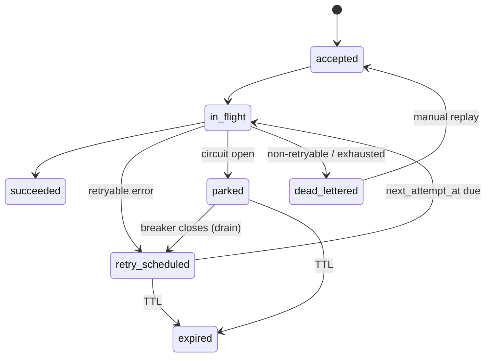

# F-09 — Durable delivery: outbox, worker, wait/async/async_callback

## Summary
The Postgres outbox behind the `Queue` interface, the worker loop, the guarded request state machine, backoff with jitter, retry budget, TTL expiry, DLQ with replay, and the three non-sync delivery modes: `wait` (default), `async`, `async_callback` (DESIGN §5.2, §10.3, §10.6–10.9, §11, D3, D9).

## Status
`in-progress` — 2026-11-01. Queue, states, worker, scheduler, async and wait modes shipped in M4 (`docs/milestones/M4.md`); parking/drain is M5, the per-integration retry override HUB-124.

## Owner
`backend-engineer`.

## Milestone / Epic
M4 · EP-05 · HUB-110–139 (shared with F-10, F-11).

## Problem
Fire-and-forget traffic (engagement events, SMS) is lost today when a vendor or a caller's process fails. "Accepted" must literally mean "committed", and every accepted request must reach exactly one terminal state.

## Goals / Non-goals
**Goals**
- `Queue` interface (DESIGN §11.2) with Postgres impl: `SKIP LOCKED` claim, visibility timeout 30 s, `Nack(retryAt)`, `Park`, `Release`, `DeadLetter`.
- Envelope holds canonical body + integration id, never the vendor payload (DESIGN §11.3).
- Worker re-resolves and re-transforms at send time (F-14 for pinned).
- State machine (DESIGN §10.9) with compare-and-set transitions.
- Backoff +1 s, +5 s, +30 s, +2 min, +10 min, +30 min, +1 h, +1 h, full jitter; DLQ after 8 attempts or TTL.
- `wait`: persist → immediate in-gateway attempt → 200 within `wait_ms` (3000) or 202 `in_flight`.
- DLQ (14 days) with replay by filter; poison detector (2 worker crashes → DLQ).
- Interactive integrations (flag set at creation) restricted to `sync` (DESIGN §5.4).

**Non-goals**
- Parking/drain logic (F-12); micro-batching and `ordering_key` at scale (Release 2/3).

## User stories
- [US-0901](../product/USER_STORIES.md) — 202 means committed
- [US-0902](../product/USER_STORIES.md) — Wait mode
- [US-0903](../product/USER_STORIES.md) — Crash-safe worker
- [US-0904](../product/USER_STORIES.md) — Retry, DLQ and replay
- [US-0905](../product/USER_STORIES.md) — TTL expiry
- [US-0906](../product/USER_STORIES.md) — Interactive integrations stay sync

## UX / API surface
| Surface | Item | Contract ref |
| --- | --- | --- |
| Caller API | `invoke` returns 202 `{request_id, status, reason, poll}` | `contracts/openapi/hub-public.v1.yaml#invokeIntegration` → `#/components/schemas/Accepted` |
| Caller API | `GET /v1/requests/{id}` | `#getRequestStatus` |
| Admin API | `GET /admin/v1/dlq`, `POST /admin/v1/dlq/replay`, `POST /admin/v1/dlq/purge` | `contracts/openapi/hub-admin.v1.yaml#listDeadLetters`, `#getDeadLetter`, `#replayDeadLetters`, `#purgeDeadLetters` |

## Behaviour & rules

1. 202 is returned only after the outbox row commits; if Postgres is unavailable, return 503 retryable, never 202.
2. Onboarding a `wait`/`async`/`async_callback` integration requires a declared polling path or callback subscription (DESIGN §5.2); publish enforces it.
3. Transitions use compare-and-set on `status`; duplicates cannot double-complete or double-callback.
4. TTL (`expires_at`) is checked before every attempt; past it → `expired` (+ callback if subscribed).
5. Retries ≤ 20 % of the account's live traffic (retry budget; F-13 enforces).
6. 429 retries wait max(backoff, `Retry-After`).
7. 401/403 and other 4xx → `dead_lettered` immediately; `TRANSFORM_FAILED` → `dead_lettered` + alert (DESIGN §10.2).
8. Replay re-resolves and re-transforms, so a transformer fix applies; replay records actor + reason in `change_log`.
9. Paused integration: worker nacks for later (DESIGN §18.4 worker loop).
10. Separate worker pools for messaging vs LLM (DESIGN §17).
11. **Claiming (HUB-412, ADR-0019).** The worker claims continuously: as soon as one of its `HUB_WORKER_CONCURRENCY` slots frees, it claims `min(HUB_WORKER_CLAIM_BATCH, free slots)`, so no envelope waits for another envelope's attempt to finish. It claims only what it can start at once, so shutdown just stops claiming and lets the attempts in flight finish. Each `(account, endpoint)` may hold at most `HUB_WORKER_TARGET_CAP` slots; envelopes over it are put back unattempted (F-13 rule 9).
12. **Startup (HUB-406).** A worker claims nothing until the first registry snapshot is loaded (`worker.waiting_for_snapshot`), so a restart with a backlog neither panics nor counts crashes toward the poison detector; an envelope somehow claimed without a snapshot is put back unattempted.

## Data model impact
`outbox` (indexes `(status, next_attempt_at)`, `(status, account_id, endpoint_id)`), `dead_letters` (DESIGN §18.2).

## Config impact
Integration version `delivery: { mode, wait_ms, ttl, retry? }`; without `ttl` the Hub default TTL applies (the capability's `default_ttl` is gone, ADR-0023). Every async request is queued in the `messaging` pool until HUB-439 adds an explicit LLM setting (ADR-0024). A pass-through request completed by the worker stores the vendor body as its result (non-JSON as a JSON string) and keeps `UPSTREAM_*` codes for failures. Worker process: `HUB_WORKER_CONCURRENCY`, `HUB_WORKER_CLAIM_BATCH`, `HUB_WORKER_TARGET_CAP` (TECH_SPEC §8.1).

## Observability
| Kind | Name | Notes |
| --- | --- | --- |
| Metric | `queue_depth`, `queue_oldest_age_s`, `dlq_count` | per account/endpoint |
| Metric | async accept latency (edge timing of 202) | NFR-02 |
| Log | `state_transition` | request_id, from, to, attempt |
| Metric | `worker_inflight{pool}` | slots in use (HUB-412) |
| Log | `worker.waiting_for_snapshot` | INFO, once per start before the first snapshot (HUB-406) |
| Trace | spans `worker.claim`, `upstream` linked to the original trace via envelope `traceparent` | |
| Alert | `queue_oldest_age_s` > 2 min | page |
| Alert | > 50 DLQ entries / 10 min / account | page |

## Security & PII
Envelope stores the canonical body; it falls under the same payload policy as audit for at-rest protection (see open questions).

## Failure modes
| Failure | Behaviour | Caller sees |
| --- | --- | --- |
| Worker killed mid-flight | Reclaimed after visibility timeout; at-least-once to vendor, guarded completion | One completion, one callback |
| Postgres down | Async invoke 503; workers idle | 503 retryable |
| Poison envelope | DLQ after 2 crashes | `request.failed` |
| Worker starts before its first snapshot | Claims nothing until it loads; no crash counted | Nothing (delivery starts once the snapshot is in) |
| One vendor slow or hanging | Holds at most its target cap of slots; others keep claiming | Other vendors unaffected (`docs/tech/ISOLATION.md`) |

## Testing
- **Integration**: kill worker mid-flight → reclaimed and delivered once from caller's view (DESIGN §19 M4); TTL expiry → `expired` + callback; wait-mode 200 vs 202 boundary.
- **Integration (HUB-412, HUB-406)**: `TestWorkerClaimsContinuously` (B delivered while A's 1.5 s attempt is in flight; the old batch loop failed it at 1.51 s), `TestWorkerShutdownFinishesInFlight`, `TestWorkerWaitsForSnapshot` and `TestWorkerReleasesClaimWithoutSnapshot` (both panicked before the fix).
- **Unit**: state machine transition table; backoff schedule with seeded jitter; worker limits and per-target slot accounting (`worker_test.go`).
- **Contract**: 202 body validates against `hub-public.v1.yaml#/components/schemas/Accepted`.

## Rollout & migration
`wait` becomes the default mode for new integrations (D3) once M4 ships.

## Open questions
- Should the outbox canonical body be encrypted for `masked`/`sealed` integrations? DESIGN is silent.
- `wait` mode: if the immediate attempt is still running at `wait_ms`, who owns it — gateway or worker? Proposed: gateway finishes the attempt and records it; worker claims only after visibility timeout.

## Tickets
HUB-110 – HUB-139 (EP-05, filter `feature: F-09`).

## Changelog of this doc
| Date | Change | Author |
| --- | --- | --- |
| 2026-10-31 | Created | docs agent |
| 2026-11-07 | Rules 11–12: continuous claiming, per-target cap, snapshot gate; worker settings (HUB-412, HUB-406) | backend-engineer |
| 2026-11-07 | Interactive is an integration flag; Hub default TTL; pool and pass-through results (ADR-0023, ADR-0024, HUB-437) | docs-keeper |
