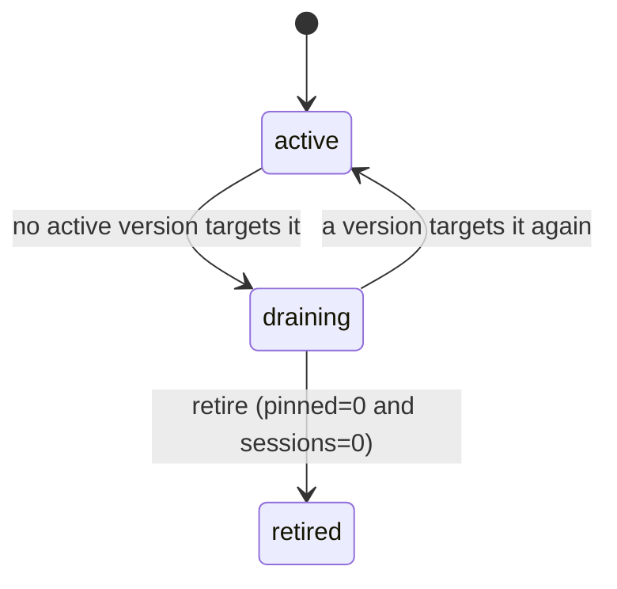

# F-15 — Account lifecycle & credential rotation

## Summary
Accounts move `active → draining → retired` with a retire guard, and hold `active`/`next` credential slots so rotation needs no integration version (DESIGN §6.5, §6.6).

## Status
`shipped` — 2026-11-02 (M6, `docs/milestones/M6.md`).

## Owner
`backend-engineer`.

## Milestone / Epic
M6 · EP-07 · HUB-170–199.

## Problem
Removing an old vendor account or rotating its keys today risks breaking in-flight work and requires every team to redeploy.

## Goals / Non-goals
**Goals**
- Automatic `draining` when no active integration version targets the account.
- Retire refused while pinned requests or open vendor sessions reference it; credentials deleted only at retire.
- `next` slot: add → test-connection → promote → watch `UPSTREAM_AUTH_FAILED` 15 min → delete old.
- In-flight calls keep injected credentials; later attempts (incl. drained parked requests) use `active` at send time.

**Non-goals**
- Automatic scheduled rotation with vendors (manual runbook in v1); KMS/Vault (F-22).

## User stories
- [US-1501](../product/USER_STORIES.md) — Add an account and test it
- [US-1502](../product/USER_STORIES.md) — Safe retire
- [US-1503](../product/USER_STORIES.md) — Rotate credentials without a version

## UX / API surface
| Surface | Item | Contract ref |
| --- | --- | --- |
| Admin API | `POST /admin/v1/accounts`, `GET /admin/v1/accounts/{id}` | `contracts/openapi/hub-admin.v1.yaml#createAccount`, `#getAccount` |
| Admin API | `POST .../credentials/next`, `POST .../credentials/promote`, `POST .../credentials/delete-old` | `#addNextCredential`, `#promoteNextCredential`, `#deleteOldCredential` |
| Admin API | `POST .../test-connection`, `POST .../lifecycle` (`active → draining → retired`) | `#testAccountConnection`, `#transitionAccountLifecycle` |

## Behaviour & rules

1. Draining is computed at snapshot build; draining accounts still serve pinned requests and sessions.
2. Retire checks `outbox` (pinned envelopes referencing the account) and `vendor_sessions` (unexpired); non-zero → 409 `RETIRE_BLOCKED` with `meta.pinned_requests`, `meta.open_sessions`, `meta.active_versions`.
3. Publish refuses versions targeting `retired` accounts (F-14).
4. Promote swaps slots atomically and pings the snapshot; credential caches invalidate (F-07).
5. Test-connection uses the vendor `health_probe` endpoint (dry where supported) with the chosen slot.
6. All lifecycle and credential actions land in `change_log`; credential values never.

## Data model impact
`accounts.state`, `account_credentials.slot` (DESIGN §18.2).

## Config impact
Account YAML `state`, `credentials_ref`; vendor `health_probe`.

## Observability
| Kind | Name | Notes |
| --- | --- | --- |
| Metric | `account_state{account}` | |
| Metric | `hub_requests_total{code="UPSTREAM_AUTH_FAILED",account}` | watched after promote |
| Metric | `credential_expiry_days` | |
| Alert | any `UPSTREAM_AUTH_FAILED` | page |
| Log | `credentials decrypted` (info), `credentials reloaded after rotation` (info) | account@version only, never values (HUB-177) |
| Change log | `addNextCredential`, `promoteNextCredential`, `deleteOldCredential`, `retireAccount` | slot metadata (version, fingerprint), never values |

## Security & PII
Old credentials deleted at retire or after rotation confirmation; deletion audited.

## Failure modes
| Failure | Behaviour | Caller sees |
| --- | --- | --- |
| New creds rejected after promote | Page; runbook re-promotes previous version while still present | `UPSTREAM_AUTH_FAILED` during window |
| Retire with pending work | Refused | Nothing |

## Testing
- **Integration**: retire refused with pinned requests or sessions (DESIGN §19 M6 accept); promote then drain uses new creds.
- **Unit**: lifecycle transitions table.

## Rollout & migration
Rotation runbook documented in `docs/tech/` ops notes.

## Open questions
- Can a `retired` account be resurrected, or is a new account id required?
- Keep the old credential version for rollback for how long after promote (DESIGN says "delete old" after 15 min watch)?

## Tickets
HUB-170 – HUB-199 (EP-07, filter `feature: F-15`).

## Changelog of this doc
| Date | Change | Author |
| --- | --- | --- |
| 2026-10-31 | Created | docs agent |
| 2026-11-02 | Shipped in M6: retire guard, rotation with a `previous` slot, `hub:creds` reload | backend-engineer |
