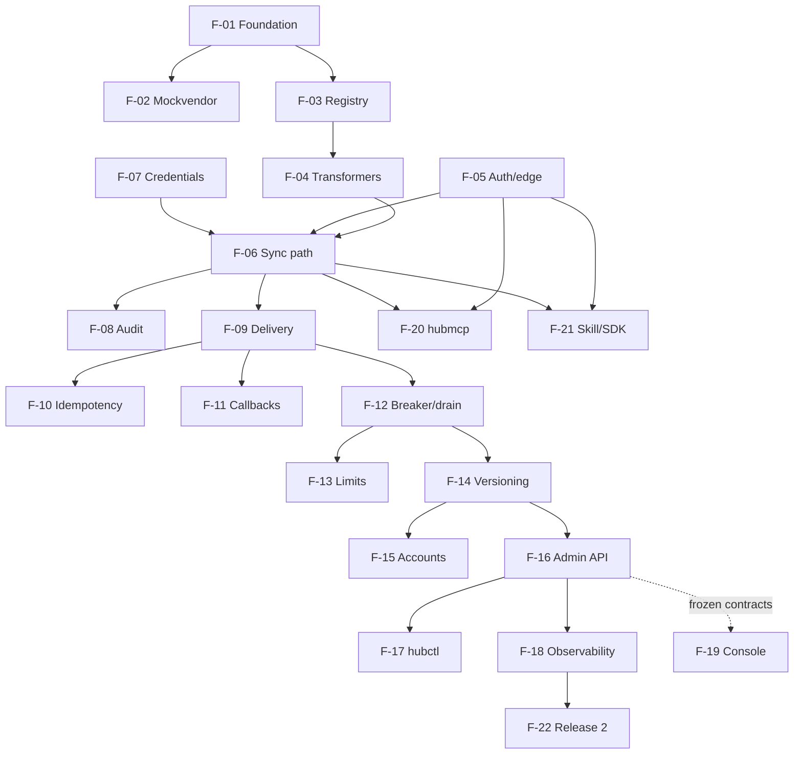

# Feature index

One doc per feature, created from [`_TEMPLATE.md`](_TEMPLATE.md). Status lifecycle: `proposed → in-progress → shipped` (AGENTS.md §8). Stories live in [USER_STORIES.md](../product/USER_STORIES.md) (`US-FFNN`, FF = feature number). Tickets live in [`docs/tickets/TICKETS.md`](../tickets/TICKETS.md).

Several features share one epic and therefore one ticket range; the feature field on each ticket says which feature it belongs to.

| ID | Name | Milestone / Epic | Status | Doc | Stories | Tickets |
| --- | --- | --- | --- | --- | --- | --- |
| F-01 | Repo foundation, dev environment & CI | Phase 1 + M0 · EP-00/EP-01 | in-progress | [F-01](F-01-repo-foundation.md) | US-0101–0104 | HUB-001–016, HUB-020–039 |
| F-02 | Mock vendor (programmable fake vendor) | M0 · EP-01 | shipped (M0) | [F-02](F-02-mock-vendor.md) | US-0201–0203 | HUB-020–039 |
| F-03 | Config registry & snapshots | M1 · EP-02 | shipped (M1) | [F-03](F-03-config-registry.md) | US-0301–0304 | HUB-040–059 |
| F-04 | Transformation engine & golden fixtures | M2 · EP-03 | proposed | [F-04](F-04-transformation-engine.md) | US-0401–0405 | HUB-060–079 |
| F-05 | Tenant auth, grants & edge validation | M3 · EP-04 | proposed | [F-05](F-05-tenant-auth-edge.md) | US-0501–0504 | HUB-080–109 |
| F-06 | Sync invoke path & canonical error envelope | M3 · EP-04 | proposed | [F-06](F-06-sync-invoke-errors.md) | US-0601–0605 | HUB-080–109 |
| F-07 | Credentials & vendor auth schemes | M3 · EP-04 | proposed | [F-07](F-07-credentials-auth-schemes.md) | US-0701–0703 | HUB-080–109 |
| F-08 | Audit trail | M3 · EP-04 | proposed | [F-08](F-08-audit-trail.md) | US-0801–0804 | HUB-080–109 |
| F-09 | Durable delivery: outbox, worker, wait/async/async_callback | M4 · EP-05 | proposed | [F-09](F-09-durable-delivery.md) | US-0901–0906 | HUB-110–139 |
| F-10 | Idempotency | M4 · EP-05 | proposed | [F-10](F-10-idempotency.md) | US-1001–1004 | HUB-110–139 |
| F-11 | Outbound callbacks & registrar (signed webhooks, SSRF guard) | M4 · EP-05 | proposed | [F-11](F-11-outbound-callbacks.md) | US-1101–1103 | HUB-110–139 |
| F-12 | Circuit breaker, parking & ramped drain | M5 · EP-06 | proposed | [F-12](F-12-circuit-breaker-drain.md) | US-1201–1206 | HUB-140–169 |
| F-13 | Rate limits & bulkheads | M5 · EP-06 | proposed | [F-13](F-13-rate-limits-bulkheads.md) | US-1301–1304 | HUB-140–169 |
| F-14 | Integration versioning & cutover (weights, shadow, rollback) | M6 · EP-07 | proposed | [F-14](F-14-versioning-cutover.md) | US-1401–1406 | HUB-170–199 |
| F-15 | Account lifecycle & credential rotation | M6 · EP-07 | proposed | [F-15](F-15-account-lifecycle-rotation.md) | US-1501–1503 | HUB-170–199 |
| F-16 | Admin API, RBAC & change log | M7 · EP-08 | proposed | [F-16](F-16-admin-api-rbac.md) | US-1601–1604 | HUB-200–229 |
| F-17 | hubctl & config-as-code | M7 · EP-08 | proposed | [F-17](F-17-hubctl-config-as-code.md) | US-1701–1704 | HUB-200–229 |
| F-18 | Observability: metrics, traces, alerts, dashboards, load tests | M8 · EP-09 | proposed | [F-18](F-18-observability.md) | US-1801–1804 | HUB-230–249 |
| F-19 | Admin console (SvelteKit frontend) | Parallel · EP-10 | proposed | [F-19](F-19-admin-console.md) | US-1901–1906 | HUB-250–299 |
| F-20 | Hub MCP server (`hubmcp`) | After M3 · EP-11 | proposed | [F-20](F-20-hub-mcp-server.md) | US-2001–2006 | HUB-300–329 |
| F-21 | Consumer Claude skill & Go SDK (`hubclient`) | After M3 · EP-11 | proposed | [F-21](F-21-claude-skill-sdk.md) | US-2101–2104 | HUB-300–329 |
| F-22 | Release-2 capabilities | Release 2 · EP-12 | proposed | [F-22](F-22-release-2.md) | US-2201–2208 | HUB-330–399 |

## Dependency graph

## Contract references

Feature docs refer to operationIds as `<file>#<operationId>` in the frozen 1.0.0 contracts: `contracts/openapi/hub-public.v1.yaml` (caller API `/v1/*`, health, inbound webhooks, outbound callback `webhooks`), `contracts/openapi/hub-admin.v1.yaml` (`/admin/v1/*`), `contracts/openapi/mockvendor.v1.yaml` (mockvendor control API) and `contracts/mcp/hubmcp-tools.json` (MCP tools). Error codes and conventions are in `contracts/README.md`. An operation a feature needs but the contract lacks is marked **(missing — needs CCR)** and goes through `docs/process/CONTRACT_CHANGES.md`; never code against it until the steward adds it.
