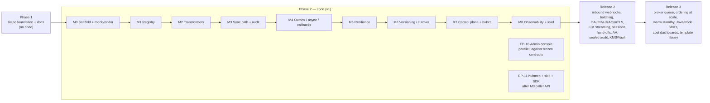

# Integration Hub — Product Requirements Document

| Field | Value |
| --- | --- |
| Status | Draft (Phase 1, documentation only) |
| Source of truth for behaviour | [`docs/DESIGN.md`](../DESIGN.md) |
| Related | [PERSONAS](PERSONAS.md) · [USER_STORIES](USER_STORIES.md) · [Feature index](../features/README.md) · `docs/tech/TECH_SPEC.md` · `docs/tickets/TICKETS.md` · `contracts/` |
| Last updated | 2026-10-31 |

> **Naming.** The repo uses *Phase 1* (foundation and docs, no code) and *Phase 2* (code, milestones M0–M8). DESIGN.md's own "Phase 2" and "Phase 3" (after M8) are called **Release 2** and **Release 3** in this document to avoid the clash.

---

## 1. Problem

Every internal service integrates third parties directly: CleverTap and other engagement tools, SMS/WhatsApp BSPs, credit bureaus, UIDAI/PAN/KYC providers, Account Aggregators, payment and mandate rails, and LLM APIs (DESIGN §1). The result:

- **N copies of vendor keys** spread across services and secret stores, each rotated on its own schedule (or not at all).
- **N half-built retry loops**; most do not survive a vendor outage without losing messages or hammering the vendor on recovery.
- **Vendor coupling in caller code**: changing CleverTap account A→B, OpenAI→Anthropic, or adding a brand field touches and redeploys every caller.
- **No single audit trail** of what was sent to a regulated vendor (bureau, Aadhaar, PAN, AA) and what came back.
- **No shared view of vendor health**: an outage is discovered N times, by N teams.

## 2. Product summary

One vendor-agnostic API. Callers send a **stable integration ID** plus a **canonical request body** and receive a **canonical response**. The Hub resolves vendor, account and transformer, enforces delivery policy, rate limits and circuit breakers, transforms, calls the vendor now or later via a durable queue, maps the response back, and writes a lossless audit trail (DESIGN §1, §5).

**Caller invariant:** callers never see or select vendor names, account names or versions (DESIGN §0, D12). A vendor or account swap is a Hub-side config publish (DESIGN §6.1).

## 3. Goals (v1 = through M8 + admin console + MCP/skill)

| # | Goal | Measured by |
| --- | --- | --- |
| G1 | Callers integrate once against a canonical contract and never redeploy for vendor/account/transformer changes | Swap ≤ 1 working day, zero caller deploys |
| G2 | Accepted async work is never lost, including across vendor outages and worker crashes | 0 lost accepted requests in soak test |
| G3 | The Hub adds negligible latency | Sync overhead p99 ≤ 5 ms; async accept p99 ≤ 10 ms |
| G4 | Vendor outages are contained: fail fast, park, and drain automatically | Drain starts ≤ 60 s after recovery |
| G5 | Every call is explainable after the fact | Complete per-request timeline (DESIGN §13) |
| G6 | Adding a vendor for an existing capability is cheap and safe | ≤ 2 engineer-days, goldens enforced at publish |
| G7 | Operators manage the Hub without SQL or redeploys | Admin API, `hubctl`, admin console |
| G8 | Developers discover and try integrations from their own tools | MCP server + consumer Claude skill |

## 4. Non-goals (v1)

From DESIGN §1, plus scope boundaries agreed for this repo:

- Not a multi-step workflow/orchestration engine across vendors (vendor sessions for one vendor's two-step flow are Release 2, F-22).
- Not ETL or data sync.
- Not a gateway for our own public APIs; callers are internal services (pending open question Q1).
- Not a self-serve builder for business users; transformers are authored by the platform team and gated by goldens (D7).
- No caller-side version, vendor or account selection, ever (D12).
- No broker-backed queue in v1 (Postgres outbox only, D9); NATS/RabbitMQ is Release 3.
- No multi-region active/active; one region (warm standby is Release 3, pending Q8).
- The admin console does not edit transformers in v1 (viewer + dry-run + goldens only); a transformer editor is Release 2.
- The MCP server does not expose admin *mutations*; admin tools are read-only.

## 5. Personas (summary)

Full detail in [PERSONAS.md](PERSONAS.md).

| Persona | Primary need | Main surfaces |
| --- | --- | --- |
| Service developer (tenant/caller) | Call a vendor capability without knowing the vendor | Caller API, `hubclient` SDK |
| Platform engineer (Hub owner) | Add vendors/transformers safely, run the Hub | `hubctl`, config-as-code, admin API |
| On-call SRE | Detect and contain vendor outages, explain failures | Admin console health board, request explorer, alerts |
| Integration admin / reviewer | Publish versions, run canary cutovers, roll back | Admin console, `hubctl plan/apply` |
| Compliance / audit officer | Prove what was sent to regulated vendors; controlled unseal | Request explorer, change log, unseal (Release 2) |
| AI-assisted developer | Discover and dry-run integrations from the laptop via Claude | `hubmcp`, consumer skill |

## 6. Scope by phase

| Stage | Contents | Features |
| --- | --- | --- |
| **Phase 1** | Monorepo layout (`backend/`, `frontend/`, `contracts/`, `clients/claude-skill/`), AGENTS.md, PRD, personas, stories, feature docs, tech spec, frozen contracts, ticket backlog | F-01 (docs part) |
| **Phase 2 · M0** | Go module, Makefile, CI, docker-compose (Postgres 16, Redis 7), `hub` role entrypoints, health endpoints, redacting logger, mockvendor | F-01, F-02 |
| **M1** | Loaders, validation, snapshot build and atomic swap, dev config | F-03 |
| **M2** | DSL compile, stdlib, request/response/error mapping, dry-run, golden runner, T1/T2/R1/R2 | F-04 |
| **M3** | Tenant keys, grants, validation, sync invoke, local credential source, static/bearer/basic auth, error envelope, audit, `hubclient`, **caller discovery endpoints** | F-05, F-06, F-07, F-08 |
| **M4** | Postgres outbox, worker, state machine, wait/async/async_callback, DLQ, TTL, idempotency, registrar + signed callbacks | F-09, F-10, F-11 |
| **M5** | Breaker, `on_circuit_open`, pause, parking, ramped drain, account/tenant limiters, bulkheads | F-12, F-13 |
| **M6** | Immutable versions, publish validation, rollback, weights, shadow, re-resolve vs pinned, account lifecycle, credential rotation | F-14, F-15 |
| **M7** | Admin API, OIDC stub, RBAC, change log, `hubctl`, request explorer, DLQ replay | F-16, F-17 |
| **M8** | Metrics, traces, alerts-as-code, dashboards, load and soak tests | F-18 |
| **EP-10** (parallel) | SvelteKit admin console, pulled forward from Release 2 | F-19 |
| **EP-11** (after M3) | `hubmcp`, consumer Claude skill, `hubclient` polish | F-20, F-21 |
| **Release 2** | DESIGN §19 "Phase 2" items not pulled forward | F-22 |
| **Release 3** | DESIGN §19 "Phase 3" items | (future features) |

## 7. Agreed deviations from DESIGN.md (additive)

These are agreed additions. None breaks a DESIGN §2 decision; each will be recorded as an ADR in `docs/tech/adr/`.

| # | Deviation | Why | Respects |
| --- | --- | --- | --- |
| DV-1 | **Monorepo layout**: Go backend under `backend/` (module `github.com/Donquixot-Doflamingo/integration-hub/backend`), SvelteKit console in `frontend/`, contracts in `contracts/`, consumer skill in `clients/claude-skill/`. DESIGN §18.1 paths are relative to `backend/`. | Frontend and backend built in parallel against frozen contracts | §18.1 layout unchanged inside `backend/` |
| DV-2 | **Admin console pulled forward** from Release 2 (DESIGN §19 Phase 2 "admin UI") into v1, built in parallel with M1–M8 against frozen admin contracts. Screens: integrations list/detail (version history, diff, publish/rollback/weights/pause); vendor & account health board (breaker states); request explorer with timeline; DLQ console with replay by filter; transformer viewer with dry-run and goldens; tenants / API keys / registrar endpoints; change log. Transformer *editing* stays Release 2. | Operators need it from the first production pilot | RBAC from §16.1; UI changes go through the same publish pipeline |
| DV-3 | **Caller discovery endpoints** (additive to DESIGN §4.1): `GET /v1/integrations` (integrations the calling tenant may invoke: id, capability, operations, delivery mode, paused flag, description), `GET /v1/integrations/{id}`, `GET /v1/capabilities/{capability}` (canonical request/response JSON Schemas per operation). They never return vendor, account or version. | MCP server and Claude skill need to discover what to call | §0 caller invariant, D12 |
| DV-4 | **`hubmcp`** MCP server (Go; stdio + streamable HTTP), configured with `HUB_BASE_URL` + `HUB_API_KEY`. Tenant tools `hub_list_integrations`, `hub_describe_integration`, `hub_dry_run`, `hub_invoke`, `hub_get_request`; optional read-only admin tools with `HUB_ADMIN_TOKEN`: `hub_admin_search_requests`, `hub_admin_request_timeline`, `hub_admin_breaker_states` (contract: `contracts/mcp/hubmcp-tools.json`). `hub_invoke` requires `confirm: true` and an idempotency key for integrations flagged `moves_money_or_quota`. | AI-assisted development | Uses only contract endpoints |
| DV-5 | **Consumer Claude skill** (`clients/claude-skill/integration-hub/SKILL.md`), copied to `~/.claude/skills/integration-hub/`. | Teach correct Hub usage (idempotency, 202 handling, signature verification) | §4.5 SDK rule |
| DV-6 | **Caller dry-run is a documented, scope-gated exception to the no-vendor-leak rule** (see OI-1): it returns the exact upstream request (method, URL, headers, body) with credentials and secret values replaced by `***`. It requires API-key scope `dry_run`, which is not granted by default and is meant for integration developers during onboarding and debugging; callers must never build logic on its output (it changes at every Hub-side cutover). Decided by the lead and frozen in `contracts/openapi/hub-public.v1.yaml` 1.0.0. | DESIGN §4.1 dry-run "returns the vendor request"; integration developers need the exact request to debug mappings | §0 and D12 hold for every other caller operation; the exception is explicit (`x-audience: integration-developers`), audited (`dry_run: true`) and opt-in per key |

## 8. Functional requirements

Priority: **M** = Must (v1), **S** = Should (v1), **C** = Could, **R2** = Release 2.

### 8.1 Caller API & edge (F-05, F-06)
| ID | Requirement | Pri | Ref |
| --- | --- | --- | --- |
| FR-01 | `POST /v1/integrations/{id}/invoke` and `/invoke/{op}` accept a canonical body and return a canonical response | M | §4.1 |
| FR-02 | Authenticate tenants by bearer key (hashed, in-memory lookup); reject with `UNAUTHORIZED`. Key scopes `invoke`, `dry_run`, `requests_read` (optionally `<scope>:<integration_id>`); missing scope → `FORBIDDEN` reason `missing_scope` | M | §4.2, §5.1, §16.5 |
| FR-03 | Allow invocation only by the owning tenant or a grantee; else `FORBIDDEN` | M | §3.4, §4.4 |
| FR-04 | Validate the body against the pre-compiled capability schema at the edge; `VALIDATION_FAILED` with JSON pointers; never fail validation later in a queue | M | §5.1 |
| FR-05 | Enforce body limits (1 MB default, 4 MB LLM); oversized → 413 `PAYLOAD_TOO_LARGE` | M | §16.5 |
| FR-06 | Every response (success or error) carries `X-Hub-Request-Id`; errors use the single envelope with `request_id` | M | §4.3 |
| FR-07 | Map every vendor/Hub outcome to exactly one canonical code of the caller error catalogue (`contracts/README.md`: DESIGN §4.4 plus `IDEMPOTENCY_KEY_REQUIRED`, `OPERATION_NOT_FOUND`, `CAPABILITY_NOT_FOUND`, `REQUEST_NOT_FOUND`, `IDEMPOTENCY_CONFLICT`, `PAYLOAD_TOO_LARGE`, `INTERNAL_ERROR`, `NOT_READY`) | M | §4.4, §10.2 |
| FR-08 | Honour `X-Request-Deadline` as a cap on sync timeout; accept and continue `traceparent` | M | §4.2 |
| FR-09 | No header or field allows a caller to select vendor, account or version | M | D12 |
| FR-10 | Discovery: `GET /v1/integrations`, `GET /v1/integrations/{id}`, `GET /v1/capabilities/{capability}` scoped to the calling tenant, no vendor/account/version in the payload | M | DV-3 |
| FR-11 | `GET /v1/requests/{request_id}` returns status and final canonical result to the owning tenant | M | §4.1 |
| FR-12 | Caller dry-run (`dryRunIntegration`) returns the exact upstream request the Hub would send (method, URL, headers, body), without sending it, with secrets replaced by `***`; requires key scope `dry_run` (not granted by default); documented as "never build logic on it" | M | §4.1, DV-6 |

### 8.2 Registry & transformation (F-03, F-04)
| ID | Requirement | Pri | Ref |
| --- | --- | --- | --- |
| FR-13 | Load capability, vendor, account, transformer, integration, tenant and registrar YAML/JSON with path-qualified validation errors | M | §8.1, M1 |
| FR-14 | Build immutable snapshots; nodes swap atomically within 10 s; a node that cannot fetch keeps the last good snapshot; boot from object storage if control plane is down | M | §8.2, §17 |
| FR-15 | Transformers are declarative YAML with `expr` expressions, compiled and type-checked at snapshot build, never per request | M | §7.1 |
| FR-16 | Transform sandbox: no network/disk/loops; max depth, output size and time budget | M | §7.1 |
| FR-17 | `creds.*` allowed only in header/query/auth targets unless `allow_creds_in_body: true` | M | §7.2 |
| FR-18 | Golden fixtures are mandatory; publish and CI run them; publishing with failing goldens is impossible | M | §7.6 |

### 8.3 Credentials (F-07, F-15)
| ID | Requirement | Pri | Ref |
| --- | --- | --- | --- |
| FR-19 | Credentials stored encrypted (local AES-GCM file in dev; KMS/Vault in Release 2); no decryption on the request path | M | §9 |
| FR-20 | Auth schemes static headers, bearer, basic in v1; query param supported but never logged; OAuth2 CC, HMAC signing, mTLS in Release 2 | M / R2 | §9 |
| FR-21 | Accounts hold `active` and `next` credentials; promote without a version; later attempts use `active` at send time | M | §6.6 |
| FR-22 | Account lifecycle `active → draining → retired`; retire refused while pinned requests or open sessions exist; credentials deleted only at retire | M | §6.5 |

### 8.4 Delivery (F-09, F-10, F-11)
| ID | Requirement | Pri | Ref |
| --- | --- | --- | --- |
| FR-23 | Delivery modes `sync`, `wait` (default, 3 s), `async`, `async_callback` per integration version | M | §5.2, D3 |
| FR-24 | Non-sync modes persist to the Postgres outbox **before** returning 202 | M | §11.1 |
| FR-25 | Guarded state machine `accepted → in_flight → succeeded | retry_scheduled | parked | dead_lettered | expired`, plus terminal `failed` for a sync request that returned an error (contract `RequestState`) | M | §10.9 |
| FR-26 | Backoff with full jitter (8 attempts default), retry budget ≤ 20 % of account live traffic, TTL per envelope | M | §10.3, §10.7 |
| FR-27 | DLQ with 14-day retention and replay by filter that re-resolves and re-transforms; poison detector | M | §10.6 |
| FR-28 | Idempotency: same key within 24 h returns the stored result with `X-Hub-Idempotent-Replay: true`; same key with a different body, or while the original is in progress, → 409 `IDEMPOTENCY_CONFLICT`; mandatory for integrations with `moves_money_or_quota: true` (else 400 `IDEMPOTENCY_KEY_REQUIRED`) | M | §4.2, §5.1 |
| FR-29 | Registrar endpoints with SSRF guard; subscriptions per integration version; HMAC-signed callbacks with own retries and DLQ | M | §12.1 |
| FR-30 | Interactive capabilities only in `sync` mode; publish rejects others | M | §5.4 |

### 8.5 Resilience (F-12, F-13)
| ID | Requirement | Pri | Ref |
| --- | --- | --- | --- |
| FR-31 | Circuit breaker per `(account, endpoint)`, shared via Redis, with integration overrides | M | §10.4, D5 |
| FR-32 | `on_circuit_open`: `fail_fast` (default), `failover`, `queue_if_allowed` | M | §5.3 |
| FR-33 | Synthetic health probe every 30 s while open | M | §10.4 |
| FR-34 | Parking and ramped drain (20 % → 100 %, doubling every 30 s); re-open mid-drain keeps the rest parked | M | §10.5 |
| FR-35 | Integration pause (kill switch) → `INTEGRATION_PAUSED`; other integrations on the account unaffected | M | §10.4 |
| FR-36 | Tenant token bucket at the edge; account quota in shared Redis bucket; per-account bulkhead (64 in flight); separate LLM pool | M | §10.8 |

### 8.6 Versioning & cutover (F-14)
| ID | Requirement | Pri | Ref |
| --- | --- | --- | --- |
| FR-37 | Integration versions are immutable; publish runs full validation (§6.4) | M | §6.4 |
| FR-38 | Rollback = new version with old content; history linear | M | §6.4 |
| FR-39 | Weighted targets (hashed on idempotency key / request id) and shadow mode (logged, never returned) | M | §6.4 |
| FR-40 | Pending requests re-resolve at send time by default; `pinned` opt-in; every attempt records its version | M | §6.3, D10 |

### 8.7 Audit (F-08)
| ID | Requirement | Pri | Ref |
| --- | --- | --- | --- |
| FR-41 | Emit every §13.1 event per request with sha256 + byte size, non-blocking buffered writer with drop counter | M | §13 |
| FR-42 | Payload policies `full`, `masked` (default), `metadata_only` in v1; `sealed` + audited unseal in Release 2 | M / R2 | §13.2 |
| FR-43 | Secrets never appear in any stored event or log (redaction by value) | M | §9 |

### 8.8 Control plane & tooling (F-16, F-17, F-19)
| ID | Requirement | Pri | Ref |
| --- | --- | --- | --- |
| FR-44 | Admin API `/admin/v1` covering §16.1 resources, OIDC, RBAC `admin | editor | viewer | tenant_viewer` | M | §16.1 |
| FR-45 | Every admin mutation recorded in `change_log` (actor, action, object, before, after, reason) | M | §16.1 |
| FR-46 | `hubctl plan|apply|transform test|dry-run|replay`; `apply` idempotent; config round-trips to Git minus secrets | M | §16.1, M7 |
| FR-47 | Admin console screens per DV-2, using a client generated from `contracts/openapi/hub-admin.v1.yaml` | M | DV-2 |

### 8.9 Developer tooling (F-20, F-21)
| ID | Requirement | Pri | Ref |
| --- | --- | --- | --- |
| FR-48 | `hubmcp` tenant tools and optional read-only admin tools per DV-4 | M | DV-4 |
| FR-49 | `hub_invoke` requires `confirm: true` and an idempotency key for integrations with `moves_money_or_quota: true`, and refuses without calling the Hub otherwise | M | DV-4 |
| FR-50 | `hubclient` returns 202 as a distinct `Queued` type, never as success | M | §4.5 |
| FR-51 | Consumer skill documents discovery, canonical bodies, Idempotency-Key, 202 vs 200, callback signature verification, MCP wiring | M | DV-5 |

### 8.10 Observability (F-18)
| ID | Requirement | Pri | Ref |
| --- | --- | --- | --- |
| FR-52 | Metrics per §16.2, alerts per §16.3 as code, OTel spans per §16.4, dashboards (tenant, vendor, platform) | M | §16 |
| FR-53 | Every middleware publishes its own duration metric | M | §18.5 |

## 9. Non-functional requirements

| ID | Category | Requirement | Ref |
| --- | --- | --- | --- |
| NFR-01 | Latency | Hub-added sync overhead p99 ≤ 5 ms (4 KB, warm, vendor time excluded); budget per stage in §18.6 | §1, §18.6 |
| NFR-02 | Latency | Async accept (202) p99 ≤ 10 ms | §1 |
| NFR-03 | Latency | Transform ≤ 0.5 ms p99 for 4 KB; each middleware < 100 µs p99 | §7.6, §18.5 |
| NFR-04 | Latency | Discovery endpoints served from the snapshot, p99 ≤ 5 ms | DV-3 |
| NFR-05 | Throughput | 500 sync RPS + 2,000 async msg/s on laptop-scale setup (M8); outbox ~2–5k msg/s | §11.1, M8 |
| NFR-06 | Availability | Gateway 99.9 % in v1, 99.95 % from Release 2 | §1 |
| NFR-07 | Availability | Gateway keeps serving on last good snapshot if the control plane, Postgres replica or object store is down; boot from last snapshot blob | §6.4, §17 |
| NFR-08 | Durability | 0 accepted async requests lost: 202 only after the outbox commit; at-least-once delivery, guarded transitions prevent double-complete/callback | §11 |
| NFR-09 | Durability | Recovery drain starts ≤ 60 s after vendor recovery | §1 |
| NFR-10 | Consistency | Config propagates to all nodes ≤ 10 s; breaker state agreed across nodes ≈ 1 s | §8.2, §10.4 |
| NFR-11 | Security | Tenant keys hashed, shown once, rotatable with overlap; secrets envelope-encrypted; egress only to declared vendor hosts; TLS 1.2+ | §16.5 |
| NFR-12 | Security | Callback SSRF guard (no private/link-local, no redirects, 5 s timeout); HMAC signature with 5-min replay window | §12.1 |
| NFR-13 | Security | Admin API behind OIDC + RBAC; MCP admin tools read-only | §16.1, DV-4 |
| NFR-14 | PII | `x-pii` tags drive masking; `masked` default 30 days; bureau/Aadhaar/PAN `sealed` 90 days (R2); LLM `metadata_only`; Aadhaar number never stored | §13.2, §14 |
| NFR-15 | PII | Deletion job purges by subject identifier; regional accounts enforce data residency | §16.5 |
| NFR-16 | Auditability | sha256 + size for every payload kept even when bodies are masked/sealed/omitted | §13.3 |
| NFR-17 | Operability | Paged alerts for breaker open > 5 min, parked age > 10 min, queue age > 2 min, DLQ burst, any `UPSTREAM_AUTH_FAILED` or `TRANSFORM_FAILED` | §16.3 |
| NFR-18 | Testability | No test calls a real vendor; `go test -race` in CI; integration tests on real Postgres/Redis | §0 |

## 10. Success metrics

From DESIGN §1. Measured from M8 load/soak tests and production dashboards.

| Metric | Target | How measured |
| --- | --- | --- |
| Hub-added latency, sync, p99 | ≤ 5 ms | `hub_overhead_ms` histogram |
| Async accept latency, p99 | ≤ 10 ms | Edge timing for 202 responses |
| Accepted async requests lost | 0 | Soak test ledger reconciliation |
| Vendor or account swap, config only, incl. canary | ≤ 1 working day | Change log timestamps (first draft → 100 % weight) |
| New vendor for an existing capability | ≤ 2 engineer-days | Ticket cycle time |
| Gateway availability | 99.9 % (v1), 99.95 % (Release 2) | SLO dashboard |
| Config propagation to all nodes | ≤ 10 s | `snapshot_version` skew |
| Parked backlog starts draining after recovery | ≤ 60 s | `parked_count` vs breaker transitions |

Adoption metrics (proposed, not in DESIGN): number of tenants live; share of vendor calls routed via the Hub; MCP/skill weekly active developers.

## 11. Release plan

| Release | Contents | Exit criteria |
| --- | --- | --- |
| **Phase 1 — Foundation** | Docs, contracts frozen (caller + admin OpenAPI, capability and event schemas), ticket backlog, agents and skills | Contracts reviewed; tickets HUB-001..399 drafted |
| **v1 alpha (M0–M3)** | Sync path end to end against mockvendor; discovery endpoints; audit | M3 accept tests (DESIGN §19) green |
| **v1 beta (M4–M6)** | Async, callbacks, idempotency, resilience, cutover | Chaos scenarios M5.1–5 and §6.3 scenarios green |
| **v1 GA (M7–M8 + EP-10 + EP-11)** | Control plane, `hubctl`, admin console, `hubmcp`, skill, observability | Overhead p99 ≤ 5 ms at target load; zero loss in soak; CleverTap pilot live |
| **Release 2** | F-22 items | Per-item feature docs |
| **Release 3** | Broker queue, ordering at scale, warm standby, Java/Node SDKs, cost dashboards, template library | TBD |

Pilot: CleverTap `events.track@v1` for `orders-service` (integrations `int_evt_brandA`, `int_evt_brandB`, `int_evt_brandB_min`), then the second engagement vendor to prove the swap (Q3).

## 12. Risks and mitigations

| Risk | Impact | Mitigation |
| --- | --- | --- |
| Hub becomes a single point of failure for all vendor traffic | High | Stateless gateways, last-good-snapshot, boot from object storage, 99.9 % SLO, per-account bulkheads |
| Postgres outbox throughput ceiling (~2–5k msg/s) | Medium | `Queue` interface (D9); Release 3 broker relay; volume answer from Q2 |
| Transformer bugs reach production | High | Compile-time type check, mandatory goldens, dry-run, shadow mode, `TRANSFORM_FAILED` page |
| Vendor identity leaks into the caller contract (error messages, discovery) | High | Contract tests asserting no vendor/account fields on every caller operation except the documented `dryRunIntegration` exception; `UPSTREAM_REJECTED` passes vendor *message* only (review per transformer) |
| Callers build logic on dry-run output (the DV-6 exception) | Medium | Scope `dry_run` not granted by default and issued only to integration developers; contract and skill say "never build logic on it"; dry-runs audited with `dry_run: true`; secrets always `***` |
| Secrets leak into logs or audit | High | Value-based redaction, `creds.*` target restriction, grep test on stored events (M3) |
| Retry storms on vendor recovery | Medium | Ramped drain, retry budget, live traffic priority |
| Idempotency misuse on money/quota capabilities | High | Mandatory key enforced at edge; MCP `confirm: true`; skill guidance |
| Frontend/backend drift | Medium | Frozen contracts, generated client, contract tests |
| Redis outage (breaker, limits, idempotency) | Medium | Local breaker cache; degrade policy to be defined in TECH_SPEC (see gaps) |
| Real vendor payload shapes differ from illustrative ones | Medium | Verify against vendor docs, cite URL in transformer file (§0) |
| AI tooling triggers real side effects | Medium | MCP dry-run first, `confirm: true` gate, tenant-scoped key, read-only admin tools |

## 13. Dependencies

| Dependency | Needed by | Notes |
| --- | --- | --- |
| Postgres 16 (managed primary + read replica) | M1+ | Registry, outbox, audit, change log |
| Redis 7 (managed) | M3+ | Breaker, limits, idempotency, snapshot ping |
| Object storage | M1 (snapshots), M3 (large payloads) | Local MinIO or filesystem in dev |
| KMS or Vault | Release 2 | Q7; local AES-GCM file in v1 dev |
| OIDC provider | M7, EP-10 | Stub in dev |
| Kubernetes cluster/region | GA | Q8 |
| Vendor sandbox accounts + current API docs | Before each production transformer | CleverTap first |
| Libraries | M0 | chi, pgx/sqlc, goose, go-redis, expr-lang/expr, santhosh-tekuri/jsonschema, OTel, MCP Go SDK; SvelteKit + OpenAPI client generator |
| `contracts/` frozen | EP-10, EP-11 | Contract-first workflow (AGENTS.md §4) |

## 14. Open questions

From DESIGN §20, plus questions raised while writing this PRD.

| # | Question | Owner | Blocks |
| --- | --- | --- | --- |
| Q1 | Callers: internal services only, or external customers too? | user | Auth model, discovery exposure |
| Q2 | Expected volume at launch and in 12 months (sync RPS, async msg/s) | user | Queue choice timing, capacity |
| Q3 | First production capabilities/vendors after the CleverTap pilot (bureau? PAN? AA? LLM?), and which second engagement vendor proves the swap | user | Release 2 ordering |
| Q4 | How many CleverTap accounts exist today and what distinguishes them (brand, region, environment) | user | Dev/prod config |
| Q5 | Do any callers need CleverTap's synchronous response, or can all engagement integrations default to async? | user | Default mode for pilot |
| Q6 | PII/retention: confirm 30-day masked default and 90-day sealed for bureau/KYC | user | F-08, F-22 |
| Q7 | Secrets backend: cloud KMS or HashiCorp Vault | user | F-22 |
| Q8 | Hosting: which Kubernetes cluster/region; is a warm standby needed in phase 1? | user | GA |
| Q9 | ~~Which capabilities are flagged as "moves money or quota"?~~ **Resolved by the contract (1.0.0):** an integration-level boolean `moves_money_or_quota` (admin `Integration`, shown in discovery with `idempotency_key_required`) replaces the proposed `x-side-effects` capability flag. Which integrations set it remains a per-integration decision at onboarding | user | F-10, F-20 |
| Q10 | ~~Should `GET /v1/integrations` list only invocable integrations, or also paused ones?~~ **Resolved by the contract (1.0.0):** integrations the tenant owns or is granted, paused ones included with `paused: true` | user | F-05 |
| Q11 | Is the `hubmcp` streamable-HTTP mode for shared team deployment, and if so who hosts it? | user | F-20 |
| Q12 | ~~Canonical codes for Hub-internal failures, oversized bodies and idempotency conflicts~~ **Resolved by the contract (1.0.0):** `INTERNAL_ERROR` 500, `PAYLOAD_TOO_LARGE` 413, `IDEMPOTENCY_CONFLICT` 409, `IDEMPOTENCY_KEY_REQUIRED` 400, `NOT_READY` 503 (`contracts/README.md`) | lead | F-05, F-06, F-10 |

### 14.1 Open issues (decisions the user may revisit)

| # | Issue | Decision | Revisit if |
| --- | --- | --- | --- |
| OI-1 | DESIGN §4.1 says the caller dry-run "returns the vendor request", which conflicts with the §0 / D12 caller invariant | Lead's call, adopted in the contract: the caller `dryRunIntegration` (`POST /v1/integrations/{id}/dry-run`) is a **documented, scope-gated exception** to the no-vendor-leak rule: it returns the exact upstream request (method, URL, headers, body) with credentials and secret values replaced by `***`. It requires API-key scope `dry_run`, which is not granted by default and is meant for integration developers during onboarding and debugging; callers must never build logic on its output (it changes at every Hub-side cutover). Decided by the lead and frozen in `contracts/openapi/hub-public.v1.yaml` 1.0.0. Recorded as DV-6 | The user prefers a redacted caller dry-run (host and vendor-identifying headers masked) with the full request only via an admin dry-run; that would be a contract change (CCR) |
