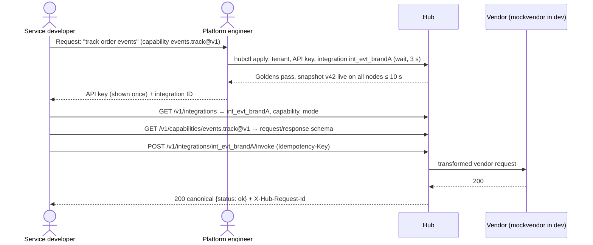
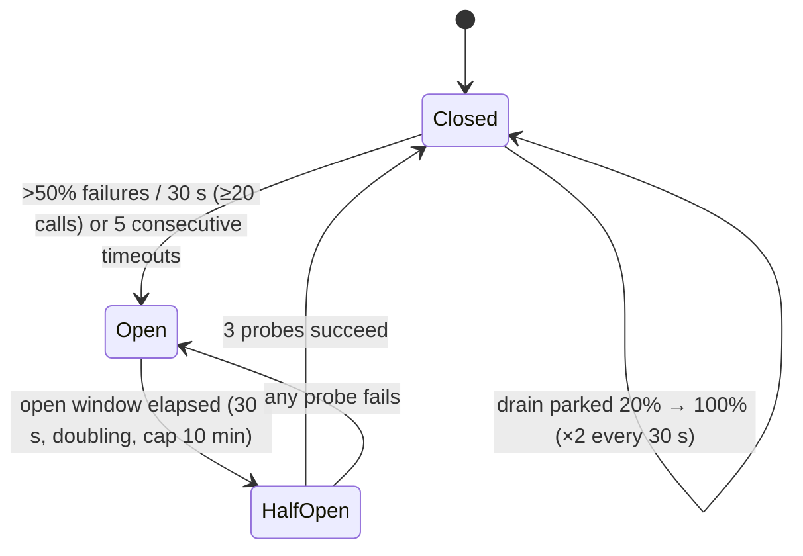

# Integration Hub — User Stories

ID scheme: **`US-FFNN`** — `FF` = feature number, `NN` = story within the feature (US-0601 = first story of F-06). IDs are never reused. Personas: [PERSONAS.md](PERSONAS.md). Features: [docs/features/README.md](../features/README.md). Priority: **Must / Should / Could** for the release that owns the feature (F-22 stories are Release 2).

Acceptance criteria use **Given / When / Then**. Section references (§x.y) point at [DESIGN.md](../DESIGN.md); DV-n points at the agreed deviations in [PRD §7](PRD.md#7-agreed-deviations-from-designmd-additive).

---

## End-to-end journeys

### J-A — A service team onboards a new integration and makes its first call
Stories: US-0301, US-0401, US-0501, US-0503, US-1601, US-1101, US-0601, US-0602, US-1001, US-2101

1. Platform engineer adds tenant `orders-service`, key, and integration `int_evt_brandA` with `wait` mode; publish validates and goldens pass.
2. Developer receives the key once and lists invocable integrations; no vendor, account or version appears.
3. Developer fetches the capability schema and builds a canonical body.
4. Developer calls `invoke` with an `Idempotency-Key`; receives 200 (or 202 `in_flight` handled as `Queued` by `hubclient`).
5. Developer sees the request in the console (`tenant_viewer`) with a full timeline.

### J-B — Platform swaps CleverTap account A→B with canary and rollback
Stories: US-1501, US-1401, US-1403, US-1404, US-1405, US-1502, US-1902

1. Admin creates account `ct-brandB-us`, adds credentials, runs test-connection (US-1501).
2. Publishes v8 of `int_evt_brandA` with weights A 90 / B 10 (US-1403). `hubctl plan` shows the diff; change log records author + reason.
3. Watches per-version error rate and latency in the console; B shows elevated `UPSTREAM_REJECTED`.
4. Rolls back: publishes v9 = v7 content in one action (US-1404). History stays v7→v8→v9.
5. After a transformer fix, publishes v10 with B 50/50, then v11 B 100. Queued requests re-resolve to v11 at send time (US-1405).
6. Account A has no active version targeting it → `draining`; retire succeeds only once pinned requests and sessions are zero (US-1502).

### J-C — Vendor outage → breaker opens → async parks → recovery drain
Stories: US-1201, US-1202, US-1203, US-1204, US-1205, US-0902, US-1801

1. mockvendor goes hard-down for `ct-brandA-in`/`upload@1`; breaker opens within the window.
2. Sync integrations get 503 `UPSTREAM_UNAVAILABLE`, `circuit: open`, `retry_after_ms`; `wait` returns 202 `queued, reason: circuit_open`; `async` envelopes park.
3. Alert "breaker open > 5 min" pages; SRE sees the account on the health board with parked count and age.
4. Vendor recovers; health probe closes the breaker; drain starts ≤ 60 s at 20 % of the account limit, doubling every 30 s, live traffic first.
5. Callbacks for drained `async_callback` requests arrive signed; no request lost, none delivered twice from the caller's view.

### J-D — On-call investigates a failed request via timeline
Stories: US-0801, US-0802, US-1603, US-1901, US-1903, US-0904

1. A tenant reports `request_id = req_01J9…` returned `UPSTREAM_REJECTED`.
2. SRE opens the request explorer, searches by id; the timeline shows `request.received` → `validated` → `integration.resolved` (v7, account, transformer, snapshot, breaker state) → `transformed` (secrets `***`) → `vendor.sent` → `vendor.responded` (422 body) → `request.failed`.
3. Diff of canonical input vs vendor request reveals a transformer mapping bug; platform ships T1@8, publishes v8.
4. SRE replays matching dead letters by filter (integration, reason, time range); replay re-transforms with T1@8.

### J-E — A developer uses Claude + MCP to discover and dry-run an integration
Stories: US-2001, US-2002, US-2003, US-2004, US-2101, US-2102

1. Developer copies the skill to `~/.claude/skills/integration-hub/` and adds `hubmcp` to their MCP config with `HUB_BASE_URL` and their tenant `HUB_API_KEY`.
2. Asks Claude "how do I send an order event?"; Claude calls `hub_list_integrations`, then `hub_describe_integration int_evt_brandA` (capability schema, delivery mode).
3. Claude builds a canonical body and calls `hub_dry_run` (the developer's key has scope `dry_run`); the output shows the exact upstream request with secrets as `***` (PRD DV-6). Claude uses it only to check the mapping, never to generate logic.
4. Claude generates `hubclient` code with an `Idempotency-Key` and `Queued` handling.
5. Developer asks to send one test event; Claude calls `hub_invoke`. For an integration with `moves_money_or_quota: true`, the tool refuses until `confirm: true` and an idempotency key are passed after the developer agrees.

---

## F-01 Repo foundation, dev environment & CI

### US-0101 — One-command local environment
**As a** platform engineer, **I want** `docker compose up` plus `make run` to start Postgres, Redis and the `hub` roles, **so that** I can develop without shared infrastructure. · **Must**
- **Given** a fresh clone with Docker, **when** I run `docker compose -f deploy/docker-compose.yml up -d` and `cd backend && make run`, **then** `hub gateway` answers `/healthz` 200 and `/readyz` 200 once Postgres and Redis are reachable.
- **Given** Redis is stopped, **when** I call `/readyz`, **then** it returns 503 naming the failing dependency.

### US-0102 — CI enforces the rules
**As a** platform engineer, **I want** CI to run lint, `go test -race`, integration tests, frontend checks and contract validation on every PR, **so that** `main` stays green. · **Must**
- **Given** a PR, **when** CI runs, **then** `make lint test itest`, `npm run check && npm test` and OpenAPI lint all run and block merge on failure.
- **Given** a PR that changes `contracts/` without bumping `info.version` and `contracts/CHANGELOG.md`, **when** CI runs, **then** it fails.

### US-0103 — Docs and conventions before code
**As a** contributor (human or agent), **I want** PRD, stories, feature docs, tech spec, contracts and tickets in the repo, **so that** Phase-2 work starts from agreed IDs. · **Must**
- **Given** Phase 1 is merged, **when** I open `docs/features/README.md`, **then** every F-01..F-22 has a doc, milestone and ticket range.
- **Given** any ticket `HUB-###`, **when** I read it, **then** it links an `F-XX` and at least one `US-xxxx`.

### US-0104 — Redacting logger from day one
**As a** platform engineer, **I want** the `slog` handler to redact registered secret values, **so that** no milestone can leak a secret. · **Must**
- **Given** a secret registered with the redactor, **when** any log line contains it (message, attribute, nested JSON), **then** it is emitted as `***`.

## F-02 Mock vendor

### US-0201 — Programmable behaviour per route
**As a** platform engineer, **I want** to set latency, status codes, error ratio, 429 with `Retry-After`, hard-down, slow drip and malformed bodies per route via a control API, **so that** I can test every failure class without a real vendor. · **Must**
- **Given** a route configured with `status: 503, ratio: 0.5`, **when** 100 requests arrive, **then** about 50 % return 503 (seeded RNG makes tests deterministic).
- **Given** `hard_down: true`, **when** the Hub connects, **then** the connection is refused.
- **Given** `slow_drip`, **when** a request arrives, **then** the body is written byte by byte over the configured duration.

### US-0202 — Request recording for assertions
**As a** platform engineer, **I want** mockvendor to record every received request (method, path, headers, body), **so that** tests assert the exact vendor request. · **Must**
- **Given** recorded requests, **when** a test queries the control API, **then** it receives them in arrival order and can reset the log.
- **Given** a test asserting no secret leaks, **when** it reads recorded headers, **then** credentials appear only where the transformer placed them.

### US-0203 — Outbound webhooks from the mock
**As a** platform engineer, **I want** mockvendor to POST inbound webhooks to the Hub on command, **so that** Release-2 inbound flows can be tested. · **Should**
- **Given** a webhook template and signing secret, **when** I trigger it, **then** mockvendor POSTs to `/webhooks/in/{vendor}/{account}` with a valid signature.

## F-03 Config registry & snapshots

### US-0301 — Precise validation errors
**As a** platform engineer, **I want** every config error reported with file and path, **so that** I fix configs in one pass. · **Must**
- **Given** an integration referencing a non-existent account, **when** I validate, **then** the error reads like `integrations/int_evt_brandA.yaml: versions[2].targets[0].account: unknown account "ct-brandC"`.
- **Given** multiple errors, **when** I validate, **then** all are reported, not just the first.

### US-0302 — Atomic, race-free snapshot swap
**As a** platform engineer, **I want** the gateway to swap snapshots atomically, **so that** in-flight requests never see a half-built config. · **Must**
- **Given** concurrent readers under `-race`, **when** a new snapshot is swapped, **then** no race is reported and each request sees exactly one snapshot version.
- **Given** a new snapshot fails to compile, **when** the node tries to load it, **then** it keeps the last good one and emits an error metric.

### US-0303 — Propagation within 10 s
**As an** integration admin, **I want** a publish to reach all nodes within 10 s, **so that** cutovers are predictable. · **Must**
- **Given** 3 gateway nodes, **when** I publish, **then** `snapshot_version` on all nodes equals the new version within 10 s.
- **Given** the control plane is down at boot, **when** a node starts, **then** it loads the last snapshot blob from object storage.

### US-0304 — Dev file watcher
**As a** platform engineer, **I want** the dev registry to reload on file save, **so that** I iterate on configs quickly. · **Should**
- **Given** `hub gateway --dev`, **when** I save a valid YAML change, **then** a new snapshot is live within 2 s; an invalid change logs errors and keeps the old snapshot.

## F-04 Transformation engine & golden fixtures

### US-0401 — Goldens gate publish
**As a** platform engineer, **I want** `hubctl transform test` to run all goldens and the publish pipeline to refuse failures, **so that** a broken transformer cannot ship. · **Must**
- **Given** T1 with fixtures `*.input.json`, `*.expected_request.json`, `*.vendor_response.json`, `*.expected_response.json`, **when** I run `hubctl transform test`, **then** each pair is compared and a diff is printed on mismatch.
- **Given** a failing golden, **when** I publish an integration version referencing that transformer, **then** publish is rejected with the failing fixture name.
- **Given** a transformer with no fixtures, **when** I publish, **then** it is rejected.

### US-0402 — Compile-time type checking
**As a** platform engineer, **I want** expressions type-checked against the capability schema at snapshot build, **so that** typos fail before traffic. · **Must**
- **Given** `req.event.nmae`, **when** the snapshot builds, **then** compile fails naming the transformer, line and unknown field.
- **Given** a transformer using `creds.passcode` in `body`, **when** `allow_creds_in_body` is not set, **then** compile fails.

### US-0403 — Bounded, pure execution
**As a** platform engineer, **I want** depth, output size and time budgets enforced, **so that** a transformer cannot stall the gateway. · **Must**
- **Given** an output exceeding the max size, **when** it runs, **then** it fails with `TRANSFORM_FAILED` and the audit records the failing expression.
- **Given** `BenchmarkTransform4KB`, **when** run in CI, **then** p99 ≤ 0.5 ms.

### US-0404 — Config over fork
**As a** platform engineer, **I want** `account.config.*` available in expressions, **so that** brands that differ only in values share one transformer. · **Must**
- **Given** T1 and accounts A and B with different `project_id`, **when** both are dry-run, **then** each request carries its own account's value from the same transformer.

### US-0405 — Error mapping
**As a** platform engineer, **I want** response `errors:` rules mapping vendor status/body to canonical codes, **so that** callers get consistent errors. · **Must**
- **Given** R1 and a vendor 429 with `Retry-After: 7`, **when** mapped, **then** the result is `UPSTREAM_RATE_LIMITED`, retryable, `retry_after_ms: 7000`.
- **Given** no rule matches a non-2xx, **when** mapped, **then** the Hub default classification from §10.2 applies.

## F-05 Tenant auth, grants & edge validation

### US-0501 — API keys shown once
**As a** service developer, **I want** a tenant API key shown once and stored hashed, **so that** a DB leak does not expose it. · **Must**
- **Given** an admin creates a key, **when** the response returns, **then** the plaintext appears once and only the hash is stored.
- **Given** two active keys during rotation, **when** either is used, **then** both authenticate until the old one is revoked.

### US-0502 — Owner and grantee enforcement
**As a** service developer, **I want** only my tenant and explicit grantees to invoke my integration, **so that** others cannot spend my quota. · **Must**
- **Given** tenant `payments` without a grant on `int_evt_brandA`, **when** it invokes, **then** 403 `FORBIDDEN`.
- **Given** an unknown or revoked key, **when** used, **then** 401 `UNAUTHORIZED` with no hint whether the integration exists.

### US-0503 — Discover what I can call
**As a** service developer, **I want** `GET /v1/integrations` and `GET /v1/capabilities/{capability}`, **so that** I can find integration IDs and canonical schemas without asking the platform team. · **Must**
- **Given** my key, **when** I list integrations, **then** each item has id, capability, operations, delivery mode, paused flag and description, and none has vendor, account or version.
- **Given** a capability I can invoke, **when** I fetch it, **then** I receive request and response JSON Schemas per operation.
- **Given** an integration I am neither owner nor grantee of, **when** I fetch `GET /v1/integrations/{id}`, **then** 404 `INTEGRATION_NOT_FOUND`.

### US-0504 — Validation errors at the edge
**As a** service developer, **I want** schema failures returned immediately with JSON pointers, **so that** I fix my payload, not hunt a queue. · **Must**
- **Given** a body missing `event.name`, **when** I invoke any mode, **then** 400 `VALIDATION_FAILED` with details `[{"pointer":"/event/name","reason":"required"}]`, nothing persisted to the outbox.
- **Given** a body > 1 MB (non-LLM), **when** I invoke, **then** it is rejected before parsing with 413 `PAYLOAD_TOO_LARGE` (contract error catalogue).

## F-06 Sync invoke path & canonical error envelope

### US-0601 — Canonical call, canonical answer
**As a** service developer, **I want** to send an integration ID + canonical body and receive a canonical response, **so that** my code never contains vendor shapes. · **Must**
- **Given** `int_evt_brandA` in `sync`, **when** the vendor returns 200, **then** I receive the R1-shaped canonical body and `X-Hub-Request-Id`.
- **Given** any request, **when** I inspect headers and body, **then** no vendor name, account name or version appears (except debug-only `X-Hub-Integration-Version`).

### US-0602 — One error envelope, one code per outcome
**As a** service developer, **I want** every failure in one envelope with `code`, `retryable`, `retry_after_ms` and `request_id`, **so that** my retry logic is generic. · **Must**
- **Given** mockvendor returns each of 401, 422, 429, 500, timeout, **when** I invoke, **then** I get `UPSTREAM_AUTH_FAILED` 502, `UPSTREAM_REJECTED` 422, `UPSTREAM_RATE_LIMITED` 429, `UPSTREAM_UNAVAILABLE` 503, `UPSTREAM_TIMEOUT` 504 respectively.
- **Given** a transformer exception, **when** I invoke, **then** 500 `TRANSFORM_FAILED` and platform is paged.

### US-0603 — Deadlines and traces
**As a** service developer, **I want** `X-Request-Deadline` to cap the sync timeout and my `traceparent` continued, **so that** the Hub fits my latency budget and traces. · **Must**
- **Given** `X-Request-Deadline: 800` and a vendor taking 2 s, **when** I invoke, **then** 504 `UPSTREAM_TIMEOUT` at ~800 ms.
- **Given** a `traceparent`, **when** I invoke, **then** Hub spans are children of my span.

### US-0604 — Single safe retry on timeout
**As a** service developer, **I want** one immediate retry on timeout only for idempotent endpoints or keyed requests, **so that** transient blips are absorbed without duplicates. · **Should**
- **Given** an idempotent endpoint and a first-attempt timeout, **when** the retry succeeds, **then** I get 200 and the audit shows 2 attempts.
- **Given** a non-idempotent endpoint without a key, **when** it times out, **then** no retry is made.

### US-0605 — Dry-run without side effects
**As a** service developer, **I want** `POST /v1/integrations/{id}/dry-run` to show what the Hub would send, **so that** I can check my body maps correctly. · **Should**
- **Given** a key with scope `dry_run` and a valid body, **when** I dry-run, **then** nothing is sent to the vendor (no queue entry, no idempotency record) and the response is the exact upstream request (method, URL, headers, body) with credentials and secret values replaced by `***` (PRD DV-6, a documented exception to the no-vendor-leak rule).
- **Given** a key without scope `dry_run` (the default), **when** I dry-run, **then** 403 `FORBIDDEN` with reason `missing_scope`.
- **Given** any dry-run, **when** I read the contract, **then** it states that callers must never build logic on the output, and the audit records the call with `dry_run: true`.

## F-07 Credentials & vendor auth schemes

### US-0701 — No decryption on the request path
**As a** platform engineer, **I want** decrypted credentials cached and warmed on snapshot load, **so that** sync latency is unaffected. · **Must**
- **Given** a warmed cache, **when** 1,000 requests run, **then** the decrypt counter does not increase.
- **Given** a snapshot ping, **when** credentials changed, **then** the cache entry for that `account + cred_version` is invalidated.

### US-0702 — Static headers, bearer, basic
**As a** platform engineer, **I want** the three v1 auth schemes as plugins, **so that** CleverTap, OpenAI/Anthropic and Twilio-style vendors work. · **Must**
- **Given** each scheme, **when** a request is built against mockvendor, **then** the recorded request carries the correct header and the audit shows `***`.

### US-0703 — Local encrypted credential file
**As a** platform engineer, **I want** a `CredentialSource` backed by an AES-GCM file with a dev key, **so that** local dev has realistic encryption without KMS. · **Must**
- **Given** the dev key is wrong, **when** the hub boots, **then** it fails readiness with a clear error and no secret in the log.

## F-08 Audit trail

### US-0801 — Complete timeline per request
**As an** on-call SRE, **I want** every §13.1 event stored per request, **so that** I can explain any outcome. · **Must**
- **Given** a sync request, **when** it completes, **then** `request.received`, `request.validated`, `integration.resolved`, `request.transformed`, `vendor.sent`, `vendor.responded`, `response.transformed`, `request.completed` exist in order.
- **Given** `integration.resolved`, **when** read, **then** it records integration version, vendor, account, transformers, snapshot version and breaker state.

### US-0802 — Secrets never stored
**As a** compliance officer, **I want** a grep test proving no secret is ever in `request_events`, **so that** audit storage is not a secret store. · **Must**
- **Given** the M3 e2e suite, **when** it finishes, **then** a scan of all stored events finds zero occurrences of any configured secret.

### US-0803 — Masking via `x-pii`
**As a** compliance officer, **I want** `masked` policy to mask/hash `x-pii` fields at every stage, **so that** PII is not readable in audit. · **Must**
- **Given** a field tagged `x-pii: phone`, **when** stored under `masked`, **then** the value is masked and the event keeps sha256 + byte size of the original payload.

### US-0804 — Audit never blocks the hot path
**As a** platform engineer, **I want** audit writes buffered and non-blocking with a drop counter, **so that** a slow DB cannot raise latency. · **Must**
- **Given** the buffer is full, **when** an event is emitted, **then** it is dropped, `audit_events_dropped_total` increments and a warn alert fires; terminal records for async paths are still written transactionally.

## F-09 Durable delivery: outbox, worker, wait/async/async_callback

### US-0901 — 202 means committed
**As a** service developer, **I want** a 202 only after my request is durably in the outbox, **so that** accepted work is never lost. · **Must**
- **Given** `async` mode, **when** I get 202, **then** a committed `outbox` row exists with my canonical body.
- **Given** Postgres is unavailable, **when** I invoke `async`, **then** I get 503 (retryable), never 202.

### US-0902 — Wait mode
**As a** service developer, **I want** `wait` to return 200 if the vendor answers within `wait_ms`, else 202 `in_flight`, **so that** I get speed when possible and safety always. · **Must**
- **Given** `wait_ms: 3000` and a 200 ms vendor, **when** I invoke, **then** 200 with the canonical result.
- **Given** a 5 s vendor, **when** I invoke, **then** 202 `in_flight` at ~3 s and the worker completes it; `GET /v1/requests/{id}` later shows `succeeded`.

### US-0903 — Crash-safe worker
**As an** on-call SRE, **I want** a killed worker's claimed envelopes reclaimed after the visibility timeout, **so that** crashes do not lose or double-deliver work. · **Must**
- **Given** a worker killed mid-flight, **when** the visibility timeout passes, **then** another worker claims and delivers it, and the caller sees exactly one completion and one callback.

### US-0904 — Retry, DLQ and replay
**As an** on-call SRE, **I want** retries with jittered backoff, a DLQ with full context, and replay by filter, **so that** I can fix and resend failed work. · **Must**
- **Given** a 5xx vendor, **when** attempts exhaust (8), **then** the envelope is `dead_lettered` with canonical payload, last vendor request/response and attempt history.
- **Given** a filter (integration, reason, time range), **when** I replay, **then** matching entries re-resolve and re-transform with the current active version.
- **Given** an envelope that crashed a worker twice, **when** claimed again, **then** it is dead-lettered as poison.

### US-0905 — TTL expiry
**As a** service developer, **I want** envelopes past `expires_at` marked `expired` and reported, **so that** stale messages are not sent. · **Must**
- **Given** an envelope parked past its TTL, **when** checked before an attempt, **then** status becomes `expired` and a `request.expired` callback is sent if subscribed.

### US-0906 — Interactive capabilities stay sync
**As an** integration admin, **I want** publish to reject non-sync modes for `interactive: true` capabilities, **so that** a person waiting never gets a 202. · **Must**
- **Given** `llm.chat@v1` with mode `wait`, **when** I publish, **then** it is rejected citing §5.4.

## F-10 Idempotency

### US-1001 — Same key, same result
**As a** service developer, **I want** a repeated `Idempotency-Key` within 24 h to return the stored result, **so that** my retries never double-send. · **Must**
- **Given** a completed request with key K, **when** I resend K, **then** I get the stored status/body with `X-Hub-Idempotent-Replay: true` and mockvendor records one call.
- **Given** two concurrent submissions with key K, **when** both arrive, **then** exactly one vendor call is made.

### US-1002 — Mandatory where money or quota moves
**As an** integration admin, **I want** integrations that move money or quota to require `Idempotency-Key`, **so that** bureau pulls and payments are never duplicated. · **Must**
- **Given** an integration with `moves_money_or_quota: true`, **when** I invoke without a key, **then** 400 `IDEMPOTENCY_KEY_REQUIRED`.
- **Given** such an integration, **when** I discover it, **then** `idempotency_key_required: true` is shown.

### US-1003 — Retries of failed requests resolve fresh
**As a** service developer, **I want** a retry of a *failed* request with the same key to make a new attempt, **so that** idempotency only short-circuits completions. · **Must**
- **Given** request with key K ended `UPSTREAM_UNAVAILABLE`, **when** I resend K after a cutover, **then** a new attempt runs on the new active version.

### US-1004 — Key reuse with a different body
**As a** service developer, **I want** reuse of a key with a different body rejected, **so that** bugs are visible. · **Should**
- **Given** key K stored with body hash H1, **when** I send K with body hash H2, **then** 409 `IDEMPOTENCY_CONFLICT` (contract error catalogue).

## F-11 Outbound callbacks & registrar

### US-1101 — Register an endpoint once
**As a** service developer, **I want** to register a callback URL + signing secret once per tenant, **so that** all my integrations reuse it. · **Must**
- **Given** an allowlisted host, **when** I register, **then** I get `endpoint_id` and the secret is stored by reference only.
- **Given** a URL resolving to a private or link-local address, **when** I register or the Hub delivers, **then** it is refused.

### US-1102 — Signed callbacks I can verify
**As a** service developer, **I want** `X-Hub-Signature: t=…,v1=…`, **so that** I can reject forged or replayed callbacks. · **Must**
- **Given** a callback, **when** my receiver computes `HMAC-SHA256(secret, t + "." + body)`, **then** it matches `v1`.
- **Given** `t` older than 5 minutes, **when** received, **then** my receiver (and the skill's sample code) rejects it.

### US-1103 — Independent callback retries
**As a** service developer, **I want** callback delivery retried on its own schedule with its own DLQ, **so that** my outage does not affect vendor delivery. · **Must**
- **Given** my endpoint returns 500, **when** the Hub retries, **then** the vendor is not called again and `callback_deliveries.attempts` increases; exhausted callbacks land in the callback DLQ.
- **Given** a redirect response, **when** delivering, **then** the redirect is not followed.

## F-12 Circuit breaker, parking & ramped drain

### US-1201 — Shared breaker per account and endpoint
**As an** on-call SRE, **I want** the breaker keyed by `(account, endpoint)` and shared across nodes, **so that** an outage is detected once. · **Must**
- **Given** > 50 % failures over 30 s with ≥ 20 calls, **when** observed on any nodes, **then** all nodes see Open within ~1 s.
- **Given** 5 consecutive timeouts (or 3 with an integration override), **when** observed, **then** the breaker opens.

### US-1202 — Behaviour per mode while open
**As a** service developer, **I want** predictable behaviour when the vendor is down, **so that** my service degrades gracefully. · **Must**
- **Given** Open and `sync` + `fail_fast`, **when** I invoke, **then** 503 `UPSTREAM_UNAVAILABLE`, `circuit: "open"`, `retry_after_ms` from the open window.
- **Given** Open and `wait`, **when** I invoke, **then** 202 `status: queued, reason: circuit_open`.
- **Given** Open and `async`, **when** I invoke, **then** 202 and the envelope is `parked`.

### US-1203 — Failover and queue_if_allowed
**As an** integration admin, **I want** `failover` and `queue_if_allowed` policies, **so that** suitable integrations stay available. · **Must**
- **Given** `failover` and an idempotent endpoint, **when** the primary is open, **then** the failover target serves and the response has `X-Hub-Served-By: failover:1`; chain exhausted → `fail_fast`.
- **Given** `queue_if_allowed` and the caller sent `Prefer: respond-async`, **when** open, **then** 202; without the header and no callback subscription → `fail_fast`.

### US-1204 — Recovery without live traffic
**As an** on-call SRE, **I want** a synthetic probe every 30 s while Open, **so that** recovery is detected even with no traffic. · **Must**
- **Given** Open and the vendor recovers, **when** half-open probes (3) succeed, **then** the breaker closes; any failure re-opens with a doubled window (cap 10 min).

### US-1205 — Ramped drain
**As an** on-call SRE, **I want** parked envelopes released at 20 % of the account limit, doubling every 30 s, live traffic first, **so that** recovery does not cause a 429 storm. · **Must**
- **Given** 10,000 parked envelopes, **when** the breaker closes, **then** drain starts ≤ 60 s and the observed rate ramps 20 → 40 → 80 → 100 %.
- **Given** the breaker re-opens mid-drain, **then** remaining envelopes stay parked in arrival order.

### US-1206 — Pause an integration
**As an** on-call SRE, **I want** a kill switch per integration, **so that** I can stop one caller's traffic without affecting others on the account. · **Must**
- **Given** `int_evt_brandA` paused, **when** invoked in sync/wait, **then** 503 `INTEGRATION_PAUSED` and nothing is parked; `int_evt_brandB` on the same account is unaffected.

## F-13 Rate limits & bulkheads

### US-1301 — Tenant fairness
**As a** platform engineer, **I want** a token bucket per tenant + integration at the edge, **so that** one tenant cannot starve others. · **Must**
- **Given** a tenant over its budget, **when** it invokes, **then** 429 `UPSTREAM_RATE_LIMITED` with `retry_after_ms` and `ratelimit_rejections_total{layer="tenant"}` increments.

### US-1302 — Account quota without 429s
**As a** platform engineer, **I want** workers to throttle to the account limit via a shared Redis bucket, **so that** we do not collect vendor 429s. · **Must**
- **Given** account quota 50 rps and 4 workers, **when** 1,000 envelopes are queued, **then** the aggregate send rate stays ≤ 50 rps and mockvendor records no 429.

### US-1303 — Bulkheads
**As an** on-call SRE, **I want** per-account concurrency limits (64) and a separate LLM worker pool, **so that** one slow vendor cannot exhaust the Hub. · **Must**
- **Given** one account with a 30 s slow drip, **when** load runs on another account, **then** the other account's p99 is unchanged.

### US-1304 — Retry budget
**As a** platform engineer, **I want** retries capped at 20 % of the account's live traffic, **so that** retries cannot amplify an outage. · **Should**
- **Given** the budget is exhausted, **when** a retry is due, **then** it is deferred and `retry_budget_exhausted_total` increments.

## F-14 Integration versioning & cutover

### US-1401 — Immutable versions
**As an** integration admin, **I want** published versions immutable, **so that** history is trustworthy. · **Must**
- **Given** v7 published, **when** anyone tries to modify it, **then** the API refuses; changes require v8.

### US-1402 — Full publish validation
**As an** integration admin, **I want** publish to check schemas, expressions, goldens, response conformance, references and interactive rules, **so that** bad versions never go live. · **Must**
- **Given** a version referencing a `retired` account, **when** I publish, **then** it is rejected naming the account.
- **Given** a response transformer whose output violates the capability response schema, **when** I publish, **then** it is rejected.

### US-1403 — Weighted canary
**As an** integration admin, **I want** weights across targets hashed on idempotency key or request id, **so that** I can canary a new account or vendor. · **Must**
- **Given** weights A 90 / B 10, **when** 10,000 requests are sent, **then** B serves 10 % ± 1 % and the same idempotency key always lands on the same target.

### US-1404 — One-action rollback
**As an** integration admin, **I want** rollback to publish a new version with the old content, **so that** I can undo safely and keep history linear. · **Must**
- **Given** v8 active, **when** I roll back to v7, **then** v9 is created with v7's spec, becomes active, and the change log records the reason.

### US-1405 — Pending work follows the cutover
**As an** integration admin, **I want** queued/parked envelopes to re-resolve at send time (unless `pinned`), **so that** a cutover also fixes the backlog. · **Must**
- **Given** envelopes parked on v7 and v8 published, **when** they drain, **then** they are sent via v8 and each attempt records v8.
- **Given** `pending: pinned`, **when** they drain, **then** they use v7.
- **Given** an in-flight attempt on v7, **when** v8 publishes, **then** that attempt completes on v7.

### US-1406 — Shadow mode
**As an** integration admin, **I want** to shadow traffic to a new target with results logged and never returned, **so that** I compare vendors without risk. · **Should**
- **Given** shadow to B, **when** a request runs, **then** the caller receives A's result and the audit holds B's result; for side-effecting vendors only dry-run shadow is allowed.

## F-15 Account lifecycle & credential rotation

### US-1501 — Add an account and test it
**As a** platform engineer, **I want** to create an account and run test-connection, **so that** I know credentials work before a version targets it. · **Must**
- **Given** a new account with credentials, **when** I run test-connection, **then** the Hub calls the vendor's health endpoint (dry where supported) and reports success or the mapped error code.

### US-1502 — Safe retire
**As an** integration admin, **I want** retire refused while pinned requests or open sessions reference the account, **so that** no in-flight work loses credentials. · **Must**
- **Given** no active version targets account A, **when** the snapshot builds, **then** A becomes `draining`.
- **Given** A has 3 pinned envelopes, **when** I retire, **then** it is refused with the count; at zero it succeeds and credentials are deleted.

### US-1503 — Rotate credentials without a version
**As a** platform engineer, **I want** `next` credentials added, tested and promoted, **so that** rotation needs no integration publish. · **Must**
- **Given** `next` added and promoted, **when** a parked envelope drains, **then** it uses the new `active` credentials; an in-flight call keeps its injected credentials.
- **Given** promotion, **when** `UPSTREAM_AUTH_FAILED` occurs within 15 min, **then** on-call is paged and the runbook allows re-promoting the old version.

## F-16 Admin API, RBAC & change log

### US-1601 — Manage the registry by API
**As a** platform engineer, **I want** `/admin/v1` endpoints for vendors, accounts, capabilities, transformers, integrations, tenants, API keys, registrar endpoints, snapshots, requests, DLQ and breakers, **so that** every operation is scriptable. · **Must**
- **Given** an `editor` token, **when** I create an integration draft and publish it, **then** it goes through the §6.4 pipeline and returns the new version.

### US-1602 — RBAC
**As an** integration admin, **I want** roles `admin | editor | viewer | tenant_viewer`, **so that** access matches responsibility. · **Must**
- **Given** a `viewer`, **when** they call publish, **then** 403.
- **Given** a `tenant_viewer` of `orders-service`, **when** they search requests, **then** they only see their tenant's requests, and vendor/account fields are hidden (open question in F-16).

### US-1603 — Change log
**As a** compliance officer, **I want** every admin mutation in `change_log` with actor, action, object, before, after, reason, **so that** I can audit config changes. · **Must**
- **Given** any mutation (publish, pause, weight change, breaker force, DLQ replay/purge), **when** it succeeds, **then** a change log row exists; a mutation without `reason` is rejected.

### US-1604 — Breaker force and pause
**As an** on-call SRE, **I want** to force-open/close a breaker and pause/resume an integration via API, **so that** I can intervene during incidents. · **Must**
- **Given** force-open on `(ct-brandA-in, upload@1)`, **when** applied, **then** all nodes treat it as Open within ~1 s until released.

## F-17 hubctl & config-as-code

### US-1701 — Plan before apply
**As an** integration admin, **I want** `hubctl plan` to show exact diffs against live, **so that** PR reviewers see what changes. · **Must**
- **Given** a changed integration YAML, **when** I run `hubctl plan`, **then** it prints the field-level diff and the resulting new version number.

### US-1702 — Idempotent apply
**As a** platform engineer, **I want** `hubctl apply` idempotent, **so that** CI can run it on every merge. · **Must**
- **Given** the dev config already applied, **when** I apply again, **then** no new versions or change log rows are created.

### US-1703 — Round-trip without secrets
**As a** platform engineer, **I want** the registry exported to Git YAML minus secrets, **so that** Git is the reviewable source. · **Should**
- **Given** `hubctl export`, **when** run, **then** output matches the repo layout and contains no credential values (only `credentials_ref`).

### US-1704 — Scripted dry-run and replay
**As an** on-call SRE, **I want** `hubctl dry-run` and `hubctl replay --filter`, **so that** I can script investigations. · **Should**
- **Given** `hubctl replay --integration int_evt_brandA --reason UPSTREAM_UNAVAILABLE --since 2h`, **when** run, **then** it prints the count and asks for confirmation before replaying.

## F-18 Observability

### US-1801 — Metrics and alerts as code
**As an** on-call SRE, **I want** §16.2 metrics and §16.3 alerts defined in `deploy/`, **so that** paging is consistent and reviewable. · **Must**
- **Given** a breaker open for > 5 min, **when** the rule evaluates, **then** a page fires with account and endpoint labels.
- **Given** any `UPSTREAM_AUTH_FAILED` or `TRANSFORM_FAILED`, **then** a page fires.

### US-1802 — Overhead breakdown
**As a** platform engineer, **I want** each middleware stage to publish its own duration, **so that** I can find latency regressions. · **Must**
- **Given** a sync request, **when** metrics are scraped, **then** `hub_overhead_ms` has a stage label for every §18.4 stage.

### US-1803 — Load and soak tests
**As a** platform engineer, **I want** k6/vegeta load tests at 500 sync RPS + 2,000 async msg/s and a soak with random outages, **so that** we prove the budgets. · **Must**
- **Given** the M8 load test, **when** it runs, **then** overhead p99 ≤ 5 ms and async accept p99 ≤ 10 ms.
- **Given** a soak with random mockvendor outages, **when** it ends, **then** every accepted request reached a terminal state; lost = 0.

### US-1804 — Dashboards
**As a** service developer, **I want** a tenant dashboard of my requests, error codes and latencies, **so that** I can self-diagnose. · **Should**
- **Given** the dashboards JSON, **when** imported, **then** tenant, vendor and platform dashboards render with the §16.2 metrics.

### US-1806 — One trace per request, across the queue
**As an** on-call SRE, **I want** the spans of a request (edge, transform, upstream, worker attempt, callback) linked into one trace that continues my caller's `traceparent`, **so that** I can see where an async request spent its time without reading logs. · **Must**
- **Given** an async request with a sampled caller `traceparent`, **when** the worker delivers it and the callback is sent, **then** the edge span continues the caller's trace, the worker attempt links to the accepting trace, the upstream span is the attempt's child, and the callback span links to the attempt; every span carries `hub.request_id`.
- **Given** a vendor listed in `HUB_TRACE_FORWARD_VENDORS`, **when** the Hub calls it, **then** the request carries the Hub's `traceparent` and no `tracestate`; other vendors get neither.
- **Given** any span, **then** its attributes are on the allowlist and none contains a body, a header credential or a secret.
### US-1805 — Erase a data subject's stored payloads
**As a** compliance officer, **I want** to purge every stored payload that holds a data subject's identifier while keeping hashes, sizes and timelines, **so that** we can honour an erasure request without losing the proof of what happened. · **Must**
- **Given** a tenant's requests whose stored bodies hold an identifier (full, masked, sealed, envelopes, results, callbacks, sessions), **when** the erasure runs, **then** no stored body holds it in any stored form, and event sha256, bytes, times and the final records remain.
- **Given** an erasure, **when** it finishes, **then** `change_log` has one row with actor, reason, counts and a subject reference, never the identifier.
- **Given** a request still queued or with a callback to deliver, **when** the erasure runs, **then** it is deferred and reported, and a re-run after it is terminal erases it.

### US-1807 — Runbook for every alert
**As an** on-call SRE, **I want** every alert to link a short runbook with the checks, likely causes, fixes and escalation rules, **so that** I can act on a page at night without reading the code. · **Must**
- **Given** any rule in `deploy/alerts/hub.rules.yaml`, **when** I open its `runbook_url`, **then** `docs/runbooks/<AlertName>.md` exists and lists what fired, the caller impact in canonical codes, the first checks (dashboard panel, query, command), causes with fixes, and when to escalate.
- **Given** a runbook step that acts on the Hub, **when** I follow it, **then** it uses a real `hubctl` command or an admin `operationId` from `contracts/openapi/hub-admin.v1.yaml`.

## F-19 Admin console

### US-1901 — Request explorer with timeline
**As an** on-call SRE, **I want** to search requests and see the event timeline, **so that** I can explain a failure in minutes. · **Must**
- **Given** a request id, **when** I open it, **then** I see each event, attempt (version, account, status, duration), and payload views per audit policy, with sha256 and size.
- **Given** filters (tenant, integration, status, code, time), **when** I search, **then** results paginate within 1 s for a 24 h range.

### US-1902 — Integration detail and cutover controls
**As an** integration admin, **I want** version history, diff, publish, rollback, weights and pause on one screen, **so that** I run a cutover without the CLI. · **Must**
- **Given** an integration, **when** I select two versions, **then** a side-by-side spec diff is shown.
- **Given** I change weights or roll back, **when** I confirm, **then** a reason is required and the change log updates.

### US-1903 — Vendor & account health board
**As an** on-call SRE, **I want** breaker states, parked counts/ages and error rates per account and endpoint, **so that** I see outages at a glance. · **Must**
- **Given** a breaker opens, **when** the board refreshes (≤ 5 s), **then** the account tile turns Open with time-in-state and parked count.

### US-1904 — DLQ console
**As an** on-call SRE, **I want** to filter dead letters and replay or purge by filter, **so that** recovery is one action. · **Must**
- **Given** a filter, **when** I click replay, **then** the console shows the matching count, requires a reason and confirmation, and reports replayed ids.

### US-1905 — Transformer viewer with dry-run and goldens
**As a** platform engineer, **I want** to view a transformer version, run its goldens and dry-run a body, **so that** I can debug mappings in the browser. · **Should**
- **Given** T1@7, **when** I run goldens, **then** pass/fail per fixture with diffs is shown; editing is not offered (Release 2).

### US-1906 — Tenants, keys, registrar, change log
**As a** platform engineer, **I want** screens for tenants, API keys, registrar endpoints and the change log, **so that** onboarding needs no CLI. · **Should**
- **Given** I create an API key, **when** it is returned, **then** it is shown once with a copy button and never again.

## F-20 Hub MCP server (`hubmcp`)

### US-2001 — Discover integrations from Claude
**As an** AI-assisted developer, **I want** `hub_list_integrations` and `hub_describe_integration`, **so that** Claude knows what I can call and the exact canonical schema. · **Must**
- **Given** `HUB_BASE_URL` + `HUB_API_KEY`, **when** Claude calls `hub_list_integrations`, **then** it receives only integrations my tenant may invoke, with no vendor, account or version.
- **Given** an integration id, **when** Claude calls `hub_describe_integration`, **then** it receives capability, operations, delivery mode and request/response schemas.

### US-2002 — Dry-run from the editor
**As an** AI-assisted developer, **I want** `hub_dry_run`, **so that** Claude can verify a body before generating code. · **Must**
- **Given** an invalid body, **when** Claude dry-runs, **then** the tool returns the `VALIDATION_FAILED` pointers as structured content.
- **Given** `HUB_API_KEY` lacks scope `dry_run`, **when** Claude dry-runs, **then** the tool returns 403 `FORBIDDEN` (`missing_scope`) as an error result.

### US-2003 — Guarded invoke
**As an** AI-assisted developer, **I want** `hub_invoke` to require `confirm: true` for integrations with `moves_money_or_quota: true`, **so that** an assistant cannot trigger real side effects by accident. · **Must**
- **Given** a `moves_money_or_quota` integration and no `confirm: true` or no `idempotency_key`, **when** Claude calls `hub_invoke`, **then** the tool returns `outcome: refused` and explains it needs explicit confirmation, without calling the Hub.
- **Given** `confirm: true` and an `idempotency_key`, **when** called, **then** it sends that `Idempotency-Key` and returns `outcome: completed` or `outcome: queued` distinctly. No key is generated: the frozen tool contract requires the caller's key for these integrations (ADR-0018).

### US-2004 — Check a request
**As an** AI-assisted developer, **I want** `hub_get_request`, **so that** Claude can poll a 202. · **Must**
- **Given** a request id from my tenant, **when** called, **then** status and canonical result are returned.

### US-2005 — Read-only admin tools for on-call
**As an** on-call SRE, **I want** `hub_admin_search_requests`, `hub_admin_request_timeline` and `hub_admin_breaker_states` when `HUB_ADMIN_TOKEN` is set, **so that** I can investigate with Claude. · **Should**
- **Given** no admin token, **when** tools are listed, **then** admin tools are absent.
- **Given** an admin token, **when** any admin tool runs, **then** only GET admin endpoints are called.

### US-2006 — Transports
**As an** AI-assisted developer, **I want** stdio and streamable HTTP transports, **so that** I can run it locally or share it. · **Should**
- **Given** `hubmcp --transport stdio`, **when** started by Claude Code, **then** tools list within 1 s; given `--transport http --addr 127.0.0.1:8090` (a non-loopback address also needs `--allow-remote`), the same tools are served at `/mcp` to clients that send their tenant API key as bearer token (ADR-0018).

## F-21 Consumer Claude skill & Go SDK (`hubclient`)

### US-2101 — Skill teaches correct usage
**As an** AI-assisted developer, **I want** a SKILL.md in `~/.claude/skills/integration-hub/`, **so that** Claude follows Hub rules when writing my integration code. · **Must**
- **Given** the skill is installed, **when** I ask Claude to "send a WhatsApp message", **then** it uses discovery (or MCP), builds a canonical body, adds `Idempotency-Key`, and never suggests calling a vendor directly.
- **Given** a `wait`/`async` integration, **when** Claude writes code, **then** it handles 202/`Queued` separately from 200.

### US-2102 — Callback verification sample
**As a** service developer, **I want** a copy-paste signature verifier in the skill and SDK, **so that** I verify callbacks correctly. · **Must**
- **Given** the sample, **when** fed a test vector from `contracts/`, **then** it accepts the valid signature and rejects tampered body or stale `t`.

### US-2103 — `Queued` is not success
**As a** service developer, **I want** `hubclient.Invoke` to return `Result` or `Queued` as distinct types, **so that** I cannot treat accepted as done. · **Must**
- **Given** a 202, **when** decoded, **then** the SDK returns `Queued{RequestID, Status, Poll}` and no `Result`.
- **Given** an error envelope, **when** decoded, **then** a typed error exposes `Code`, `Retryable`, `RetryAfter`.

### US-2104 — Idempotency helper
**As a** service developer, **I want** an SDK helper that derives stable idempotency keys from my business ids, **so that** retries are safe by default. · **Should**
- **Given** the same business id, **when** keys are derived, **then** they are equal; different ids produce different keys.

## F-22 Release-2 capabilities

### US-2201 — Inbound vendor webhooks
**As a** service developer, **I want** vendor delivery-status webhooks verified, correlated and forwarded as canonical events, **so that** I learn message outcomes without vendor code. · **Must**
- **Given** a valid signed webhook to `/webhooks/in/{vendor}/{account}`, **when** received, **then** the Hub replies 200 immediately and fans out `message.delivered@v1` to subscribed endpoints.
- **Given** a replay older than 5 min or a bad signature, **then** it is rejected and audited.

### US-2202 — Micro-batching
**As a** platform engineer, **I want** the worker to batch envelopes per account + endpoint within 50–200 ms for `batch:` transformers, **so that** throughput rises without vendor 429s. · **Should**
- **Given** 500 envelopes in 100 ms for CleverTap, **when** delivered, **then** one vendor call per ≤ 1,000 records is made and per-record results map back to each request.

### US-2203 — OAuth2, HMAC, mTLS schemes
**As a** platform engineer, **I want** OAuth2 client credentials (token cache, refresh 60 s early, single-flight), HMAC signing and mTLS, **so that** payment and regulated partners are supported. · **Must**
- **Given** 100 concurrent requests and an expired token, **when** sent, **then** exactly one token refresh occurs.

### US-2204 — LLM streaming
**As a** service developer, **I want** `llm.chat@v1` streaming via SSE with pre-first-byte failover and token accounting, **so that** chat UIs stay responsive and costs are tracked. · **Must**
- **Given** the primary 5xx before first byte, **when** streaming, **then** failover serves; after the first byte a failure yields a terminal error event.

### US-2205 — Vendor sessions and hand-offs
**As a** service developer, **I want** two-step flows (Aadhaar OTP) via `X-Hub-Session` and redirect hand-offs (DigiLocker, eSign, eNACH), **so that** multi-step KYC works through one contract. · **Must**
- **Given** step 1 `generate`, **when** it returns, **then** I receive `X-Hub-Session`; step 2 `verify` with it is routed to the same account + version within 10 min; after expiry → `SESSION_NOT_FOUND`.

### US-2206 — Account Aggregator long-running requests
**As a** service developer, **I want** AA consent → notification → FI fetch handled as one long-running request with a callback, **so that** I receive FI data without orchestrating the AA flow. · **Should**
- **Given** consent approved and FI ready notifications, **when** the Hub fetches data, **then** a single `request.completed` callback carries the canonical result; TTL in days.

### US-2207 — Sealed audit and unseal
**As a** compliance officer, **I want** bureau/Aadhaar/PAN payloads sealed with a per-tenant key and readable only via an audited unseal, **so that** sensitive data is protected but provable. · **Must**
- **Given** a sealed request, **when** a viewer opens it, **then** only sha256, size and metadata are shown.
- **Given** a user with unseal permission and a reason, **when** they unseal, **then** the payload is shown and a `change_log` / audit event records who, when, why.

### US-2208 — KMS / Vault credential sources
**As a** platform engineer, **I want** KMS and Vault `CredentialSource` implementations, **so that** production secrets use managed envelope encryption. · **Must**
- **Given** the KMS source, **when** a credential is decrypted, **then** the decrypt is audited and the plaintext data key never persists.
