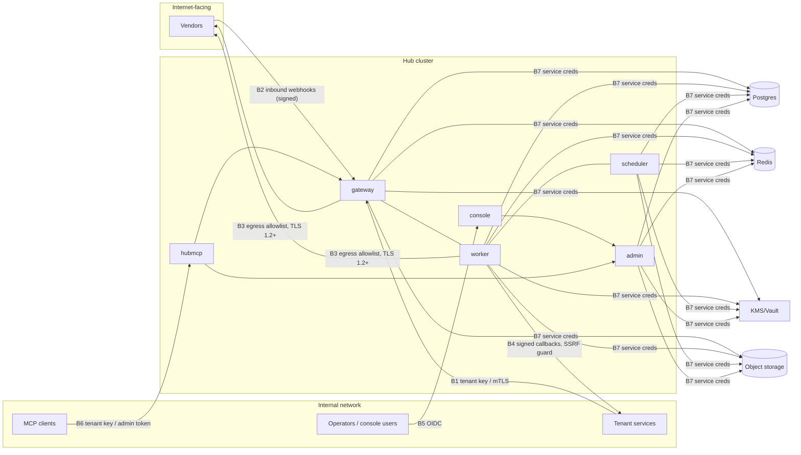
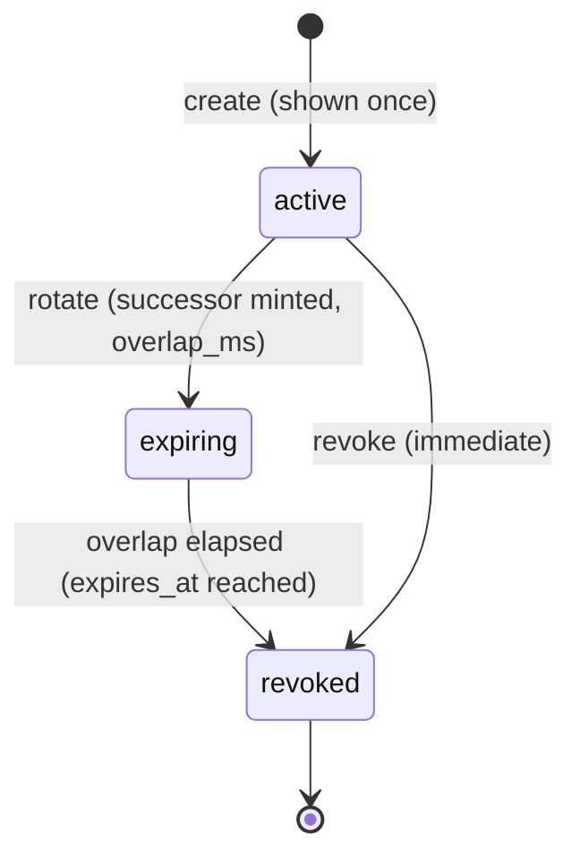

# Integration Hub — Security

| | |
| --- | --- |
| Status | Phase 1 (plan); HUB-234 hardening checks in CI and tests |
| Date | 2026-10-31 (updated 2026-11-07, HUB-234) |
| Behaviour source | DESIGN §9 (credentials), §12 (webhooks), §13.2 (payload policies), §16.1 (RBAC), §16.5 (security) |

## 1. Assets and trust boundaries

| Asset | Sensitivity |
| --- | --- |
| Vendor credentials (account secrets, OAuth tokens, mTLS keys) | critical |
| Tenant API keys | critical |
| Registrar signing secrets, inbound webhook secrets | high |
| Sealed payloads (bureau, Aadhaar, PAN, AA data), per-tenant sealing keys | critical (regulated) |
| Masked/full payloads in the audit trail | high (PII) |
| Registry config (transformers, integrations) | high (integrity: controls where data goes) |
| Admin identity (OIDC tokens), console session cookies | high |

## 2. Threat model (STRIDE-lite)

### 2.1 Gateway (`/v1`, B1)
| Threat | STRIDE | Mitigation |
| --- | --- | --- |
| Stolen/guessed tenant key | S | 256-bit random keys, stored as SHA-256 hash (high-entropy keys do not need a slow KDF), constant-time lookup via hash map; shown once; rotation with overlap; optional mTLS identity (DESIGN §4.2) |
| Tenant invokes another tenant's integration | E | grant check on every request (owner or `integration_grants`) before validation; returns 403 `FORBIDDEN`, and 404 for integrations the tenant cannot see in discovery (no existence oracle) |
| Caller learns vendor/account/version | I | contract scanner (TESTING §4.1), D12; the one documented exception is `dryRunIntegration` (exact upstream request, secrets `***`), gated by key scope `dry_run` that is not granted by default (PRD DV-6); `X-Hub-Integration-Version` debug header **disabled in prod** by default; error envelope `upstream` carries only numeric status/code; vendor error messages passed through for `UPSTREAM_REJECTED` are a leak risk → transformers must map them to canonical text where they name the vendor (review checklist) |
| Body bombs / slowloris | D | body limit 1 MB (4 MB LLM) (DESIGN §16.5; `TestBodyLimitsAtTheEdge`: declared and chunked bodies, 413 `PAYLOAD_TOO_LARGE` before validation or any vendor call), `ReadHeaderTimeout` 5 s, read timeout and max header bytes (not set yet: HUB-249), global in-flight limit, tenant token buckets |
| Replay of side-effecting calls | T | `Idempotency-Key` mandatory for integrations with `moves_money_or_quota: true` (DESIGN §4.2), enforced at the edge with 400 `IDEMPOTENCY_KEY_REQUIRED` |
| Request smuggling | T | single HTTP parser (Go), ingress normalises; reject ambiguous `Content-Length`/`Transfer-Encoding` |
| Repudiation of calls | R | audit `request.received` with tenant key hash + key id |

### 2.2 Admin plane (`/admin/v1`, console, hubctl, B5)
| Threat | STRIDE | Mitigation |
| --- | --- | --- |
| Unauthorised config change redirects data to an attacker host | T/E | RBAC (§7), egress allowlist is part of vendor definitions and itself an admin-only change; publish validation; every mutation in `change_log` with before/after/reason |
| Token theft from the browser | S | BFF pattern: tokens only server-side in the SvelteKit session (TECH_SPEC §17.3); `HttpOnly`, `Secure`, `SameSite=Lax`; CSRF protection on form actions (SvelteKit origin check) |
| Over-broad unseal | I | `admin` only, mandatory reason, audited as an event on the request and in `change_log`; rate-limited; alert on unseal volume |
| CSRF/XSS in console | T | Svelte auto-escaping, strict CSP (`default-src 'self'`), no `{@html}` with API data; transformer YAML shown in a code viewer, never rendered as HTML |
| Insider replays DLQ to a changed transformer | T | replay requires `editor`+, recorded in `change_log`, replay re-resolves through the published (validated) version only |
| Node impersonation fetching snapshots | S/I | node service credential for `/admin/v1/snapshots/*` (TECH_SPEC §22.6); snapshots contain no secrets |

### 2.3 Webhooks in (B2) and out (B4)
| Threat | STRIDE | Mitigation |
| --- | --- | --- |
| Forged vendor webhook | S | verify per account scheme (HMAC / basic / IP allowlist) before parsing; reject timestamps > 5 min (DESIGN §12.2); constant-time compare |
| Replay of a vendor webhook | T | timestamp window + dedup on vendor event id (24 h Redis set) |
| Webhook correlation spoofing (attach events to another tenant's request) | E | correlate only via Hub-issued request id embedded in the outbound call or `vendor_ref` recorded in audit for **that account** |
| SSRF via registrar URL | E/I | host allowlist per tenant; resolve host, refuse private, loopback, link-local, CGNAT, IPv6 ULA/link-local, metadata IPs; dial the **resolved IP** (prevents DNS rebinding); no redirects; 5 s timeout (DESIGN §12.1); HTTPS only outside local |
| Tenant can't verify Hub callbacks | S | `X-Hub-Signature: t=…,v1=HMAC-SHA256(secret, t.body)`; secret rotation with dual-sign overlap |
| Callback flood to a slow tenant | D | per-endpoint concurrency cap, own retry schedule and DLQ, independent of vendor delivery |

### 2.4 Transformers
| Threat | STRIDE | Mitigation |
| --- | --- | --- |
| Expression exfiltrates credentials into the body | I | `creds.*` only in header/query/auth targets (compile-time) unless `allow_creds_in_body: true` (reviewed flag); goldens + secret grep test |
| DoS via expensive expression | D | no loops (only `map`/`filter`), `MaxNodes`, max depth, memory budget, max output size, runtime budget (ADR-0002); compile once at snapshot build |
| Sandbox escape (network, disk) | E | expr env exposes only the stdlib in DESIGN §7.3; no reflection on arbitrary Go values; env built from plain maps |
| Malicious transformer PR from another team | T | D7: PRs gated by goldens + CODEOWNERS review by the platform team; publish validation |

### 2.5 MCP server (`hubmcp`, B6)
| Threat | STRIDE | Mitigation |
| --- | --- | --- |
| Prompt injection via vendor response causes unwanted `hub_invoke` | E/T | `hub_invoke` annotated destructive so clients ask for confirmation; idempotency key on every invoke; scoped tenant key (grants limit blast radius); recommend `hub_dry_run` first; results are returned as data |
| Leakage of vendor/account/version to the LLM | I | tools built on discovery endpoints only (ADR-0007); leak test (TESTING §13) |
| PII to an LLM context | I | admin tools are metadata-only, never unseal, never return payloads; tenant tools return what the tenant already receives |
| Token handling | S | stdio: key from env; HTTP: per-session `Authorization` forwarded, never stored or logged; bind `127.0.0.1` by default; `Origin` validation (DNS rebinding); TLS required when exposed |
| Admin token misuse | E | admin tools exist only when `HUB_ADMIN_TOKEN` is set; token should be a `viewer` or `tenant_viewer` role; GET-only client enforced in code |

## 3. Secrets handling
- **At rest**: envelope encryption, per-account data key wrapped by KMS/Vault transit (DESIGN §9). DB stores ciphertext + wrapped key only. Registrar and webhook secrets use the same mechanism (`secret_ref`).
- **In memory**: decrypted cache only (TTL 5 min, warmed on snapshot load); no decrypt on the request path; values registered with the redactor (TECH_SPEC §9).
- **In logs/traces/metrics**: never. Redaction by value plus key-name denylist (OBSERVABILITY §4.3). The process redaction set holds the decrypted credentials and registrar signing secrets (credential cache) and, since HUB-234, the Postgres DSN password and `HUB_AUDIT_MASK_KEY` (`roles.Run`, for every entry point). Span attributes come from an allowlist (`telemetry.AllowedSpanAttributes`, OBSERVABILITY §5.2) enforced by tests; span statuses carry error classes, never error text. Audit `request.transformed` stores redacted headers.
- **Trace ids to third parties**: only vendors listed in `HUB_TRACE_FORWARD_VENDORS` receive the Hub's `traceparent`; `tracestate` is never sent (ADR-0013).
- **In Git**: never. `backend/config/` holds references; dev secrets in `dev-secrets.enc` encrypted with a git-ignored dev key. Secret scanning (gitleaks) in CI.
- **In fixtures**: fixed fake values clearly marked (`test-passcode-not-real`).
- **Rotation**: accounts `active`/`next` (DESIGN §6.6); tenant keys overlap; registrar secrets dual-sign window; KMS key rotation by the provider.
- **Deletion**: credentials deleted only at account `retired` (DESIGN §6.5).

## 4. PII policies (DESIGN §13.2)
| Policy | Stored | Readable by | Default for |
| --- | --- | --- | --- |
| `full` | raw bytes at every stage | `viewer`+ for platform, `tenant_viewer` for own tenant | engagement, messaging (only when no `x-pii` fields require masking) |
| `masked` | `x-pii` fields masked/hashed (e.g. `maskPAN`, `maskAadhaar`, `sha256` for identifiers), rest raw | same as full | default |
| `sealed` | raw bytes, field-level encrypted with a per-tenant key | only through audited **unseal** (`admin`) | bureau, Aadhaar, PAN, AA (D6); 90 d |
| `metadata_only` | no bodies; sha256 + size only | `viewer`+ | LLM prompts (DESIGN §15) |

Always: SHA-256 + byte size of every payload, so losslessness is verifiable (DESIGN §13.3). Aadhaar numbers are never stored, even sealed, in vendor sessions (DESIGN §14). Publish validation rejects `full` on a capability whose schema has `x-pii` fields of class `regulated`.

### 4.1 Subject erasure (DESIGN §16.5, HUB-233, ADR-0012)
`hub erase-subject -tenant T -actor WHO -reason TEXT [-since RFC3339] [-until RFC3339] [-dry-run] < identifier` purges every stored body of the tenant's requests that hold a data subject's identifier, and keeps hashes, sizes, timelines and metadata.

| Aspect | Rule |
| --- | --- |
| Input | The identifier is read from **stdin only**, never from flags (process listings, shell history). It is registered with the redacting logger, never logged and never stored. Requires `HUB_PG_DSN`, `HUB_AUDIT_MASK_KEY` (the gateway's key) and, if the tenant has sealed payloads, the seal key file (`-dev-key-file`). Without it the job fails (`ErrNoSealKey`) rather than report a partial search as done |
| Forms searched | raw value and its JSON-escaped forms (full payloads, sealed plaintext, outbox/DLQ envelopes, kept results, callback payloads), the per-tenant HMAC used by `masked` for `identifier`/`ip_address`/`device_id`, and HMAC(local part)@domain for `email`. Kinds masked to the last four characters or `***` keep nothing identifying and are not searched |
| Where | `request_events.payload` (clear payloads in SQL, sealed ones opened one by one), `request_results.result/error`, `outbox.envelope`, `dead_letters.envelope/last_vendor_request/last_vendor_response`, `callback_deliveries.payload`, `vendor_sessions.data/vendor_txn_id`, scoped to the tenant (and to the window by request creation time) |
| Purge | For every matched request: event payloads → NULL, `payload_state = omitted`, `meta.pii_erased = <change_id>`; kept result/error → NULL; dead-letter canonical → null and last vendor exchange dropped (replay refused); delivered/dead-lettered callback payloads emptied; matching vendor sessions deleted. Event rows, sha256, bytes, types, times, `requests`, `request_attempts`, dead-letter and callback metadata remain |
| In flight | Requests still in the outbox or with callbacks to deliver are **deferred** (listed, exit code 3) and erased by a re-run once they are terminal |
| Audit | One `change_log` row per run (`eraseSubjectPayloads`, `object_type = request`, reason ≥ 10 characters) with tenant, counts, request ids and `subject_ref` (an HMAC with its own domain label, never equal to a stored form). A dry run writes nothing |
| Not covered | Idempotency replay records in Redis (24 h TTL, hashed keys; releasing them could re-run money-moving calls; HUB-246). Identifiers used as `Idempotency-Key` or ordering keys: callers must not put PII in keys. Object-storage spill (HUB-098, when it lands). Lookup is a scan of the tenant's rows; a hashed subject index is HUB-245. An admin API operation with RBAC is requested in HUB-247 (CCR) |

## 5. Egress allowlist and TLS
- Allowed hosts = the union of hosts in vendor definitions (`regions`, endpoint hosts) of the **current snapshot** plus registrar hosts. The upstream dialer refuses any other host (checked after DNS resolution, same IP-range rules as SSRF for non-vendor targets).
- Network layer: Kubernetes NetworkPolicy / egress gateway mirrors the allowlist (defence in depth); changes go through the deploy repo.
- TLS 1.2+ with verification; no `InsecureSkipVerify` (lint rule); optional certificate pinning per account for regulated partners; per-account mTLS client certs (DESIGN §9). The floor is explicit (`MinVersion: tls.VersionTLS12`) in both egress clients, `upstream.Client` (vendors) and `callbacks.Guard` (tenant callbacks; its test seam can add roots but never lower the floor), rather than relying on Go's default client floor.
- Tests (HUB-234): `TestTLS` (upstream) runs the real client against vendors that speak only TLS 1.0 or 1.1 and expects a tls-phase `ErrConnect` with no request served, with a positive control proving those vendors complete the old handshake with a permissive client; TLS 1.2-only and 1.3 vendors succeed. `TestTLSFloorIsExplicit` pins the configured floor, and `TestGuardRefusesTLSBelow12` covers callbacks. Note for test authors: since Go 1.22 a Go **server** defaults to a TLS 1.2 floor, so a test server with only `MaxVersion: TLS11` speaks no version at all and proves nothing; set `MinVersion` explicitly.
- Egress tests: `TestUndeclaredHostRefusedBeforeDial` (undeclared host, port, scheme, unparsable URL and plain http to a remote host are refused before the dialer, counted in `upstream_egress_denied_total`) and `TestDialerChecksEgress` (the dial functions refuse undeclared addresses and dials without an allowlist).
- Regional accounts enforce data residency: an integration version cannot target an account outside the tenant's allowed regions (publish check).

## 6. Tenant key lifecycle

- Format: `hk_live_…` / `hk_test_…` + 32 random bytes base62 (contract `bearerAuth`); the prefix lets secret scanners detect leaks; the admin API shows only the first 12 characters (`prefix`) and `key_id` (`key_` + ULID), both safe to log.
- Stored: `key_hash = SHA-256(key)`, `key_id`, `tenant_id`, `scopes[]` (`invoke`, `dry_run`, `requests_read`, each optionally `<scope>:<integration_id>`, DESIGN §16.5; `dry_run` never granted by default), `created_at`, `expires_at`, `revoked_at`, `last_used_at` (updated asynchronously, sampled).
- Gateway loads hashes from the snapshot (in-memory hash set, DESIGN §5.1); revocation propagates with the snapshot (≤ 10 s).
- Rotation overlap default 7 days; alerts on keys unused for 90 days.

## 7. RBAC matrix (`/admin/v1`, DESIGN §16.1)
Legend: **R** read · **W** create/update · **X** execute action · — denied. `tenant_viewer` sees only objects owned by (or granted to) their tenant and never vendor credentials.

| Resource / action | admin | editor | viewer | tenant_viewer |
| --- | --- | --- | --- | --- |
| vendors | R W | R W | R | — |
| accounts (metadata) | R W | R W | R | — |
| accounts: test-connection | X | X | — | — |
| accounts: rotate credentials / promote `next` | X | — | — | — |
| accounts: lifecycle (drain, retire) | X | — | — | — |
| capabilities | R W | R W | R | R |
| transformers | R W | R W | R | — |
| transformers: dry-run, run-goldens | X | X | X | — |
| integrations, versions, diff | R W | R W | R | R (own) |
| integrations: publish, rollback, weights | X | X | — | — |
| integrations: pause / resume | X | X | — | — |
| tenants | R W | R | R | R (own) |
| api-keys: create, rotate, revoke | X | X (non-own tenants require admin) | — | — |
| api-keys: list (metadata) | R | R | R | R (own) |
| registrar-endpoints | R W | R W | R | R (own) |
| snapshots | R | R | R | — |
| requests: search, timeline (policy-filtered) | R | R | R | R (own) |
| requests: unseal | X (reason required) | — | — | — |
| dlq: list | R | R | R | R (own) |
| dlq: replay | X | X | — | — |
| dlq: purge | X | — | — | — |
| breakers: state | R | R | R | — |
| breakers: force-open / force-close | X | — | — | — |
| change_log | R | R | R | R (own objects) |

Every W/X writes `change_log` (actor, action, object, before, after, reason). Irreversible actions require a reason (frontend/AGENTS.md). The admin API is the enforcement point; the console only hides controls.

## 8. Supply chain
- **Go**: `go.mod`/`go.sum` committed; minimal dependency set (TECH_SPEC §13); `govulncheck` and `gosec` in CI (blocking, §8.1); Renovate/Dependabot weekly with grouped minor updates; `GOFLAGS=-mod=readonly`; the toolchain is pinned in `go.mod` (`toolchain go1.26.10` since HUB-234: go1.26.0 had 36 stdlib vulnerabilities reachable from Hub code, among them crypto/x509, net/url and html/template).
- **Node**: `package-lock.json` committed, `npm ci` only, exact versions for generators (`openapi-typescript`, `openapi-fetch`); `npm audit --audit-level=high` blocking; `ignore-scripts=true` in `.npmrc` except allowlisted packages.
- **Images**: base images pinned by digest; distroless/non-root; SBOM (syft) and provenance (SLSA, `actions/attest-build-provenance`) on release; image scan (grype/trivy) blocking on critical.
- **CI**: GitHub Actions pinned by commit SHA; least-privilege `permissions:`; no secrets on PRs from forks.
- **Vendored skills** (`.claude/skills/`, `backend/.claude/skills/`, `frontend/.claude/skills/`): third-party skills are vendored with their `LICENSE.txt`, listed in `THIRD_PARTY_SKILLS.md` with source URL and commit, reviewed before adding (scripts read in full), and never added from an unknown source without the user's approval (AGENTS §12). Skill scripts are not executed in CI.
- **Secret scanning**: gitleaks on every PR, plus the `hub_` key prefix rule.
- **Contracts**: only the steward edits `contracts/`; CODEOWNERS enforces review.

### 8.1 Static analysis and vulnerability gates (HUB-234)
| Gate | Command (backend/) | Tool version | Fails on |
| --- | --- | --- | --- |
| CI job `govulncheck` | `make vuln` | `golang.org/x/vuln` v1.9.0 | any known vulnerability in a called symbol of the stdlib or a module (imported-but-not-called findings are informational) |
| CI job `gosec` | `make gosec` | `github.com/securego/gosec/v2` v2.30.0, `-severity medium` | any medium- or high-severity finding in non-test code that is not triaged (gosec does not scan `_test.go`) |
| CI job `lint` | `golangci-lint run` | v2.15.0 (bundled gosec) | as before; honours the same `#nosec` annotations |

Both tools run with `go run <module>@<version>` (pinned in the Makefile; bump deliberately). Locally: `make security`.

**Triage policy.** Fix real findings. A false positive gets a narrowly scoped annotation on the flagged line: `// #nosec <rule> -- <reason>` (one rule ID, a reason a reviewer can check). Both gosec and golangci-lint honour it; `//nolint:gosec` is not used because standalone gosec ignores it. No gosec config-level exclusions exist. The annotations in the tree at HUB-234 (all false positives, reviewed):

| Rule | Where | Why it is safe |
| --- | --- | --- |
| G115 (integer conversion) | `audit/store.go`, `audit/ledger.go` (`int64(SnapshotVersion)`), `control/guard.go` (`int32` version), `audit/seal.go` (`byte(len(id))`), `registry/watch.go`, `core/ids.go`, `core/state.go`, `resolve/resolve.go`, `testkit/mockvendor/server.go` | values are bounded (versions far below 2^31, id length checked to 1..255, 48-bit timestamps, modulo 100) or only hashed/compared for equality |
| G304 (file path from variable) | `creds/localfile.go` (`HUB_DEV_KEY_FILE`), `control/snapshots.go` (path confined to the blob root), `cmd/hubctl/ops.go` (file named by the operator) | operator configuration or confined path, never request input |
| G301 / G306 (dir 0755 / file 0644) | `cmd/hubctl/config.go` | writes registry config pulled from a snapshot: readable by design, no secrets (snapshots contain none) |
| G705 (XSS via `Write`) | `control/adminapi/snapshots.go` (`getSnapshot`) | archived registry JSON served with `Content-Type: application/json`, never HTML; `nosniff` hardening tracked in HUB-248 |
| G107 / G704 (request to variable URL) | `testkit/contract/contract.go` | test helper calling the test's own server |
| G404 (math/rand) | `delivery/backoff.go`, `testkit/mockvendor/server.go` | retry jitter and a deterministic test double, not security |
| G101 (hardcoded credentials) | `cmd/hubctl/creds.go` | usage text that mentions `signing_secret=`; no credential |

## 9. Security testing
SSRF, signature, redaction and secret-grep tests (TESTING_STRATEGY §2, §3, §5); the role-log secret grep (HUB-234, below); fuzzing of parsers (§8); RBAC table test generated from §7 (every role × action → expected 2xx/403); dependency and image scans (§8); a pre-production review of the threat model before the first real vendor account is created.

**Role-log secret grep (HUB-234).** In `cmd/hub/internal/roles`, every role a test starts (`startRoleWith`) logs through the production logger (`telemetry.NewLogger`: JSON, value redaction, debug level) into one capture shared by the package. Tests declare every secret they hand to the roles with `forbid` (vendor credentials, registrar signing secrets, the dev master key in base64/hex forms, the audit mask key, tenant API keys including unknown ones a caller presented, admin access tokens). `TestMain` fails the package if any declared value appears in the captured logs of the whole run, printing labels, never values. `TestRoleLogsCarryNoSecrets` runs gateway, worker, scheduler and admin together on the encrypted localfile credential source and drives every secret-handling path: a sync call (positive control: the vendor receives the passcode), a vendor that echoes the credentials in 400/401 error bodies (gateway and worker), async delivery with a signed callback (positive control: `X-Hub-Signature` received), an admin connection test, a rotation (add next, test, promote) followed by a call that uses the rotated value, an unknown account, and an unknown API key. It also asserts lines from every role, a request-path line and the rotation lines reached the capture. Mutation check: logging a vendor error body is redacted (`***`); with credential registration disabled the test fails.

Scope note: per-package integration tests outside `roles` keep their own log captures and greps (`TestE2EErrorClasses` in `edge` greps its gateway logs and the stored audit events); the Postgres password of the local test DSN (`hub`) is too short and common to grep and is covered by `TestRunRegistersConfigSecrets` instead.
