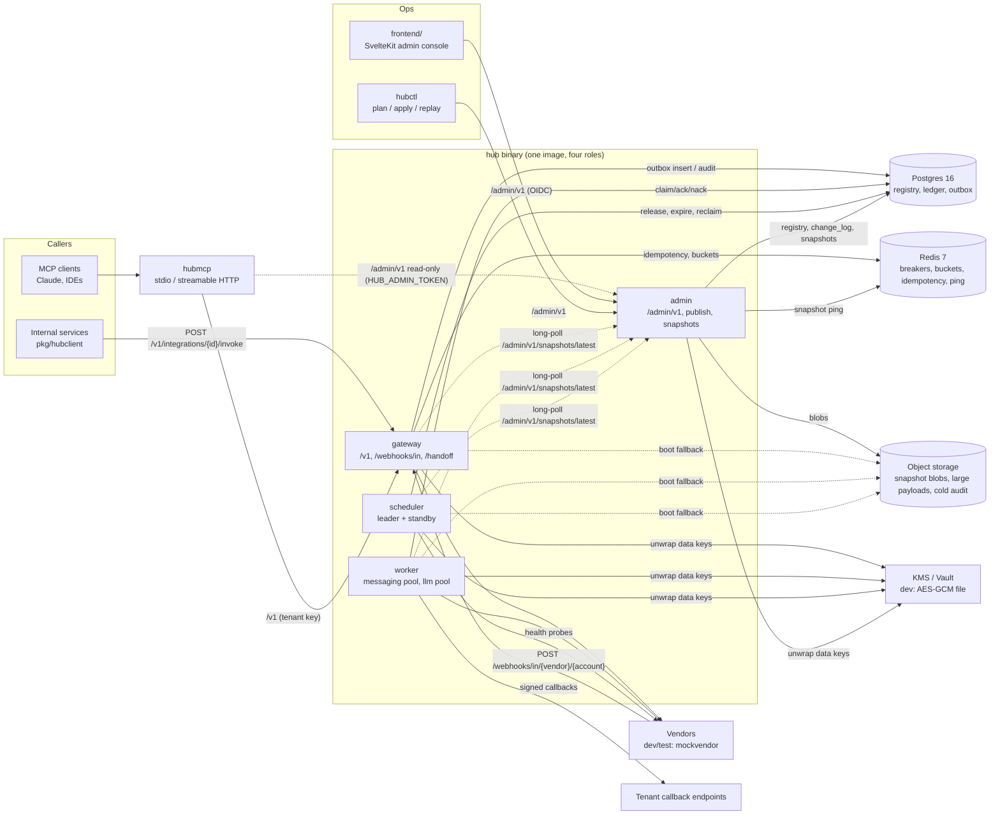
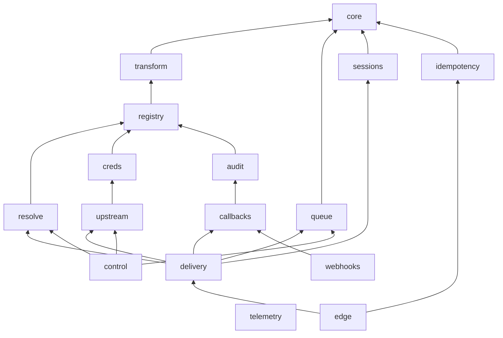
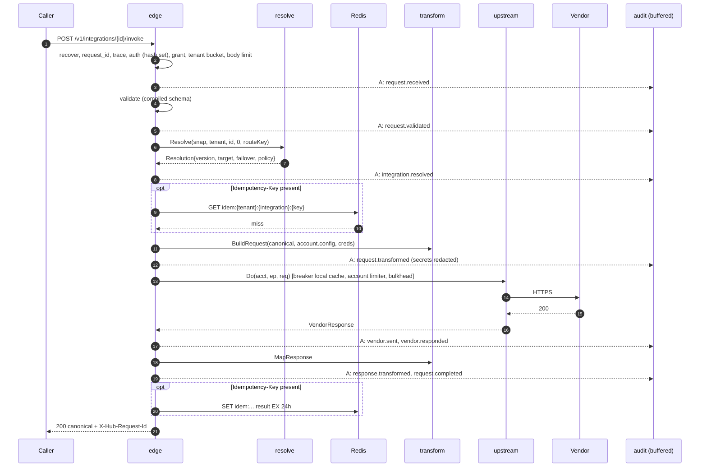
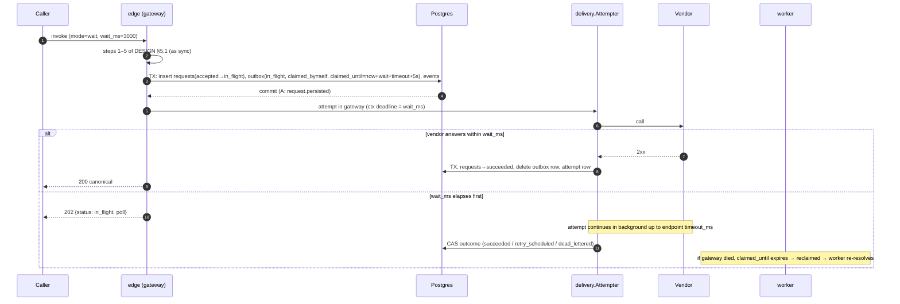
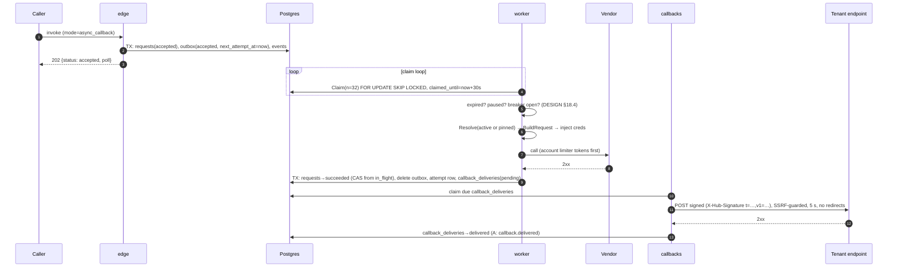
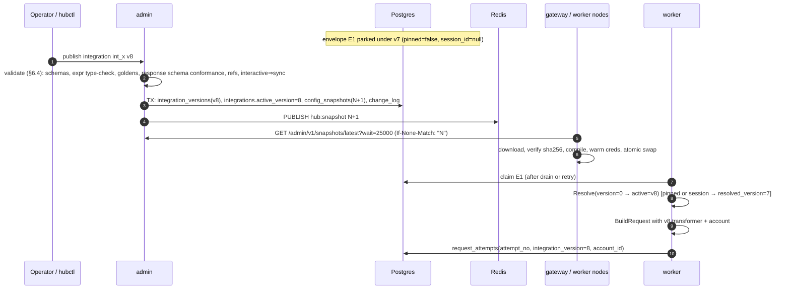
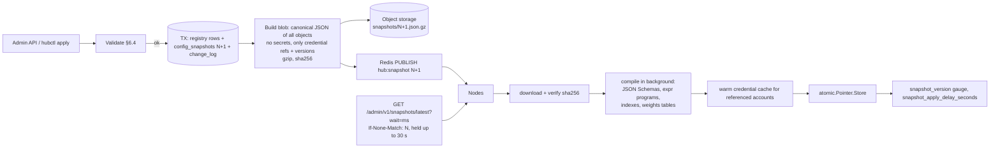
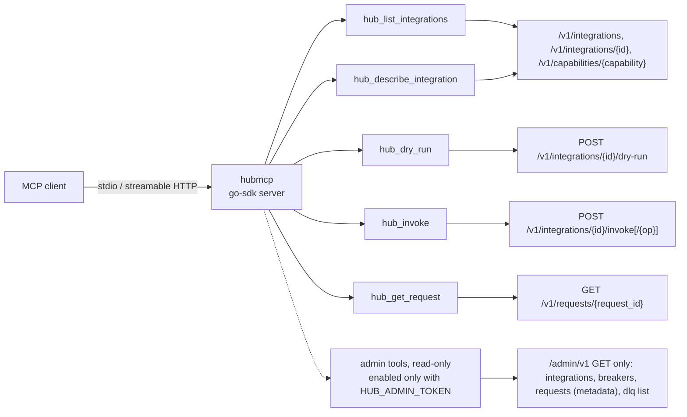

# Integration Hub — Technical Specification

| | |
| --- | --- |
| Status | Phase 1 (documentation only, no code yet) |
| Date | 2026-10-31 |
| Source of truth for behaviour | `docs/DESIGN.md` (cited as "DESIGN §x"). This file says **how** we build it. |
| Related | `OBSERVABILITY.md`, `TESTING_STRATEGY.md`, `SECURITY.md`, `adr/`, `docs/process/*` |

Where this spec makes a choice DESIGN leaves open, it is marked **Decision** and, if it changes architecture, it has an ADR. Where DESIGN is silent or ambiguous and a lead decision is needed, it is marked **Open** and listed in §22.

---

## 1. Architecture overview

The Hub is one Go binary (`hub`) that runs in one of four roles (DESIGN §17), plus three companion binaries (`hubctl`, `mockvendor`, `hubmcp`) and a SvelteKit admin console. All roles share identical `resolve`, `transform`, `creds` and `upstream` code, so a request behaves the same whether it is sent by the gateway or a worker.



### 1.1 Planes
- **Data plane**: gateway, worker, scheduler. Reads config only from the in-memory `Snapshot` (DESIGN §18.3). Never reads registry tables at request time (DESIGN §18.5 rule 1).
- **Control plane**: admin role + `hubctl` + admin console. Writes registry tables, runs the publish pipeline (DESIGN §6.4, §8.2), serves snapshots, owns `change_log`.
- **Clients**: `pkg/hubclient` (Go SDK), `hubmcp` (MCP server, ADR-0006), `clients/claude-skill/` (consumer skill). All are clients of the HTTP API defined in `contracts/` and never touch Postgres or Redis.

---

## 2. Runtime roles

| Role | Command | Listens | Main loops | Scales on | Replicas (phase 1) |
| --- | --- | --- | --- | --- | --- |
| gateway | `hub gateway` | `:8080` public (`/v1`, `/webhooks/in`, `/handoff`), `:9090` ops | HTTP server, snapshot watcher, breaker sync, audit writer, idempotency client | CPU + `hub_overhead_ms` p99 (HPA) | ≥ 3 |
| worker | `hub worker --pool=messaging\|llm` | `:9090` ops only | claim loops, per-account bulkheads, callback dispatcher, audit writer, snapshot watcher, breaker sync | `queue_depth` per pool (KEDA or custom HPA metric) | ≥ 2 per pool |
| scheduler | `hub scheduler` | `:9090` ops only | leader election, drain ramp, TTL expiry, visibility reclaim, health probes, session expiry, partition maintenance, zero-loss reconciler | singleton (leader) + hot standby | 2 |
| admin | `hub admin` | `:8081` `/admin/v1`, `:9090` ops | HTTP server, publish pipeline, snapshot long-poll hub | fixed | 2 |
| — | `hubctl` | CLI | `plan`, `apply`, `transform test`, `dry-run`, `replay` | — | — |
| — | `mockvendor` | `:8099` vendor surface, `:8098` control API | programmable behaviours (DESIGN §19 M0) | — | dev/test only |
| — | `hubmcp` | stdio, or `:8090` streamable HTTP | MCP session handling, HTTP client to `/v1` and `/admin/v1` | stateless | optional |

**Ops port `:9090`** (never exposed outside the cluster): `/healthz`, `/readyz`, `/metrics`, `/debug/pprof/*` (see `OBSERVABILITY.md` §8). Kubernetes probes use it.

**Decision — scheduler leader election**: Postgres session-level advisory lock (`pg_try_advisory_lock(hashtext('hub.scheduler'))`) held on a dedicated connection; the standby retries every 2 s. Losing the connection loses the lock, so the leader's loops must be bound to a context cancelled on connection loss. No extra infrastructure (no etcd/Lease API) in phase 1.

**Wait-mode immediate attempt** runs in the gateway (DESIGN §5.2): the gateway inserts the outbox row already claimed by itself (`status=in_flight, claimed_by=<pod>, claimed_until=now()+wait_ms+endpoint timeout+5s`), so workers do not pick it up while the gateway is trying. If the gateway dies, the visibility timeout expires and the scheduler/worker reclaims it (§6.3).

---

## 3. Monorepo layout

ADR-0001. Toolchain targets: **Go ≥ 1.26 (`go.mod` minimum; goose v3.29 requires 1.26), Node 22 LTS, Postgres 16, Redis 7**.

Installed on the dev machine (HUB-012, 2026-10-31, Homebrew on macOS 15 arm64): Go 1.27.3, Node 22.23.4 (keg-only `node@22`: put `/opt/homebrew/opt/node@22/bin` first on `PATH`; a Node 26 from Homebrew is also present and must not be used), Docker CLI 29.9.2 + Compose 5.6.1 on Colima 0.10.3 (`colima start --cpu 4 --memory 6`), golangci-lint 2.15.0, sqlc 1.31.1 (HUB-047; CI runs the same version through `make sqlc-check`). The compose plugin is found through `cliPluginsExtraDirs` in `~/.docker/config.json`.

```text
integration-hub/
├── AGENTS.md, CLAUDE.md, README.md, CHANGELOG.md, THIRD_PARTY_SKILLS.md
├── Makefile                      # thin root: delegates to backend/ and frontend/
├── .github/
│   ├── workflows/ci.yml
│   └── pull_request_template.md
├── .claude/{agents,skills}/      # repo-wide agents + skills
├── contracts/                    # single source of truth for every interface (ADR-0004)
│   ├── openapi/
│   │   ├── hub-public.v1.yaml    # /v1 caller API + discovery endpoints (ADR-0007)
│   │   └── hub-admin.v1.yaml     # /admin/v1 control plane
│   ├── schemas/
│   │   ├── capabilities/<capability>.v<major>.{request,response}.json
│   │   └── events/<event>.json   # webhook payloads, envelope, canonical-error
│   ├── CHANGELOG.md
│   └── AGENTS.md
├── backend/                      # Go module github.com/Donquixot-Doflamingo/integration-hub/backend
│   ├── go.mod, go.sum, Makefile, .golangci.yml, sqlc.yaml
│   ├── cmd/
│   │   ├── hub/                  # main + role wiring (cmd/hub/internal/roles)
│   │   ├── hubctl/
│   │   ├── mockvendor/
│   │   └── hubmcp/               # main + cmd/hubmcp/internal/{tools,client}
│   ├── internal/
│   │   ├── edge/  registry/  transform/  resolve/  creds/  upstream/
│   │   ├── queue/  delivery/  sessions/  idempotency/  audit/  callbacks/  webhooks/
│   │   ├── control/  telemetry/
│   │   └── core/                 # proposed leaf of shared value types (ADR-0001, §4)
│   ├── pkg/hubclient/            # Go SDK (Result / Queued types, SSE reader)
│   ├── config/                   # dev registry (§9)
│   ├── migrations/               # goose, append-only
│   └── testdata/                 # shared fixtures (contract samples, load profiles)
├── frontend/                     # SvelteKit 2 + Svelte 5 + TS admin console (ADR-0005)
│   ├── package.json, svelte.config.js, vite.config.ts, playwright.config.ts
│   ├── src/lib/api/{schema.d.ts (generated), client.ts}
│   ├── src/routes/...
│   └── src/mocks/                # MSW handlers built from contract examples
├── clients/claude-skill/         # consumer skill (uses discovery endpoints)
├── deploy/
│   ├── docker-compose.yml        # postgres, redis (+ profiles: obs, auth, apps)
│   ├── alerts/*.yaml             # Prometheus rules (OBSERVABILITY §11)
│   ├── dashboards/*.json         # Grafana (OBSERVABILITY §10)
│   ├── load/                     # k6 scripts (OBSERVABILITY §12)
│   └── k8s/                      # later
└── docs/{DESIGN.md, product/, features/, tech/, tickets/, process/}
```

`internal/*` matches DESIGN §18.1, plus `internal/core` (shared leaf types, ADR-0001), `internal/idempotency` (the Redis Idempotency-Key store, split out of `edge` so its Lua scripts and Redis contract are tested on their own; ADR-0001, HUB-118) and `internal/testkit` (test-only helpers such as the in-process mockvendor). Binary-private code lives under `cmd/<bin>/internal/` so it cannot be imported by other binaries and does not add top-level packages.

---

## 4. Go package dependency rules

### 4.1 Layers
Packages may import only packages in **lower** layers (or the same layer where listed). No import cycles (the compiler forbids them anyway; the rules below keep the graph shallow and the hot path auditable).

| Layer | Package | May import (internal) | Never imports |
| --- | --- | --- | --- |
| L0 | `telemetry` | nothing internal (stdlib, OTel, Prometheus client only) | everything else — **leaf** |
| L0 | `core` | nothing internal | everything else — **leaf**. Holds IDs (ULID request ids), `Envelope`, canonical error codes (DESIGN §4.4), `VendorRequest`/`VendorResponse`, `Outcome`, `Mode`, request states (DESIGN §10.9) |
| L1 | `transform` | core, telemetry | registry, upstream, creds (gets `creds` as a plain map in `TransformInput`) |
| L2 | `registry` | core, transform, telemetry | resolve, creds, upstream, queue, any app package |
| L3 | `resolve` | core, registry, telemetry | transform execution, upstream, queue |
| L3 | `creds` | core, registry, telemetry | upstream, queue |
| L3 | `queue` | core, telemetry | registry (envelopes carry ids, not snapshot pointers) |
| L3 | `sessions` | core, telemetry | registry |
| L3 | `idempotency` | core, telemetry | registry and every package above L3 (Redis Idempotency-Key store, HUB-118; the edge maps its outcomes to HTTP) |
| L3 | `audit` | core, registry (PII paths for masking), telemetry | upstream, queue |
| L4 | `upstream` | core, registry, creds, telemetry | resolve, transform, queue, audit (returns attempt facts; caller emits audit) |
| L5 | `callbacks` | core, registry, audit, telemetry | delivery, edge |
| L6 | `delivery` | core, registry, resolve, transform, creds, upstream, queue, sessions, audit, callbacks, telemetry | edge, webhooks, control |
| L7 | `edge` | core, registry, resolve, transform, creds, upstream, queue, sessions, idempotency, audit, delivery (shared `Attempter`), telemetry | webhooks, control |
| L7 | `webhooks` | core, registry, transform, audit, callbacks, telemetry | edge, delivery, control |
| L7 | `control` | core, registry, transform, resolve, creds, upstream, queue, audit, sessions, telemetry | edge, delivery, webhooks |
| test | `testkit` | nothing internal (core and telemetry allowed) | must never be imported by production code; only `cmd/mockvendor` and `_test.go` files use it |
| bin | `cmd/*` | anything | — |
| SDK | `pkg/hubclient` | **nothing** under `internal/` (public SDK; wire types are its own or generated) | internal/* |


(Every package also imports `telemetry` and `core`; edges omitted for clarity.)

### 4.2 The hot-path chain
`edge → resolve → transform → creds (inject) → upstream`, with `delivery.Attempter` as the one function that runs *resolve → transform → inject → upstream → classify → map response* for **sync, wait and worker** attempts. Edge-only steps (auth, grant, tenant limit, body limit, schema validation, idempotency) stay in `edge`. Worker-only steps (claim, expire, park, nack, callbacks) stay in `delivery`.

### 4.3 Data ownership
Each table is written by exactly one package; others read through that package's API:

| Package | Owns tables |
| --- | --- |
| `control` | `tenants`, `api_keys`, `vendors`, `vendor_endpoints`, `accounts`, `account_credentials`, `capabilities`, `transformers`, `integrations`, `integration_versions`, `integration_grants`, `registrar_endpoints`, `config_snapshots`, `change_log` |
| `queue` | `outbox`, `dead_letters` |
| `audit` | `requests`, `request_events`, `request_attempts` |
| `sessions` | `vendor_sessions` |
| `callbacks` | `callback_deliveries` |

sqlc generates per-owner query packages (`internal/<pkg>/db`). A transaction that spans owners (e.g. accept = insert `requests` + `outbox` + first events) is composed by `delivery`/`edge` passing a `pgx.Tx` into each owner's `WithTx` method.

### 4.4 Enforcement
- `golangci-lint` `depguard` rules generated from the table above (`backend/.golangci.yml`).
- `internal/archtest` (unit test, runs in `make test`) fails if any internal edge outside the table exists, if `pkg/`, `cmd/mockvendor` or `cmd/hubmcp` import `internal/` (other than `testkit` for mockvendor), or if production code imports `testkit`.
- `telemetry` and `core` have a test asserting zero internal imports.

---

## 5. Request lifecycles

Notation: `A:` = audit event emitted (DESIGN §13.1). Every arrow into Redis/Postgres is the only I/O allowed at that step (DESIGN §18.5 rule 6).

### 5.1 Sync, vendor healthy


### 5.2 Wait mode (default, D3)

The attempt is detached from the HTTP request context once 202 is sent; it runs under the gateway's **work context** (cancelled only at shutdown, §12.4).

### 5.3 async_callback


### 5.4 Circuit open
```mermaid
sequenceDiagram
  autonumber
  participant C as Caller
  participant E as edge
  participant B as breaker (local cache ← Redis)
  participant PG as Postgres
  participant S as scheduler
  participant V as Vendor
  C->>E: invoke
  E->>B: State(account, endpoint)
  B-->>E: Open (retry_after = open window remaining)
  alt mode=sync, on_circuit_open=fail_fast
    E-->>C: 503 UPSTREAM_UNAVAILABLE, circuit=open, retry_after_ms
  else sync, failover (idempotent or Idempotency-Key)
    E->>E: next failover target → transform → upstream
    E-->>C: 200 + X-Hub-Served-By: failover:1
  else sync, queue_if_allowed + (Prefer: respond-async or callback subscription)
    E->>PG: persist as async, status=parked
    E-->>C: 202 queued, reason=circuit_open
  else mode=wait
    E->>PG: persist, status=parked (account, endpoint)
    E-->>C: 202 queued, reason=circuit_open
  else mode=async / async_callback
    E->>PG: persist (accepted); worker later Parks it
    E-->>C: 202 accepted
  end
  loop every 30 s while Open
    S->>V: synthetic health probe (dry)
  end
  S->>B: open → half_open → 3 probes OK → closed (Redis publish)
  S->>PG: Release(account, endpoint, limit) at 20% of account rps, doubling every 30 s
  Note over S,PG: re-open mid-drain → stop releasing; remaining stay parked (DESIGN §10.5)
```

### 5.5 Cutover with re-resolve (DESIGN §6.3, D10)


---

## 6. Data model (Postgres 16)

Columns per DESIGN §18.2. This section adds keys, indexes, partitioning and retention. Migrations: goose, append-only, expand/contract for anything touching live tables.

### 6.1 Registry (owned by `control`; small, unpartitioned)
| Table | PK | Key indexes / constraints |
| --- | --- | --- |
| `tenants` | `tenant_id` | — |
| `api_keys` | `key_id` | unique `key_hash` (SHA-256 of key, see SECURITY §6); `(tenant_id) WHERE revoked_at IS NULL`; `expires_at` for overlap rotation |
| `vendors` | `vendor_id` | — |
| `vendor_endpoints` | `(vendor_id, endpoint_id, version)` | — |
| `accounts` | `account_id` | `(vendor_id)`, check `state IN ('active','draining','retired')` |
| `account_credentials` | `(account_id, cred_version)` | unique `(account_id, slot) WHERE slot IS NOT NULL` (one `active`, one `next`) |
| `capabilities` | `(capability, major, minor)` | — |
| `transformers` | `(transformer_id, version)` | immutable: trigger rejects UPDATE/DELETE |
| `integrations` | `integration_id` | `(owner_tenant)`; FK `(integration_id, active_version)` → `integration_versions` |
| `integration_versions` | `(integration_id, version)` | immutable trigger; GIN on `spec jsonb_path_ops` for "which versions target account X" (account lifecycle, DESIGN §6.5) |
| `integration_grants` | `(integration_id, tenant_id)` | `(tenant_id)` |
| `registrar_endpoints` | `endpoint_id` | `(tenant_id)` |
| `config_snapshots` | `version` (bigint, monotonic) | `(created_at)`; retention 90 days (DESIGN §8.2) |
| `change_log` | `id` (bigserial) | `(object_type, object_id, at DESC)`, `(actor, at DESC)`; append-only trigger |

### 6.2 Ledger (owned by `audit`; partitioned)
| Table | Partitioning | PK | Indexes |
| --- | --- | --- | --- |
| `requests` | `RANGE (created_at)`, daily | `(created_at, request_id)` | `(request_id)` local per partition; `(tenant_id, integration_id, created_at DESC)`; `(status, created_at) WHERE status NOT IN ('succeeded','dead_lettered','expired')` (zero-loss reconciler) |
| `request_events` | `RANGE (at)`, daily | `(at, request_id, seq)` | `(request_id, seq)` |
| `request_attempts` | `RANGE (started_at)`, daily (**Decision**: DESIGN does not say; partitioning it keeps retention uniform) | `(started_at, request_id, attempt_no)` | `(request_id)`; `(account_id, started_at DESC)` |

- **Point lookup by `request_id`**: request ids are ULIDs (`req_` + ULID). The ULID timestamp gives the partition, so `GET /v1/requests/{id}` adds `created_at BETWEEN ts-1m AND ts+1m` and hits one partition.
- **Partition maintenance**: scheduler job creates partitions 7 days ahead and detaches partitions past retention (then exports to object storage before drop, DESIGN §13.4). No `pg_partman` dependency in phase 1.
- **Retention classes — Open**: DESIGN keeps masked payloads 30 days and sealed 90 days in the same tables. Daily partitions can only be dropped whole. Proposal: store payload bytes in `request_payloads` partitioned by `LIST (retention_class)` then `RANGE (at)`, keep `request_events` metadata (sha256, bytes, `payload_ref`) for 90 days. See §22.

### 6.3 Delivery (owned by `queue`, `sessions`, `callbacks`)
| Table | PK | Indexes | Notes |
| --- | --- | --- | --- |
| `outbox` | `request_id` | partial `(next_attempt_at) WHERE status IN ('accepted','retry_scheduled')` (claim); partial `(account_id, endpoint_id, next_attempt_at) WHERE status='parked'` (release, arrival order); partial `(claimed_until) WHERE status='in_flight'` (reclaim); `(expires_at) WHERE status IN ('retry_scheduled','parked')` (TTL); `(ordering_key, created_at) WHERE ordering_key IS NOT NULL` | **Not partitioned.** Row deleted on terminal ack in the same TX as the `requests` status change, so it stays small. `fillfactor=70`, aggressive autovacuum (`autovacuum_vacuum_scale_factor=0.01`). DESIGN §18.2 lists `(status, next_attempt_at)` and `(status, account_id, endpoint_id)`; partial indexes are the same keys narrowed by status. |
| `dead_letters` | `request_id` | `(reason, created_at)`, `(account_id, created_at)` (replay filters, DESIGN §10.6) | 14-day retention |
| `vendor_sessions` | `session_id` | `(expires_at)` (scheduler sweep); `(account_id, expires_at)` (retire guard `CountOpen`; a partial index on `expires_at > now()` is not allowed, `now()` is not immutable) | Columns: DESIGN §18.2 + `tenant_id`, `created_at` (migration `00006_sessions.sql`). 10-min default TTL; expired rows are invisible to `Get` and deleted by `sessions.Expire`. `data` (JSON object, ≤ 16 KB) and `vendor_txn_id` carry CHECKs refusing a 12-digit (4-4-4) number: the Aadhaar number is never stored (DESIGN §14). Read by the gateway only for requests carrying `X-Hub-Session` (one PK read, ADR-0011) |
| `callback_deliveries` | `delivery_id` | partial `(next_attempt_at) WHERE status IN ('pending','retry_scheduled')`; `(request_id)`; partial `(claimed_until) WHERE status='in_flight'` (reclaim, HUB-120); partial `(created_at) WHERE status='dead_lettered'` (DLQ count/replay, HUB-120); unique `(event_id, endpoint_id)` | own DLQ via `status='dead_lettered'`; `payload` holds the exact signed bytes (migration `00005_callbacks.sql`); nullable `traceparent` of the terminal transition's span, linked by `hub.callback.deliver` (`00010_callback_trace.sql`, HUB-231) |

**Claim query** (DESIGN §11.2, §18.4):
```sql
UPDATE outbox o SET status='in_flight', claimed_by=$1, claimed_until=now()+interval '30 s', attempt=attempt+1
WHERE o.request_id IN (
  SELECT request_id FROM outbox
  WHERE status IN ('accepted','retry_scheduled') AND next_attempt_at <= now()
    AND pool = $2
  ORDER BY next_attempt_at
  LIMIT $3 FOR UPDATE SKIP LOCKED)
RETURNING o.*;
```
`pool` (messaging | llm) is a column derived from the capability at insert time (**Decision**; DESIGN §17 asks for separate pools but the table has no column for it).

**Guarded transitions** (DESIGN §10.9): every status change is `UPDATE … WHERE request_id=$1 AND status=$expected AND claimed_by=$me`; zero rows affected means another actor won, and the caller drops its result (no double completion, no double callback).

### 6.4 Redis keys (not Postgres; listed here so every store is in one place)
| Key | Owner | Type | TTL | Contents |
| --- | --- | --- | --- | --- |
| `hub:idem:<hex sha256(tenant NUL integration NUL Idempotency-Key)>` | `idempotency` (HUB-118) | hash | lease 5 min while in progress; 24 h from the first claim once completed (Redis clock) | `st` (`p`/`c`), `bh` (sha256 of operation + body), `rid` (claiming request id), `exp` (unix ms deadline), and when completed `code` (200/202), `hdr` (allowlisted response headers as JSON), `body` (canonical response as replayed, ≤ 1 MiB with headers) |

Raw idempotency keys never reach Redis (F-10 security). Every operation is one single-key Lua script, so it is atomic and Redis Cluster safe. Contract of the store (outcomes, replayable results, `ErrUnavailable`): `backend/internal/idempotency/doc.go`.

---

## 7. Snapshot build and distribution



- **Build** (admin): reads registry rows in a `REPEATABLE READ` TX so the blob is consistent. Same builder package (`registry.Build`) is used by nodes to compile, so publish-time validation and node-time compilation cannot diverge.
- **Distribution**: Redis ping is the fast path (sub-second); the long-poll is the guaranteed path; both fetch the same blob. Target ≤ 10 s end to end (DESIGN §1).
- **Failure**: a node that cannot fetch or compile keeps the last good snapshot, logs `snapshot.apply_failed`, and the "node behind snapshot" alert fires after 60 s (DESIGN §16.3).
- **Boot**: admin API → object storage (latest by key listing) → local cache file `$HUB_DATA_DIR/snapshot.json.gz`. **M1 implementation (HUB-048):** every role builds from `HUB_CONFIG_DIR`; if that fails, data-plane roles boot from the archive (`hub.config_snapshots` + blob at `HUB_BLOB_URL`), then from the local cache; the admin role never boots from a copy and archives each new snapshot (dedup by checksum). Blobs hold the snapshot *sources* and are rebuilt and checksum-verified on load (`registry.Unpack`). The scheduler prunes archived snapshots older than 90 days hourly, always keeping the newest. Gauge `snapshot_origin{origin}` shows where the serving snapshot came from. `/readyz` stays false until a snapshot is loaded and credentials for active accounts are warm.
- **Swap safety**: in-flight requests hold the old `*Snapshot` pointer for their whole attempt (DESIGN §6.3 "nothing switches mid-flight"); the old snapshot is garbage-collected when the last reference drops. Compiled objects are immutable after construction.
- **Node auth to admin — Open**: nodes need a service credential for `/admin/v1/snapshots/latest` (§22).

---

## 8. Configuration

### 8.1 Process configuration (env + flags, DESIGN §19 M0)
Flags override env. Env names: `HUB_*`. Loaded once at start into an immutable struct in `cmd/hub/internal/roles`.

| Variable | Default (dev) | Roles |
| --- | --- | --- |
| `HUB_ROLE` / positional arg | — | all |
| `HUB_HTTP_ADDR` | `:8080` (gateway), `:8081` (admin) | gateway, admin |
| `HUB_OPS_ADDR` | `127.0.0.1:9090` in dev, `:9090` in cluster | all |
| `HUB_PG_DSN`, `HUB_PG_MAX_CONNS` | compose DSN, 20 | all |
| `HUB_REDIS_ADDR` | `localhost:6379` | all (gateway: idempotency store on the request path; build that client with `ContextTimeoutEnabled: true`, `DialerRetries: 1` and short read/write timeouts so a Redis outage fails within the 50 ms op timeout of §12.2 instead of go-redis' default 5 dial retries × 100 ms) |
| `HUB_ADMIN_URL` | `http://localhost:8081` | data-plane roles (snapshot fetch) |
| `HUB_BLOB_URL` | `file://./.data/blobs` | admin, boot fallback |
| `HUB_CRED_SOURCE` | `localfile://.data/dev-secrets.enc` (not under `config/`: every file there is packed into snapshot blobs; git-ignored; `hubctl creds set`) | gateway (worker from M4) |
| `HUB_DEV_KEY_FILE` | `.data/dev.key` (`hubctl creds init-key`, mode 0600, git-ignored). Missing → the gateway starts and every vendor call answers 503 `credentials_unavailable` | dev only |
| `HUB_AUDIT_MASK_KEY` | unset → random per process (masked identifiers then change on restart); ≥ 32 bytes, environment only | gateway (worker from M4) |
| `HUB_CALLBACK_ALLOW_LOOPBACK` | `false`; `true` lets callbacks reach loopback registrar endpoints over http (the dev registrar `http://127.0.0.1:8097`). Never set in production: the SSRF guard otherwise refuses loopback | worker, dev only |
| `HUB_DEBUG_HEADERS` | `false`; `true` adds the debug-only `X-Hub-Integration-Version` to 200 responses | gateway, dev/support only |
| `HUB_OIDC_ISSUER`, `HUB_OIDC_AUDIENCE` | unset; the issuer whose ES256 tokens `/admin/v1` accepts (JWKS through discovery, re-fetched on an unknown `kid`); audience optional | admin |
| `HUB_ADMIN_DEV_OIDC` | `false`; `true` runs the dev issuer stub (`/.well-known/openid-configuration`, `/oidc/jwks`, `POST /oidc/dev-token` minting a token for any subject and roles). Exclusive with `HUB_OIDC_ISSUER`. With neither, every admin request is 401 | admin, dev only |
| `HUB_CALLBACK_HOSTS` | unset (any public host); comma-separated allowlist of registrar endpoint hosts, `hooks.example.com` or `.example.com` for its subdomains. The SSRF guard applies either way | admin |
| `HUB_ADMIN_PUBLIC_URL` | `http://localhost:8081`; the admin's external base URL, used as the dev issuer's `iss` | admin |
| `HUB_CONFIG_DIR` | `config` (dev registry, M1) | dev only |
| `HUB_CONFIG_WATCH` | `false` (rebuild and swap on file changes, HUB-045) | dev only |
| `HUB_DATA_DIR` | `.data` (local cache `snapshot.json.gz` of the last good snapshot, HUB-048) | all |
| `HUB_CONTRACTS_DIR` | `../contracts` | admin, dev loader |
| `HUB_WORKER_POOL`, `HUB_WORKER_CLAIM_BATCH`, `HUB_WORKER_CONCURRENCY` | `messaging`, 32, 256 | worker |
| `HUB_SHUTDOWN_GRACE` | `25s` | all |
| `HUB_OTLP_ENDPOINT`, `HUB_TRACE_SAMPLE_RATIO` | empty (off), `0.05` | all |
| `HUB_TRACE_FORWARD_VENDORS` | empty (no vendor receives `traceparent`; comma-separated vendor names, ADR-0012) | gateway, worker |
| `HUB_LOG_LEVEL`, `HUB_LOG_FORMAT` | `info`, `json` (`text` allowed in dev) | all |
| `GOMEMLIMIT`, `GOGC` | see `OBSERVABILITY.md` §8.3 | all |
| `HUB_OIDC_ISSUER`, `HUB_OIDC_AUDIENCE` | dev stub issuer | admin |

### 8.2 Registry config files (`backend/config/`)
Dev registry, round-trippable with `hubctl plan|apply` (DESIGN §16.1). No secrets in these files.

```text
backend/config/
├── capabilities/
│   └── events.track.v1.yaml          # metadata: operations, interactive, default TTL,
│                                      # schema_ref → contracts/schemas/capabilities/events.track.v1.request.json
├── vendors/
│   └── clevertap.yaml                # DESIGN §8.3 (dev regions point at mockvendor)
├── accounts/
│   ├── ct-brandA-in.yaml
│   └── ct-brandB-us.yaml             # credentials_ref: localfile://ct-brandB-us
├── transformers/
│   ├── T1/7.yaml                      # + vendor doc URL comment (AGENTS §3.3)
│   ├── T1/fixtures/<case>.{input,expected_request,vendor_response,expected_response}.json
│   ├── T2/3.yaml, T2/fixtures/...
│   ├── R1/2.yaml, R1/fixtures/...
│   └── R2/1.yaml, R2/fixtures/...
├── integrations/
│   └── int_evt_brandA/
│       ├── integration.yaml           # owner_tenant, capability, grants, active_version
│       └── versions/{1,2,...}.yaml    # DESIGN §3.4, immutable
├── tenants/
│   └── orders-service.yaml            # keys referenced by hash only; dev keys in dev-secrets.enc
├── registrar/
│   └── reg_orders_cb.yaml             # url, secret_ref
└── dev-secrets.enc                    # AES-GCM blob (DESIGN §9), dev key not committed
```

- **Capability schemas live only in `contracts/schemas/`** (ADR-0004). `backend/config/capabilities/*.yaml` references them by path; a CI check fails if a schema is duplicated under `backend/`. Container builds copy `contracts/` into the image (Go `embed` cannot reach outside the module).
- Each file is one object; filenames equal IDs; loader errors are path-qualified (`integrations/int_evt_brandA/versions/3.yaml: delivery.wait_ms: must be ≤ 30000`).

---

## 9. Credential handling

DESIGN §9 is the behaviour; implementation:

- `creds.CredentialSource` implementations: `localfile` (dev; AES-256-GCM, key from `HUB_DEV_KEY_FILE`), `kms` and `vault` (phase 2). Envelope encryption: per-account data key wrapped by KMS; `account_credentials` holds `ciphertext` + `wrapped_key` only.
- **Cache**: `map[accountID+credVersion]*Credentials` behind an `atomic.Pointer`, warmed on snapshot load (before swap), TTL 5 min with background refresh, invalidated by snapshot ping. **No decrypt on the request path** (DESIGN §18.5 rule 4): a cache miss on the hot path is a bug, surfaced as `creds_cache_miss_total` and treated as `UPSTREAM_UNAVAILABLE` (retryable) rather than decrypting inline.
- **Injection**: transform evaluates `creds.*` only in `headers`, `query`, `auth` targets (compile-time check unless `allow_creds_in_body`). The auth-scheme plugin (static headers, bearer, basic, query, HMAC, OAuth2 CC, mTLS) applies to `core.VendorRequest` after transform.
- **Redaction**: on every cache load, the secret values are registered with `telemetry.Redactor` (a lock-free set swapped atomically). The slog handler and audit writer replace any occurrence with `***` (OBSERVABILITY §4.3). Values shorter than 6 bytes are not registered (false positives) and must not exist in production credentials (validated at account save).
- **Memory hygiene**: secrets are `[]byte`, never `string` in long-lived structs where avoidable, and old cache generations are zeroed after the swap grace period. Go cannot guarantee zeroing copies; this is best effort.
- **OAuth2 client credentials**: per-account token cache, refresh 60 s before expiry, `singleflight` per account.
- **Rotation** (DESIGN §6.6): `active`/`next` slots; promotion is a control-plane action that bumps the snapshot.

---

## 10. Error classification

Single table implemented in `delivery.Classify(outcome) → (code, retryable, breakerWeight, nextState)`, used by sync, wait and worker paths (DESIGN §4.4, §10.2, §10.4).

| Observed outcome | Canonical code | HTTP to caller | Retryable | Breaker weight | Sync | Async / wait tail |
| --- | --- | --- | --- | --- | --- | --- |
| 2xx, response maps cleanly | — | 200 | — | success | return | `succeeded` |
| 2xx, mapping hits an `errors:` rule | per rule | per code | per rule | per code | return | per code |
| Connect timeout, read timeout, `X-Request-Deadline` hit | `UPSTREAM_TIMEOUT` | 504 | yes | 1 (counts toward consecutive-timeout trip) | one immediate retry if endpoint idempotent or key present | `retry_scheduled` |
| Connection refused / reset / DNS failure / TLS handshake failure | `UPSTREAM_UNAVAILABLE` | 503 | yes | 1 | failover if configured, else return | `retry_scheduled` |
| Vendor 5xx | `UPSTREAM_UNAVAILABLE` | 503 | yes | 1 | failover if configured, else return | `retry_scheduled` |
| Vendor 429 | `UPSTREAM_RATE_LIMITED` | 429 | yes | 0.5 | return `retry_after_ms` | retry at max(backoff, Retry-After) |
| Account quota or tenant budget exhausted (Hub-side) | `UPSTREAM_RATE_LIMITED` | 429 | yes | 0 | return | wait for tokens (workers throttle, DESIGN §10.8) |
| Vendor 401 / 403 | `UPSTREAM_AUTH_FAILED` | 502 | no | 0 (credential problem, not outage) | return; page | `dead_lettered`; page |
| Vendor other 4xx | `UPSTREAM_REJECTED` | 422 | no | 0 | return | `dead_lettered` |
| Request or response transformer error / output fails response schema | `TRANSFORM_FAILED` | 500 | no | 0 | return; alert | `dead_lettered`; alert |
| Circuit open | `UPSTREAM_UNAVAILABLE` (`circuit: open`) | 503 | yes | n/a | per `on_circuit_open` | `parked` |
| Integration paused | `INTEGRATION_PAUSED` | 503 | yes | n/a | return | `nack` (retry later), never parked |
| Envelope past `expires_at` | `EXPIRED` | n/a (status/callback) | no | n/a | n/a | `expired` |
| 2xx with body unparseable as declared content type | **Open** — proposed `UPSTREAM_REJECTED` with `reason=malformed_response`, non-retryable (retrying may double-send) | 422 | no | 0.5 | return | `dead_lettered` |
| Hub dependency failure (Postgres down at accept, Redis down at idempotency) | **Open** — no canonical code exists | 503 proposed | yes | n/a | see §22 | n/a |

Breaker trip uses weights over the 30 s window (DESIGN §10.4). `UPSTREAM_*` codes never carry vendor names; `upstream.status`/`upstream.code` carry the vendor's numeric status and code only (DESIGN §4.3).

---

## 11. Performance budget

DESIGN §18.6 is the budget (≈ 3.4 ms, target ≤ 5 ms p99 Hub overhead, 4 KB, warm). DESIGN §1: async accept ≤ 10 ms p99.

| Stage (DESIGN §18.6) | Budget p99 | Measured by |
| --- | --- | --- |
| TLS + HTTP parse | 0.3 ms | load test server-side `hub_stage_duration_ms{stage="http"}` (TLS terminated at ingress in cluster; measured at ingress) |
| Auth, grant, tenant limit | 0.1 ms | `stage="auth"`, `BenchmarkEdgeAuth` |
| Schema validation | 0.8 ms | `stage="validate"`, `BenchmarkValidate4KB` |
| Resolve | 0.05 ms | `stage="resolve"`, `BenchmarkResolve` |
| Idempotency (Redis) | 1.0 ms | `stage="idempotency"`, itest against real Redis |
| Transform | 0.5 ms | `stage="transform_request"`, `BenchmarkTransform4KB` (DESIGN §7.6) |
| Credential injection | 0.02 ms | `stage="inject"`, `BenchmarkInject` |
| Breaker, account limiter, bulkhead | 0.1 ms | `stage="admission"` (excludes deliberate waits, reported separately as `hub_wait_ms{kind}`) |
| Response map + serialise | 0.4 ms | `stage="transform_response"`, `BenchmarkMapResponse4KB` |
| Audit + metrics | 0.1 ms | `stage="audit"`, `BenchmarkAuditEmit` (non-blocking send) |
| **Total** | **≤ 5 ms** | `hub_overhead_ms` = server time − vendor time − deliberate waits |

**Measured (HUB-070, 2026-10-31, Apple M4, Go 1.27, `BenchmarkTransform4KB`):** request transform (T1) + response mapping (R1) on a 4 KB `events.track@v1` body: **p99 17–18 µs**, mean 4.8 µs, 6.8 KB and 119 allocations per op (3 runs). Budget 0.5 ms p99, so about 28× headroom. Re-run with `go test -run '^$' -bench BenchmarkTransform4KB -benchmem ./internal/transform`; the benchmark fails if p99 > 0.5 ms.


How it is enforced:
1. **Benchmarks** per stage in `make bench`, compared with `benchstat` against `main` in CI; a > 10 % regression with p < 0.05 fails the `bench` job (TESTING_STRATEGY §9).
2. **In-process e2e benchmark** (M3 acceptance): caller → hub → mockvendor at 0 ms latency, p99 from the `hub_overhead_ms` histogram ≤ 5 ms.
3. **Load test** (M8): 500 sync RPS + 2,000 async msg/s with k6 (OBSERVABILITY §12); pass = server-side p99 overhead ≤ 5 ms, accept p99 ≤ 10 ms.
4. **Production**: alert `hub_overhead_ms` p99 > 5 ms for 10 min (warn, DESIGN §16.3).
5. Every middleware must publish its own stage histogram and stay < 100 µs p99 (DESIGN §18.5 rule 5) — enforced in code review and by a test that every registered middleware has a stage name.

Hot-path implementation rules (DESIGN §18.5): one JSON parse in (into `any` tree used by both validator and expr), one marshal out; `sync.Pool` for request/response buffers (bounded: buffers > 64 KB are not returned to the pool); no per-request goroutines except the upstream call itself; no reflection-heavy encoders on the response path.

---

## 12. Concurrency model

### 12.1 Goroutines per role
| Role | Goroutines | Bounded by |
| --- | --- | --- |
| all | signal handler; ops HTTP server; snapshot watcher (Redis subscriber + long-poll loop); breaker sync (Redis pub/sub `hub:breaker` + 1 s reconcile); credential cache refresher; audit writer(s) | fixed count |
| gateway | `net/http` per-connection goroutines; detached wait-mode attempts | `http.Server` `MaxHeaderBytes`, read/write timeouts; per-account bulkhead semaphore (default 64, DESIGN §10.8); global in-flight limit `HUB_GATEWAY_MAX_INFLIGHT` → 503 when exceeded |
| worker | `HUB_WORKER_CLAIMERS` claim loops (default 2) → bounded work channel (cap = 2 × claim batch) → `HUB_WORKER_CONCURRENCY` executors (default 256 messaging, 64 llm) | executor count; per-account bulkhead; account limiter tokens |
| worker | callback dispatcher: 1 claimer + 32 senders | fixed |
| scheduler (leader only) | drain ramp, TTL expiry, visibility reclaim, health probes (one per open breaker), session expiry, partition maintenance, reconciler — each a ticker loop | one per job; jobs are idempotent so a leader change mid-run is safe |
| admin | `net/http`; snapshot long-poll waiters (park on a `sync.Cond`-style broadcast, capped at 1,000 waiters) | waiter cap |

### 12.2 Channels and pools
- **Audit**: `chan RequestEvent` cap 16,384 per process; writer batches up to 500 events or 50 ms, writes with `COPY`. Full channel → drop + `audit_events_dropped_total` (DESIGN §13.4). Terminal records on async paths are written synchronously inside the state-change TX, so they are never dropped.
- **HTTP clients**: one `http.Transport` per account (DESIGN §10.8): `MaxConnsPerHost` = bulkhead size, `MaxIdleConnsPerHost` = 32, `IdleConnTimeout` 90 s, `TLSHandshakeTimeout` = connect timeout, HTTP/2 where the vendor supports it. Transports are rebuilt only when account TLS config changes in a snapshot.
- **Postgres**: `pgxpool` per process; sizes: gateway 20, worker 30, scheduler 10, admin 20. Claim and state changes use short TXs; no TX spans a vendor call.
- **Redis**: `go-redis` pool 50 per process; idempotency calls have a 50 ms timeout (budget 1 ms p99).

### 12.3 Context tree
```text
rootCtx (cancelled on SIGTERM/SIGINT)
├── acceptCtx  — gates new work: HTTP accept, claim loops, scheduler tickers
└── workCtx    — in-flight attempts, detached wait-mode attempts, callback sends
                 cancelled only after the drain deadline
     └── per-attempt ctx with deadline = min(endpoint timeout, X-Request-Deadline, envelope expires_at)
```

### 12.4 Shutdown order (grace `HUB_SHUTDOWN_GRACE`, default 25 s; pod `terminationGracePeriodSeconds` 40 s)
1. Receive SIGTERM → `/readyz` returns 503 immediately.
2. Sleep `HUB_PRESTOP_DELAY` (default 5 s) so load balancers drain the endpoint.
3. Cancel `acceptCtx`: gateway `http.Server.Shutdown(ctx)`; worker claim loops stop claiming; scheduler releases the advisory lock (standby takes over).
4. Wait for in-flight work until `grace − 5 s`:
   - sync requests finish normally;
   - wait-mode attempts finish or, at the deadline, are left `in_flight` with `claimed_until` reset to `now()` so a worker reclaims them immediately;
   - worker executors finish their attempt; unstarted envelopes in the work channel are `Nack`ed with `retryAt=now()` (not counted as an attempt);
   - LLM streams: send a terminal error event (DESIGN §15) and close.
5. Cancel `workCtx` (hard stop for stragglers; their claims expire via visibility timeout — at-least-once is preserved).
6. Flush callbacks dispatcher state (claims released), close the audit channel and drain the writer (max 3 s).
7. Flush telemetry: OTel tracer provider `Shutdown`, final metrics scrape is best effort.
8. Close Redis and Postgres pools. Exit 0.

`goleak.VerifyTestMain` in every package with goroutines proves step 8 leaves nothing running.

---

## 13. Library choices

Versions are pinned in `go.mod` / `package-lock.json` at M0 (DESIGN §18.7: "confirm current versions at kickoff").

| Concern | Choice | Rationale |
| --- | --- | --- |
| HTTP router | `net/http` + `go-chi/chi/v5` | DESIGN §18.7; stdlib-compatible middleware, zero-alloc routing |
| Postgres | `jackc/pgx/v5` + `pgxpool`; `sqlc` codegen | DESIGN §18.7; `COPY` for audit batches; typed queries without an ORM |
| Migrations | `pressly/goose/v3` | DESIGN §18.7; SQL files, embeddable |
| Redis | `redis/go-redis/v9` | DESIGN §18.7; pub/sub for snapshot + breaker pings, Lua for token buckets |
| Expressions | `expr-lang/expr` | D8, ADR-0002; compile-time type-check, no loops, `MaxNodes`, memory budget |
| JSON Schema | `santhosh-tekuri/jsonschema/v6` | DESIGN §18.7; 2020-12, compiled validators, custom vocabularies for `x-pii` |
| Breaker | custom state machine in `upstream` with Redis-shared state | DESIGN §10.4 needs weighted failures, consecutive-timeout trip, doubling open window, cross-node sharing — beyond `sony/gobreaker` |
| Rate limiting | `golang.org/x/time/rate` (local) + Redis Lua token bucket (shared account quota) | DESIGN §10.8 |
| Logging | `log/slog` JSON + custom redacting handler | DESIGN §9, §16; stdlib, structured |
| Tracing | OpenTelemetry Go SDK, OTLP/gRPC exporter, W3C propagator | DESIGN §16.4 |
| Metrics | **Decision**: `prometheus/client_golang` for metrics (native histograms, exemplars, lowest hot-path cost); OTel for traces only. Revisit if the platform standardises on OTLP metrics | DESIGN §18.7 says "OpenTelemetry Go SDK" generically |
| IDs | `oklog/ulid/v2` | time-ordered → partition pruning (§6.2) |
| Single-flight | `golang.org/x/sync/singleflight` | OAuth2 token refresh |
| CLI | `spf13/cobra` for `hubctl` | subcommands + completion |
| MCP | `github.com/modelcontextprotocol/go-sdk` | ADR-0006; official SDK, stdio + streamable HTTP |
| Tests | stdlib `testing` + `stretchr/testify` (require/assert only), `go.uber.org/goleak`, `testcontainers-go` | DESIGN §18.7 |
| Contract tests | `getkin/kin-openapi` v0.152 (`openapi3filter`, gorillamux router), wrapped by `internal/testkit/contract` (HUB-031). Spike result: all three 3.1 documents load and validate, and runtime request/response validation works (type arrays, external `$ref`s, response headers). kin applies 3.0 nullability to *examples* (false positive on `{}` schemas with `null` examples), so the harness disables example validation; examples are checked by `make contracts-check` (HUB-015). Fallback if runtime gaps appear: `pb33f/libopenapi-validator` (TESTING_STRATEGY §4) | AGENTS §4.6 |
| Lint | `golangci-lint` (incl. depguard, errcheck, gosec, revive, bodyclose, noctx) | M0 |
| Frontend | SvelteKit 2, Svelte 5 runes, TypeScript strict, `openapi-typescript` + `openapi-fetch`, Vitest + Testing Library, Playwright, MSW | ADR-0005 |
| Load | k6 (scripted scenarios, thresholds) — vegeta for quick constant-rate checks | M8 |

---

## 14. Local development

Prerequisites (installed via HUB-012; versions in §3): Go ≥ 1.26, Node 22 LTS, Docker (or Colima/OrbStack) with Compose v2, `golangci-lint`, `sqlc`, `goose`, `k6`. A `make doctor` target checks versions.

### 14.1 docker compose (`deploy/docker-compose.yml`)
| Service | Image | Profile | Port |
| --- | --- | --- | --- |
| `postgres` | `postgres:16.15-alpine` (pinned digest) | default | 5432 |
| `redis` | `redis:7.4.12-alpine` (pinned digest) | default | 6379 |
| `mockvendor` | built from `backend/` | `apps` | 8099 / 8098 |
| `hub-gateway`, `hub-worker`, `hub-scheduler`, `hub-admin` | built from `backend/` | `apps` | 8080 / 8081 |
| `oidc-stub` | dev OIDC issuer (see §17.3) | `auth` | 8085 |
| `otel-collector`, `prometheus`, `grafana`, `tempo` | pinned | `obs` | 4317 / 9091 / 3000 / 3200 |

### 14.2 Make targets
Root `Makefile` (delegates):
| Target | Does |
| --- | --- |
| `make doctor` | check toolchain versions |
| `make up` / `make down` | compose default profile (Postgres, Redis) |
| `make dev` | `up` + migrate + all hub roles + mockvendor locally + `npm run dev` |
| `make gen` | `backend: sqlc generate` + `frontend: npm run gen:api` |
| `make check` | backend `lint test` + frontend `check lint test` |
| `make ci` | everything CI runs, locally |

`backend/Makefile` (DESIGN §19 M0 lists `build test itest lint bench run`):
| Target | Does |
| --- | --- |
| `build` | `go build ./cmd/...` (trimpath, ldflags version) |
| `test` | `go test -race -shuffle=on ./...` (unit + goldens + contract tests with in-memory deps) |
| `itest` | `go test -race -tags=integration ./...` against compose or testcontainers |
| `lint` | `golangci-lint run` + arch test + `govulncheck ./...` |
| `bench` | `go test -run=^$ -bench=. -benchmem -count=10 ./... > bench.txt` |
| `benchcmp` | `benchstat main.txt bench.txt` |
| `fuzz` | `go test -fuzz` targets for 60 s each (TESTING_STRATEGY §8) |
| `run ROLE=gateway` | run a role against compose |
| `migrate` | `hub migrate`: applies the goose migrations embedded in `backend/migrations` (no goose CLI dependency; new files are added by hand as `NNNNN_name.sql`, append-only) |
| `dev-key` | generate the local AES key (git-ignored) |
| `goldens` | `hubctl transform test ./config/transformers/...` |
| `chaos` | `go test -tags=chaos ./test/chaos/...` (M5 scenarios) |
| `load` | k6 scenarios in `deploy/load/` |

Frontend `package.json` scripts: `dev`, `build`, `preview`, `check` (svelte-check), `lint`, `test` (vitest), `test:e2e` (playwright), `gen:api`.

---

## 15. Environments

| Env | Purpose | Data | Vendors | Secrets |
| --- | --- | --- | --- | --- |
| `local` | developer laptop | compose Postgres/Redis, dev config | mockvendor only | `localfile` + dev key |
| `ci` | GitHub Actions | service containers / testcontainers | mockvendor only | generated per run |
| `dev` | shared integration (phase 2) | ephemeral, reset weekly | mockvendor + vendor sandboxes | Vault/KMS dev |
| `staging` | release candidate, load + soak tests | synthetic | vendor sandboxes | KMS staging |
| `prod` | production | real | real | KMS prod |

Rules: tests never call real vendors (AGENTS §3.3) — only `staging`/`prod` reach vendor sandboxes or production endpoints. Egress allowlists differ per environment (SECURITY §5). Region-pinned accounts enforce residency in `prod` (DESIGN §16.5).

---

## 16. Deployment

- **Images**: one `hub` image (distroless static, non-root, read-only rootfs) for all roles; separate `hubmcp`, `mockvendor` (test only) and `frontend` (Node 22 slim, `adapter-node`) images. Tags = git SHA; release tags add `vX.Y.Z` (`docs/process/RELEASE.md`). SBOM + provenance attached (SECURITY §8).
- **Kubernetes** (phase 1, one region, DESIGN §17): Deployments `hub-gateway`, `hub-worker-messaging`, `hub-worker-llm`, `hub-scheduler` (2 replicas, advisory-lock leader), `hub-admin`, `hub-console`. PodDisruptionBudgets: gateway `minAvailable: 2`. HPA: gateway on CPU + p99; workers on `queue_depth{pool}`.
- **Migrations**: a pre-deploy Job runs `goose up`. Migrations are expand/contract: new code must work with the previous schema for one release.
- **Rollout order**: migrations → admin → scheduler → workers → gateways → console. Snapshot format changes are backward compatible for one release (nodes ignore unknown fields).
- **Rollback**: redeploy previous image; config rollback is a new version (DESIGN §6.4), never a DB restore.
- **Deploy checklist**: `docs/process/RELEASE.md`.

---

## 17. Frontend architecture (ADR-0005)

### 17.1 Shape
- SvelteKit 2, Svelte 5 runes, TypeScript strict, `adapter-node`.
- **Talks only to `/admin/v1`** via the generated client. Never calls `/v1`, Postgres or Redis.
- Generated client: `npm run gen:api` runs `openapi-typescript ../contracts/openapi/hub-admin.v1.yaml -o src/lib/api/schema.d.ts`; `src/lib/api/client.ts` exports `createClient<paths>()` from `openapi-fetch` with auth and error-envelope middleware. CI runs `gen:api` and fails on `git diff --exit-code` (stale client).

### 17.2 Routes
| Route | Screen | Main operations |
| --- | --- | --- |
| `/` | Overview: breaker board, parked/DLQ counts, recent publishes | breakers list, dlq summary, change log |
| `/integrations`, `/integrations/[id]` | list; detail with active version, weights, pause | integrations, versions |
| `/integrations/[id]/versions/[v]`, `/integrations/[id]/diff?from=&to=` | version view, diff | versions, diff |
| `/integrations/[id]/publish` | publish/rollback wizard with validation report | publish, rollback |
| `/capabilities`, `/capabilities/[cap]` | schemas, operations, PII tags | capabilities |
| `/vendors`, `/vendors/[id]` | endpoints, defaults, health | vendors |
| `/accounts`, `/accounts/[id]` | lifecycle, credential slots (metadata only), test connection, rotate | accounts |
| `/transformers`, `/transformers/[id]/[version]` | YAML view, dry-run, run goldens | transformers |
| `/tenants`, `/tenants/[id]` | keys (create shows once), registrar endpoints, grants | tenants, api-keys, registrar-endpoints |
| `/requests`, `/requests/[request_id]` | search; timeline; unseal (admin, reason required) | requests |
| `/dlq` | filter, replay, purge | dlq |
| `/breakers` | state, force-open/close | breakers |
| `/snapshots` | versions, checksums, node lag | snapshots |
| `/change-log` | audit of admin mutations | change log |
| `/auth/login`, `/auth/callback`, `/auth/logout` | OIDC | — |

### 17.3 Auth (OIDC stub in dev)
- Authorization Code + PKCE performed **server-side** in SvelteKit (`hooks.server.ts`). Tokens stay in an encrypted, `HttpOnly`, `SameSite=Lax`, `Secure` session cookie; the browser never sees an access token.
- Roles (`admin | editor | viewer | tenant_viewer`, DESIGN §16.1) come from a token claim (`hub_roles`, plus `hub_tenant` for `tenant_viewer`). The UI hides actions the role cannot do; **the admin API enforces RBAC** regardless (SECURITY §7).
- Dev: compose profile `auth` runs an OIDC stub with fixed users per role. **Open**: build the stub in Go (part of `mockvendor` or `cmd/hub admin --dev-oidc`) vs a pinned third-party image; supply-chain policy prefers in-repo (§22).

### 17.4 Data loading and state
- Reads: `+page.server.ts` `load` functions call the generated client with the user's token (SSR, no token in browser). Mutations: SvelteKit **form actions** that call the client, then `redirect` or return the result (progressive enhancement).
- Live views (breakers, parked counts): `invalidate('app:breakers')` on a 5 s interval while visible.
- Client state: Svelte 5 `$state` in `.svelte.ts` modules for UI-only state (filters, open dialogs). Server data is not copied into global stores; the URL holds filters (shareable).
- Errors: one mapper from the canonical error envelope to UI messages; `request_id` shown on every error.
- Irreversible actions need a confirm dialog with mandatory reason and show the resulting change-log id (frontend/AGENTS.md).
- Dev without backend: MSW handlers generated from contract examples (`src/mocks/`).

---

## 18. MCP server architecture (`hubmcp`, ADR-0006)



- **Client only**: talks HTTP to `/v1` (tenant key `HUB_API_KEY`) and optionally `/admin/v1` (`HUB_ADMIN_TOKEN`); never opens a DB or Redis connection. Its HTTP client lives in `cmd/hubmcp/internal/client`, typed from the public/admin contracts.
- **Transports**: stdio (default, one tenant per process) and streamable HTTP (`--http :8090`). In HTTP mode the tenant key comes from the MCP client's `Authorization` header per session and is never persisted or logged; bind `127.0.0.1` by default; validate `Origin`.
- **Tools** (contract owned by the steward in `contracts/`): input schemas derived from the discovery endpoints (ADR-0007), so the LLM sees capability schemas but **never vendor, account or version** (D12), except in `hub_dry_run`, which shows the upstream request with secrets `***` by design (PRD DV-6; key scope `dry_run`). Tool contract: `contracts/mcp/hubmcp-tools.json`. Annotations: list/describe/get/dry-run `readOnlyHint: true`; `hub_invoke` `destructiveHint: true, openWorldHint: true`; `hub_invoke` requires an idempotency key (generated if absent and returned in the result).
- **Results**: canonical bodies and the error envelope verbatim; 202 is returned as a distinct "queued" result with a `request_id` for `hub_get_request` (mirrors DESIGN §4.5).
- **Admin tools**: read-only, never unseal, never return payload bodies (metadata only).
- Observability: OBSERVABILITY §14. Security: SECURITY §2.5.

---

## 19. Extension points

### 19.1 New vendor for an existing capability (target ≤ 2 engineer-days, DESIGN §1)
1. Ticket + feature doc. Read the vendor's current API docs; cite the URL in the transformer file (AGENTS §3.3).
2. `config/vendors/<vendor>.yaml`: regions, endpoints (timeouts, idempotent, batch), auth scheme (existing plugin), defaults, health probe; add the hosts to the egress allowlist (SECURITY §5).
3. `config/accounts/<account>.yaml` + credentials via `hubctl` (never in Git).
4. Request + response transformers with golden fixtures; `make goldens`.
5. A `mockvendor` profile mimicking the vendor's shapes and failure modes; chaos scenarios reuse it.
6. New integration version targeting it (weights/shadow for canary, DESIGN §6.4). No code change unless a new auth scheme is required.

### 19.2 New capability
1. Contract first: the steward adds `contracts/schemas/capabilities/<cap>.v1.{request,response}.json` with `x-pii`, `interactive`, `operations` (DESIGN §8.1) via a CCR (`docs/process/CONTRACT_CHANGES.md`). It appears through the discovery endpoints automatically.
2. `config/capabilities/<cap>.v1.yaml` metadata (pool, default TTL, delivery restrictions).
3. Transformers + goldens for at least one vendor; if the capability is interactive, publish enforces sync-only.
4. If new canonical inbound events are needed, add them under `contracts/schemas/events/`.
5. Breaking schema change = new major + new integration ID (D11).

### 19.3 New auth scheme
1. Implement `creds.AuthScheme` (`Name() string`, `Validate(cfg) error`, `Apply(ctx, *core.VendorRequest, Credentials) error`, optional `Warm(ctx)` for token caches) in `internal/creds/schemes/<name>`.
2. Register it in the scheme registry; vendor YAML references it by name. Snapshot build rejects unknown schemes.
3. Register every secret value it handles (including derived tokens) with the redactor.
4. Tests: table tests, redaction grep test, mockvendor verification of signatures/tokens, OAuth-style refresh under `-race`.
5. Platform code release (the expr stdlib and schemes are extended only by platform releases, DESIGN §7.3).

---

## 20. Traceability to milestones
| Milestone (DESIGN §19) | Spec sections |
| --- | --- |
| M0 scaffold | §3, §8.1, §14, §16 images |
| M1 registry | §6.1, §7, §8.2 |
| M2 transformer | §4, §11, ADR-0002 |
| M3 sync + audit | §5.1, §6.2, §9, §10 |
| M4 outbox/worker | §5.2, §5.3, §6.3, §12 |
| M5 resilience | §5.4, §10 |
| M6 cutover | §5.5, §7 |
| M7 control plane | §17, §18 admin tools |
| M8 observability | `OBSERVABILITY.md` |

## 21. Glossary
See DESIGN §3.1. Additional: **stage** — one timed step of the hot path (§11); **attempt** — one vendor call of a request (`request_attempts`); **pool** — worker class (`messaging` | `llm`).

## 22. Open questions for the lead
1. **`internal/core` leaf package** (§4.1) — not in DESIGN §18.1; needed to share error codes, `Envelope`, `VendorRequest` without cycles. Proposed in ADR-0001.
2. **Retention classes** in partitioned ledger tables (30 d masked vs 90 d sealed) (§6.2).
3. ~~**Canonical codes for Hub-internal failures**~~ Resolved by the contract (1.0.0): `INTERNAL_ERROR` 500 (retryable), `PAYLOAD_TOO_LARGE` 413, `NOT_READY` 503 (`/readyz`), `IDEMPOTENCY_CONFLICT` 409 (`contracts/README.md`).
4. **Malformed 2xx vendor bodies** classification (§10).
5. **Redis down on the sync path**: idempotency check fail-open (risk of duplicate vendor call) vs fail-closed (503). Proposal: fail-closed when the endpoint is non-idempotent and a key was sent; fail-open otherwise. *Store side done (HUB-118):* `idempotency` returns a typed `*UnavailableError` (`errors.Is(err, idempotency.ErrUnavailable)`); F-10 sets the policy the edge applies: fail closed with 500 `INTERNAL_ERROR` (retryable) for integrations with `moves_money_or_quota`, pass through without deduplication otherwise.
6. **Node → admin service authentication** for snapshot long-poll (§7).
7. **`pool` column** on `outbox` (§6.3) — implied by DESIGN §17, not in §18.2.
8. **Dev OIDC stub** source (§17.3).
9. **Trace propagation to vendors** needs a vendor-definition flag (e.g. `propagate_trace: true`); DESIGN §16.4 says "vendors that accept it" without a field. *Interim (HUB-231, ADR-0012):* process config `HUB_TRACE_FORWARD_VENDORS`; the vendor field awaits a contract change.
