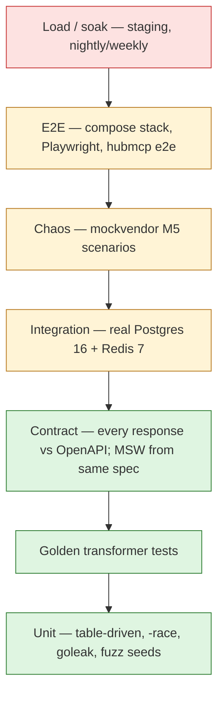

# Integration Hub — Testing Strategy

| | |
| --- | --- |
| Status | Phase 1 (plan) |
| Date | 2026-10-31 |
| Rules from | AGENTS §3 (table-driven, `-race`, real Postgres/Redis, never real vendors, goldens mandatory), DESIGN §19 acceptance criteria |

## 1. Pyramid



| Level | Where | Runs | Build tag | Target time |
| --- | --- | --- | --- | --- |
| Unit + goldens + contract (in-memory) | `backend/internal/**/_test.go`, `pkg/` | every push (`make test`) | none | < 2 min |
| Integration | `backend/internal/**` | every PR (`make itest`) | `integration` | < 8 min |
| Chaos | `backend/test/chaos/` | every PR touching `upstream`, `delivery`, `queue`; nightly otherwise | `chaos` | < 10 min |
| E2E | `backend/test/e2e/`, `frontend/tests/e2e/`, `backend/cmd/hubmcp/e2e/` | every PR (smoke), nightly (full) | `e2e` | < 15 min |
| Sync latency budget (HUB-413) | `backend/internal/edge/latency_budget_test.go` (`make latency-budget`, CI job `latency-budget`, no `-race`; [LATENCY.md](LATENCY.md)) | every PR | `integration latency` | ~2 min |
| Benchmarks | `*_test.go` `Benchmark*` | every PR (hot-path packages) | none | < 6 min |
| Fuzz | `Fuzz*` | nightly 10 min/target; seeds run in unit tests | none | — |
| Load / soak | `deploy/load/` + `backend/cmd/hubload` (`make load`) | weekly + before release (staging); laptop scale on demand | — | ~25 min laptop, 1–24 h staging |

## 2. Unit tests (Go)
- **Table-driven** (`tests := []struct{name string; ...}` + `t.Run`), `t.Parallel()` where safe.
- `go test -race -shuffle=on ./...` always. `goleak.VerifyTestMain(m)` in every package that starts goroutines.
- `testify/require` for preconditions, `assert` sparingly; no mocking frameworks — hand-written fakes implementing the DESIGN §18.3 interfaces (`Registry`, `Resolver`, `Upstream`, `Breakers`, `AuditSink`, `CredentialSource`, `Queue`).
- Time: inject a `clock` interface; no `time.Sleep` in tests (use fake clock for backoff, TTL, breaker windows, drain ramp).
- Randomness (weights, jitter): seedable; assert distributions with tolerance over N=10,000 draws.
- Required unit coverage areas (each maps to a DESIGN section):
  | Area | Examples |
  | --- | --- |
  | Config validation (M1) | each invalid field → exact path-qualified error |
  | Snapshot swap (M1) | concurrent readers + swaps under `-race` |
  | Resolver (§6, M6) | active vs pinned vs session version; weights hashed on idempotency key/request id stable; failover chain |
  | Error classification (§10.2) | every row of TECH_SPEC §10 |
  | Breaker (§10.4) | window ratio, half-weight 429, consecutive timeouts, override tightening, open-window doubling + cap, half-open probes |
  | State machine (§10.9) | every legal transition; illegal transitions rejected; CAS loser drops result |
  | Backoff (§10.3) | schedule, full jitter bounds, retry budget 20 % |
  | Drain ramp (§10.5) | 20 % → doubling every 30 s → 100 %; stop on re-open |
  | Redaction (§9) | secrets in attrs, error text, nested groups → `***` |
  | Signatures (§12.1) | HMAC `t=…,v1=…` generation, 5-min replay window |
  | SSRF guard (§12.1) | private, link-local, loopback, IPv6 ULA, DNS rebinding (resolve-then-dial pinned IP), redirects refused |
  | Publish validation (§6.4) | each rule rejects; interactive ⇒ sync only |

## 3. Golden transformer tests
- Layout (DESIGN §7.6): `config/transformers/<T>/fixtures/<case>.input.json`, `.expected_request.json`, `.vendor_response.json`, `.expected_response.json`.
- Runner: `hubctl transform test` (also `make goldens`) and a Go test `TestGoldens` that walks every transformer directory, so `make test` covers them. The **publish pipeline calls the same runner**; publish fails if any golden fails (AGENTS §3.4).
- Every transformer must have at least: a happy path, an optional field absent (`??` defaults), each `errors:` rule, and a max-size payload.
- Comparison is semantic JSON equality with a stable diff output; volatile values (`now()`, `uuid()`) are pinned by a fake clock and seeded uuid in the expr env.
- **Secret grep (M3)**: goldens use fixture credentials registered with the redactor; the test asserts the expected request contains them **only** in header/query/auth targets and that the `request.transformed` audit form contains `***`.
- **Role-log secret grep (HUB-234)**: every role started by the `cmd/hub/internal/roles` tests logs through the production logger into one capture; `TestMain` fails the package if any secret a test declared with `forbid` appears in it, and `TestRoleLogsCarryNoSecrets` drives gateway + worker + scheduler + admin through every secret-handling path on the encrypted credential source (SECURITY.md §9).
- `-update` flag regenerates expected files; CI rejects runs with `-update`.

## 4. Contract tests

### 4.1 Backend
- Every handler test (unit with `httptest`, and every e2e response) passes through a validator that checks **request and response** against `contracts/openapi/hub-public.v1.yaml` or `hub-admin.v1.yaml` (status code declared, content type, body schema, required headers like `X-Hub-Request-Id`).
- Library: `getkin/kin-openapi` `openapi3filter` (backend/AGENTS.md). **Risk**: OpenAPI 3.1 / JSON Schema 2020-12 support in kin-openapi is incomplete; spike in M0 (first ticket that adds a handler). If it cannot load the 3.1 documents, switch to `pb33f/libopenapi-validator` behind the same test helper `contracttest.Validate(t, req, resp)` and record an ADR.
- Coverage test: every `operationId` in the contracts has at least one passing contract test for each declared status code (except 5xx that need chaos). A generated report fails CI if any operation is uncovered.
- Leak test for the caller contract: the public spec and every `/v1` response in tests are scanned for vendor ids, account ids and the words `vendor`, `account`, `version` in property names (allowlist: `X-Hub-Integration-Version` debug header only) — enforces D12 and ADR-0007.
- `pkg/hubclient` and `hubmcp`'s client are tested against a recorded set of contract example responses.

### 4.2 Frontend
- Types come only from `openapi-typescript` output; `npm run check` (svelte-check, TS strict) fails on any usage mismatch.
- MSW handlers in `frontend/src/mocks/` are built from the **contract examples** (one example per response); a test asserts every MSW handler's operation exists in the spec and every example validates against its schema (Ajv 2020).
- CI regenerates the client and fails on diff (stale client = drift).

### 4.3 Drift detection end to end
Contract change → `contracts/` commit → backend contract tests fail until implemented; frontend `gen:api` diff fails until regenerated and `check` passes. See `docs/process/CONTRACT_CHANGES.md` §6.

## 5. Integration tests
- Build tag `integration`; real **Postgres 16** and **Redis 7** via `testcontainers-go` (default) or the compose stack when `HUB_ITEST_USE_COMPOSE=1` (faster locally).
- Each test package gets a fresh database (template DB cloned from a migrated template, ~50 ms) and a Redis DB index / key prefix.
- Scenarios (DESIGN §19 M3/M4/M6 acceptance):
  - Outbox: enqueue durability, `SKIP LOCKED` claim with 8 concurrent claimers (no double claim), visibility timeout reclaim, nack schedule, park/release order, DLQ, TTL expiry.
  - **Kill a worker mid-flight** → envelope reclaimed, delivered once from the caller's view (mockvendor records ≤ 2 sends; caller sees one result and one callback).
  - Idempotency: duplicate submissions with the same key → one vendor call; concurrent duplicates (in-progress marker).
  - Wait mode: 200 within window; 202 + worker completion; gateway crash during wait → reclaimed.
  - Audit: full §13.1 timeline for sync and async; sha256/bytes present; masked policy via `x-pii`; **grep test: no registered secret anywhere in `request_events`**.
  - Tracing (HUB-231): one async request through gateway, outbox, worker, mockvendor and callback dispatcher with an in-memory span recorder; asserts the caller → edge → enqueue ⇢ worker attempt → upstream (vendor got its `traceparent`) ⇢ callback chain and runs the span attribute allowlist (`telemetry.SpanAttributeViolations`: no key outside `AllowedSpanAttributes`, no credential, API key or body fragment in any value).
  - Subject erasure (HUB-233): **schema-wide grep**. Every bytea/json/jsonb/text column of every `hub` table (catalog-driven, so new tables are covered automatically), plus the opened sealed payloads, holds no stored form of the subject after erasure. The same grep before erasure must hit, so the test cannot pass vacuously. Hashes, sizes, timelines and metadata compare equal before and after; deferral of in-flight requests; `change_log` row (`TestEraseSubjectPurgesEveryStoredBody`, `TestEraseSubjectScope`).
  - Partitions: point lookup by ULID hits one partition (`EXPLAIN`); partition maintenance job idempotent.
  - Migrations: `goose up` from empty, `goose down` one step, and up again.
  - Cutover (§6.3): the six request situations × (account, vendor, transformer) change; retire refused while pinned requests or sessions exist; rollback = new version, history linear.
  - Snapshot: publish → Redis ping → node swap; admin down → node boots from object-storage fallback (local filesystem blob store in tests).
  - Admin: every mutation writes `change_log`; `hubctl apply` idempotent; `plan` shows exact diffs (M7).

## 6. Chaos tests (mockvendor, DESIGN §19 M5)
`mockvendor` control API sets per-route behaviour: latency (fixed/random), status codes, error ratio, 429 + `Retry-After`, hard down (connection refused), slow drip, malformed body; records received requests. Tests run the hub roles in-process (gateway, worker, scheduler) with real Postgres/Redis and a fake clock where possible (breaker windows, drain ramp) or shortened config windows where real time is needed.

| # | Scenario (DESIGN §19 M5) | Asserts |
| --- | --- | --- |
| C1 | Vendor down | breaker opens within the configured window; sync → 503 `UPSTREAM_UNAVAILABLE`, `circuit: open`, `retry_after_ms`; wait → 202 `queued`, `reason: circuit_open`; async → `parked` |
| C2 | Vendor recovers | probes close the breaker; drain starts ≤ 60 s; observed send rate at mockvendor ramps 20 % → 100 % (per 30 s step, ±10 %) |
| C3 | Re-open mid-drain | remaining envelopes stay parked; no envelope lost |
| C4 | Two integrations, one account | trip and recover together; pausing one → `INTEGRATION_PAUSED` for it only; the other is unaffected |
| C5 | Failover policy | served by the failover target, `X-Hub-Served-By: failover:1`; only for idempotent endpoint or with `Idempotency-Key` |
| C6 | 429 storm | `UPSTREAM_RATE_LIMITED` with `retry_after_ms`; async retries at max(backoff, Retry-After); breaker counts 429 at half weight |
| C7 | Slow drip / timeout | `UPSTREAM_TIMEOUT`; one immediate retry only if idempotent/keyed |
| C8 | Malformed body | classification per TECH_SPEC §10 (open question) |
| C9 | Auth failure | `UPSTREAM_AUTH_FAILED`, async dead-lettered immediately, alert metric incremented |
| C10 | Redis outage | breaker local cache continues; idempotency behaviour per TECH_SPEC §22.5; recovery resyncs state |
| C11 | Postgres failover/restart | gateway accept returns 503 (not 202) when the TX fails; no 202 without commit |

## 7. End-to-end tests
- **Backend e2e** (`e2e` tag): compose stack (all roles + mockvendor) driven through `pkg/hubclient`. One test per canonical error class (M3 acceptance), per delivery mode, callback signature verified by a test receiver (M4), TTL expiry → `expired` + callback.
- **Frontend e2e**: Playwright (`frontend/tests/e2e/`) against (a) MSW-mocked backend on every PR, (b) the real compose stack + OIDC stub nightly. Flows: login per role, integration publish with validation errors, rollback, pause with reason, DLQ replay, breaker force, request timeline, API key create (shown once), unseal denied for non-admin. Uses the `webapp-testing` skill helpers.
- **MCP e2e**: see §13.

## 8. Fuzzing (Go native fuzzing)
| Target | Package | Seeds | Property |
| --- | --- | --- | --- |
| `FuzzTransformerDSL` | `transform` | all transformer YAMLs in `config/` | parse/compile never panics; compile either errors or yields a program that respects `MaxNodes` |
| `FuzzTransformEval` | `transform` | golden inputs | evaluation of compiled T1/T2/R1/R2 on mutated inputs never panics, never exceeds output size/time budget, never places `creds` values outside allowed targets |
| `FuzzSchemaValidate` | `edge` | capability examples | validator never panics; accept ⇒ body re-marshals and re-validates |
| `FuzzEnvelopeDecode` | `queue` | sample envelopes | decode/encode round trip stable |
| `FuzzSignatureHeader` | `callbacks`, `webhooks` | valid headers | parser rejects malformed without panic; timing-safe compare |
| `FuzzRedactor` | `telemetry` | secrets + text | no registered secret survives redaction |
| `FuzzSSRFGuard` | `callbacks` | URLs incl. IPv6, decimal IPs, `@` tricks | never allows private/link-local/loopback |

Seed corpora live in `testdata/fuzz/`; crashers are committed as regression seeds.

## 9. Benchmarks with budgets
Benchmarks are in the package they measure; budgets from DESIGN §18.6 / §7.6. CI runs hot-path benchmarks with `-count=10`, compares to `main` with `benchstat`; > 10 % regression (p < 0.05) fails. Absolute budgets are asserted by a separate test using `testing.Benchmark` results on the CI runner class (with 1.5× tolerance for noisy runners):

| Benchmark | Budget |
| --- | --- |
| `BenchmarkTransform4KB` | ≤ 0.5 ms p99 (DESIGN §7.6, M2) |
| `BenchmarkValidate4KB` | ≤ 0.8 ms |
| `BenchmarkResolve` | ≤ 0.05 ms, 0 allocs |
| `BenchmarkEdgeAuth` | ≤ 0.1 ms |
| `BenchmarkInject` | ≤ 0.02 ms |
| `BenchmarkMapResponse4KB` | ≤ 0.4 ms |
| `BenchmarkAuditEmit` | ≤ 0.1 ms, non-blocking under full buffer |
| `BenchmarkSyncE2E` (in-process, mockvendor 0 ms) | `hub_overhead_ms` p99 ≤ 5 ms (M3) |

p99 is computed by a helper that records per-iteration durations into an HDR histogram (Go benchmarks report means only).

## 10. Load and soak
Defined in `OBSERVABILITY.md` §12 (L1–L6): 500 sync RPS + 2,000 async msg/s (M8), zero lost async requests in a soak with random outages. Run with `make load` / `make soak` (`deploy/load/run.sh`, generator `backend/cmd/hubload`, ADR-0016) against a dedicated load database. Laptop-scale defaults; full-length settings in `deploy/load/README.md`; latest report `docs/tech/LOAD_TEST_REPORT.md`. `hubload` itself has unit tests (open-loop behaviour under a stalled server, drop accounting, native and classic histogram deltas, callback duplicate/redelivery counting, chaos restore), and `TestLoadOverlayConfigBuilds` (registry) keeps the load registry overlay valid. Also a **metrics cardinality check**: run the dev config expanded to 500 integrations synthetic, scrape `/metrics`, fail if series exceed the budget in OBSERVABILITY §3.1.

## 11. Other checks
- `promtool check rules` + `promtool test rules` for `deploy/alerts/` (one test per alert with a firing and a non-firing case; `TestAlertRulesCoverDesign` enforces it and that every DESIGN §16.3 alert has a rule).
- Dashboard JSON lint and query check (`TestDashboardsAreValidAndUseExportedMetrics`, ADR-0015): valid JSON, stable uid, unique panel ids, datasource through `${datasource}`, every variable defined; every rule and panel query parses and uses only metric and label names the registry exports (`TestAlertRulesUseExportedMetrics`). Run all of it with `make monitoring` (CI job `monitoring`).
- Migration lint (no destructive change without a two-step expand/contract).
- Arch test: package dependency rules (TECH_SPEC §4.4).

## 12. Frontend unit tests
- **Vitest + @testing-library/svelte** (Svelte 5). Component tests for: forms with mandatory reason, confirm dialogs for irreversible actions, error-envelope rendering with `request_id`, role-based action visibility, diff view, timeline.
- `.svelte.ts` rune modules tested directly.
- Load functions and form actions tested with a mocked `fetch` (MSW node) using the generated types.
- Accessibility: `axe-core` assertions in component tests and Playwright (`@axe-core/playwright`) on every route.

## 13. MCP server tests (`hubmcp`)
All in `backend/cmd/hubmcp` (package `main`), `go test -race`, goleak in `TestMain`.
- **Contract**: `TestEmbeddedContractIsTheFrozenOne` (embedded copy == `contracts/mcp/hubmcp-tools.json`); `TestToolListEqualsFrozenContract` (advertised name, title, description, annotations, input and output schemas equal the frozen file, with and without `HUB_ADMIN_TOKEN`).
- **Fake Hub** (`fakehub_test.go`): one httptest server for `/v1` and `/admin/v1`; each request is matched to its operationId, answered with contract examples (optionally mutated) and the whole exchange is validated against `hub-public.v1.yaml` / `hub-admin.v1.yaml` (`internal/testkit/contract`). Every tool output is validated against the tool's `outputSchema` (`callTool`).
- **Unit**: per-tool tables for success and error paths (`TestListIntegrations`, `TestDescribeIntegration`, `TestInvoke`, `TestGetRequest`, `TestDryRun`, `TestAdmin*`); `TestEveryToolSuccessAndError` runs one success and one error scenario for every contract tool and asserts each tool only calls the operations in its `maps_to`. Input-schema validation, 202 → `queued`, error envelope passthrough, auto-retry rules, the 60 s pre-check cache, the money/quota guard (`TestConfirmGuard`), admin tools absent without a token. No idempotency key is generated (ADR-0018).
- **Leak test**: `callTool` scans every tenant tool result (structured and text) for planted vendor/account/version values, field names and debug headers; `TestDiscoveryNeverLeaksVendorIdentity` plants them in every Hub response. Credentials are asserted absent from every output and log.
- **Protocol**: in-memory go-sdk transport for most tests; `TestStdioServesContractTools` (the entry point over stdio pipes); `TestSpawnedBinaryOverStdio` (the binary spawned with `mcp.CommandTransport`: initialize, tools/list, tools/call); streamable HTTP tests for the tool list, missing/invalid bearer → 401, cross-origin → 403, key verification cache and fail-closed (`httpserve_test.go`).
- **E2E** (`//go:build integration`, `e2e_integration_test.go`): builds `hub` and `mockvendor`, runs gateway + worker + admin on the test database with a copy of `backend/config` pointed at mockvendor, and drives hubmcp over the in-memory transport: list → describe → dry-run → sync invoke → async invoke + get_request → money/quota refusal → admin tools; tenant outputs are grepped for vendor identity.
- **MCP Inspector**: manual (`npx @modelcontextprotocol/inspector bin/hubmcp`, env `HUB_BASE_URL`, `HUB_API_KEY`); not run in CI (HUB-313).
- **Evaluation**: the `mcp-builder` skill's evaluation harness (`backend/.claude/skills/mcp-builder/scripts/evaluation.py`) with ~10 realistic questions; run manually before a release, not in CI.

## 14. CI stages and gates

```mermaid
flowchart LR
  A[hygiene<br/>YAML/JSON, CHANGELOG per commit,<br/>commit message lint] --> B[contracts<br/>OpenAPI lint, $ref resolve,<br/>examples validate, version bump check]
  B --> C1[backend: lint + arch + govulncheck]
  B --> C2[frontend: gen:api diff, check, lint, npm audit]
  C1 --> D1[backend: test -race + goldens + contract]
  C2 --> D2[frontend: vitest]
  D1 --> E1[backend: itest + chaos (path-filtered)]
  D1 --> E2[bench + benchstat]
  D2 --> E3[playwright vs MSW]
  E1 --> F[e2e smoke: compose stack + hubmcp + playwright smoke]
  E3 --> F
  F --> G[merge allowed]
```

| Gate | Blocking? |
| --- | --- |
| Hygiene, commit message format, CHANGELOG entry per commit | yes |
| Contract lint + `info.version` bumped when `contracts/` changed | yes |
| golangci-lint, arch test, `govulncheck` (no known vulns in called code) | yes |
| `gosec` (no untriaged medium/high finding in non-test code, SECURITY.md §8.1) | yes |
| `make test` (-race, goldens, contract coverage) | yes |
| `make itest`, chaos (path-filtered) | yes |
| Benchmark regression | yes for hot-path packages; advisory elsewhere |
| Frontend `gen:api` diff, `check`, `lint`, `test`, Playwright (MSW) | yes |
| `npm audit --audit-level=high` | yes |
| e2e smoke | yes |
| Nightly: full e2e, fuzz, chaos all, Playwright vs real stack | no (opens a ticket on failure) |
| Weekly / pre-release: load L1–L5, soak L6 | release gate (`docs/process/RELEASE.md`) |

Coverage is reported (not gated) except: `transform`, `resolve`, `delivery` state machine, `upstream` breaker and `creds` redaction must stay ≥ 85 % line coverage.
